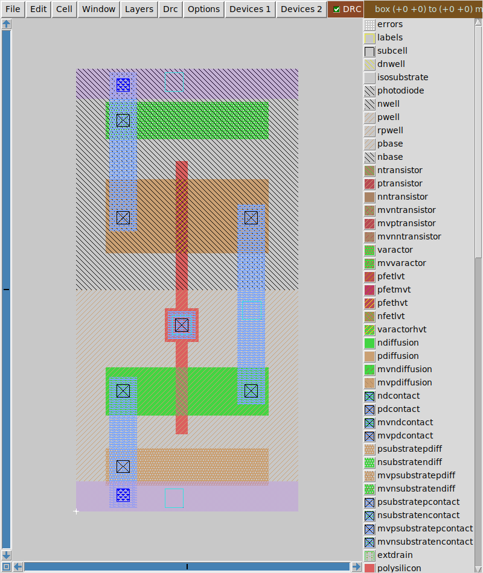

# AD104 — Layout

AD103 ended with a CMOS inverter you could simulate: two symbols and a wire. In AD104 you draw
that inverter as a layout, the coloured rectangles a foundry turns into masks. You check it with
the same tools a real tapeout uses, measure what your drawing costs against the foundry's own
cell, and finish by placing and routing a small block of standard cells by hand.

Part of the **UofT ASIC Team** education materials. Published at **https://uoftasic.com/ad104/**.
Labs run inside the shared **workspace** you set up in [IC101](https://uoftasic.com/ic101/).

## At a glance

| | |
|---|---|
| **Who it's for** | Analog-track students who have finished AD103 |
| **Track** | Analog |
| **Prerequisites** | [IC101](https://uoftasic.com/ic101/) → [AD101](https://uoftasic.com/ad101/) → [AD102](https://uoftasic.com/ad102/) → [AD103](https://uoftasic.com/ad103/), in that order |
| **Main tool** | **Magic** 8.3.681, the layout editor. You have not used it before, and [Getting started](guide/getting-started.md) assumes that. |
| **Also** | netgen for LVS, KLayout 0.30.11 for looking at GDS, ngspice 47 for timing what the geometry costs you |
| **Math level** | Arithmetic and a ruler. Every dimension in this course is a number of microns. |
| **Time** | 16–20 hours, self-paced |

## Course path

Work down this table in order. A **Read** row is one or more guide pages: concepts, figures and
worked examples, with nothing to run. A **Do** row is one lab, where you run every command
yourself. Each lab lists the pages to read before you start it.

| # | Type | What | Time |
|---|---|---|---|
| 1 | Read | [Getting started](guide/getting-started.md) · [What a layout is](guide/what-a-layout-actually-is.md) · [SiliWiz](guide/siliwiz.md) · [Anatomy of a standard cell](guide/anatomy-of-a-standard-cell.md) | 1 h |
| 2 | Do | [Lab 01 — Open a cell you did not draw](labs/lab-01-open-the-cell-overview.md) | 1.5 h |
| 3 | Read | [Drawing in Magic](guide/drawing-in-magic.md) · [Reading DRC errors](guide/drc-is-a-conversation.md) · [The full DRC rule set](guide/the-rule-set-you-are-not-running.md) | 1 h |
| 4 | Do | [Lab 02 — Break it on purpose](labs/lab-02-break-it-on-purpose-overview.md) | 2 h |
| 5 | Read | [Stick diagrams](guide/stick-diagrams.md) · [Extraction](guide/extraction-is-reverse-engineering.md) · [Layout versus schematic (LVS)](guide/lvs-asks-a-different-question.md) | 1 h |
| 6 | Do | [Lab 03 — Draw an inverter](labs/lab-03-draw-an-inverter-overview.md) | 3 h |
| 7 | Read | [Instances and hierarchy](guide/cells-are-lego.md) | 30 min |
| 8 | Do | [Lab 04 — A buffer and an AND gate](labs/lab-04-buffer-and-and-overview.md) | 2 h |
| 9 | Read | [Area, parasitics and delay](guide/what-your-drawing-costs.md) | 30 min |
| 10 | Do | [Lab 05 — What it costs](labs/lab-05-what-it-costs-overview.md) | 1 h |
| 11 | Read | [Routing by hand](guide/routing-by-hand.md) · [What sets the clock frequency](guide/why-the-clock-cannot-go-faster.md) | 45 min |
| 12 | Do | [Capstone — Place and route](labs/capstone-place-and-route-overview.md) | 3 h |

The times are estimates. Lab 03 and the capstone take longest: Lab 03 is the first cell you draw
yourself, and the capstone is the first block you route.

Keep these open while you work: [Magic cheat sheet](reference/magic-cheatsheet.md) ·
[DRC error decoder](reference/drc-error-decoder.md) ·
[SKY130 layer map](reference/sky130-layer-map.md)

**Stuck?** Ask in the [team Discord](https://discord.gg/hrJnP5UsGz). Nobody expects you to work
this out alone at 2 a.m. See [Getting help](guide/getting-started.md#getting-help) for what to
include in your question.

## The workbench

This course is pinned to the workbench image **`hpretl/iic-osic-tools:2026.08`**, which ships
**Magic 8.3.681**, **netgen 1.5.323** and **KLayout 0.30.11**. Lab 01 has you set it up and
check the Magic version.

If the environment setup in Lab 01 fails, run `make` in a lab folder anyway. Every lab pins
`PDK=sky130A` itself and ships its own `.magicrc`, so the labs run to completion in a bare
container with no setup at all, and each one ends in `PASS` or `FAIL` with a reason.

## What this course is about

A schematic says *what is connected to what*. A layout says *what is where*. What a chip costs
in area, speed, power and yield is decided by the layout, not the schematic.

You will draw a transistor as coloured rectangles, find out from the tools that it cannot be
manufactured, fix it, prove it is still the circuit you meant, and then measure what your
arrangement of rectangles costs compared with the foundry's.

The team lead's summary of layout is that ninety per cent of it is messing things up, and the
course is built around that. Lab 02 gives you real broken layouts to fix before you have drawn
anything of your own.

*Your inverter at the end of Lab 03: nwell hatched at the top, PMOS in orange p-diffusion, NMOS
in green n-diffusion, and one red poly stripe crossing both. That stripe is the gate, and its
width is L. Contacts are the boxed X's, local interconnect is pale blue, and the two supply
rails are purple metal1.*

## What you'll do

1. Open a cell **you did not draw**, the foundry's own inverter, and get four tools to agree
   about it before you draw anything.
2. Fix **five broken layouts**, each breaking exactly one real SKY130 rule, including one that
   the default rule set calls clean.
3. Draw a **DRC-clean, LVS-clean CMOS inverter** from an empty frame.
4. Turn it into a **buffer** and an **AND gate** without drawing a single new transistor.
5. Compare your cell against the foundry's **with parasitics extracted**, and find that
   identical transistors drawn differently take 4.8× the area and run 27 % slower.
6. **Place and route four standard cells by hand**, get the row clean, and measure the highest
   clock frequency your layout can run at.

## What you'll have at the end

A standard cell you drew, a GDSII file of a small block you placed and routed by hand, a number
for how fast it can be clocked, and the habit that makes layout manageable: **run the checker,
read the rule name, change one thing, run it again.**

## Next courses

- **AD201** — Analog Signal Processing · **AD202** — Mixed Signal
- **DD103** — [RTL on FPGAs & ASICs](https://uoftasic.com/dd103/), where a tool does the place
  and route you did by hand, in 54 seconds, for a whole chip
