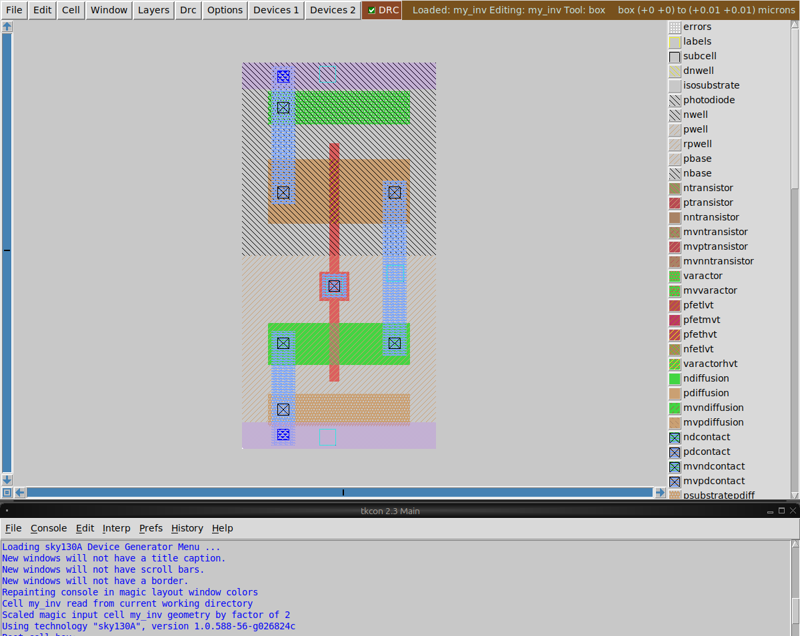

# Getting started

Before you start Lab 01 you need three things: the workbench, this course's files inside it, and
Magic opening with the SKY130 technology loaded. The third is the one that usually goes wrong, and
when it does, the message you get doesn't tell you why. This page explains how the pieces fit
together. You won't set anything up here: IC101 sets up the workbench, and
[Lab 01, Part 1](../labs/lab-01-open-the-cell-overview.md#part-1-load-the-course) loads this course
into it.

## Prerequisites

[IC101](https://uoftasic.com/ic101/) → [AD101](https://uoftasic.com/ad101/) →
[AD102](https://uoftasic.com/ad102/) → [AD103](https://uoftasic.com/ad103/).

Of the four, AD103 matters most. You should have drawn a CMOS inverter in XSchem and
swept its transfer curve, and you should be comfortable with the idea that $W$ and $L$ are numbers
you choose. AD104 takes that same inverter and asks where the silicon goes.

## The workbench

Everything in this course runs in the noVNC desktop from IC101, which is the image
`hpretl/iic-osic-tools:2026.08`. You start it the way IC101 showed you, open `http://localhost`
in a browser, and type commands in the terminal on that desktop.

The image can work with more than one manufacturing process, and the environment variable `$PDK`
chooses which one. This course needs **`sky130A`**, but the image ships with `PDK=ihp-sg13g2`, a
real 130 nm process from a different foundry, with its own layer names and its own rules. Magic
starts in IHP's process without stopping to ask, and the signs that it has are easy to miss;
[Where Magic gets the technology](#where-magic-gets-the-technology) lists them.

The course environment script, `/foss/designs/common/.designinit`, switches the whole shell to
SKY130, and it also defines `mod`, the command that copies a course's files into your workspace.
The change lasts only as long as that shell, but each new terminal on the workbench desktop loads
the script by itself, and running it again does no harm. If your workspace from IC101 isn't set
up, there is no `.designinit` to load, and `$PDK` keeps the image's default.

The desktop is 1280 × 800 by default, which fits a laptop's browser. Everything in this course
works at that size; the one window that doesn't fit, Magic's device generator in Lab 04, comes
with an instruction. If your browser window has room for more, start the workbench with a larger
desktop. On your laptop, in your `workspace` folder from IC101, run
`VNC_RESOLUTION=1680x1050 ./scripts/start_vnc.sh` on macOS or Linux, or
`set VNC_RESOLUTION=1680x1050` and then `scripts\start_vnc.bat` in the same Command Prompt on
Windows. That starts a new desktop, so save your work first; your files in `/foss/designs` stay,
and only the desktop's size changes.

## Magic

Magic is older than most of the people taking this course: it started at Berkeley in 1983, and it
looks it. It is also the only open-source layout editor with a live design-rule checker, a
built-in extractor and a scripting console, which is why the open SKY130 ecosystem is built
around it.

You start Magic yourself, from a terminal on the desktop, in the folder that holds the cell, and
give it the cell's name without the `.mag` extension. From the course folder,
`/foss/designs/modules/ad104-m`, where `mod ad104-m` puts you:

```bash
cd labs/lab-03-draw-an-inverter/mag
magic -d X11 my_inv &
```

The `&` gives you the terminal back while Magic stays open. Lab 01's cell is the foundry's, so
there you start Magic in the lab folder and give it the full path of the file in the PDK instead.

Two windows appear: **`layout1`**, which shows the drawing, and **`tkcon`**, a Tcl console where
you type Magic commands. Most of your work happens in `layout1`, with the mouse, the keys and the
menus, the way layout engineers use Magic. You type in the console only for the few things Magic
has no menu for, such as extraction.

### The Magic window

{fig-alt="Magic's layout window above its console. Along the top of the layout window are the menu buttons File, Edit, Cell, Window, Layers, Drc, Options, Devices 1 and Devices 2, a DRC button with a tick, and a brown title bar reading Loaded: my_inv Editing: my_inv Tool: box, then box (+0 +0) to (+0.01 +0.01) microns. The middle shows an inverter: two metal1 rails, two diffusions, a red poly stripe and blue local interconnect. Down the right side is the layer palette. Below, the console window, tkcon 2.3 Main, shows Magic's start-up messages."}

*Magic with `my_inv` from Lab 04's folder, a copy of the reference version of the Lab 03
inverter. Along the top are the menu buttons, the `DRC` button, and the brown strip that the labs
call Magic's title bar: the caption naming the cell, then the readout of where the box is. The
palette runs down the right side, and the console is the second window. On the workbench desktop
the two windows open in other places and overlap; drag either one by the bar the desktop draws
across its top, which shows the window's name.*

| Part | What it's for |
|---|---|
| the menu buttons, `File` to `Devices 2` | opening and saving, editing, cells, the view, DRC, the Library and DRC Managers (windows that list library cells and DRC errors), and the device generator |
| the `DRC` button | the DRC count, such as `DRC=3`, once the cell has been checked |
| the caption, in the title bar | `Loaded:` and `Editing:` name the cell; it is cut off when the window is narrow |
| the readout, at the right end of the title bar | where the box is, or where the pointer is and how far it is from the box's corner. When a step says to click the layout window's title bar, click this brown strip |
| the drawing, in the middle | the layout; keys act only while the pointer is over it |
| the palette, down the right side | one row per layer; middle-click a swatch to paint |
| the console, `tkcon` | Magic's messages, and the commands you type |

[Drawing in Magic](drawing-in-magic.md) explains how to use each of them.

### The `-d X11` option

`-d X11` picks Magic's X11 graphics driver, which is the one that works in this image. The
Cairo/OpenGL driver (`-d XR`) can fail with a `BadAlloc` inside the container, and when it does
you get a black window rather than no window at all, so it takes a while to work out what went
wrong. The team's `.designinit` also defines a `magic130` alias that adds `-d X11`; the labs
type the full `magic -d X11` command instead.

### Where Magic gets the technology

When Magic starts, it decides which technology to load from two startup files:

- The image's own `~/.magicrc` loads whichever PDK `$PDK` names. `.designinit` sets
  `PDK=sky130A`; with the image's default, `PDK=ihp-sg13g2`, you get IHP's layers and none of
  SKY130's.
- A file called `.magicrc` in **the directory you start Magic in**, if there is one. Every lab
  package has one at its top level, which is where Lab 01 starts Magic, and it loads SKY130 only
  if nothing has loaded it yet; if `~/.magicrc` already did, it does nothing. The check is there
  because loading SKY130 a second time makes Magic print these two lines in the console, which
  make a toolchain that is working fine look broken (loading it on top of IHP's technology prints
  the same two, and there something really is wrong; see the cases below):

  ```
  Error parsing ".magicrc": can't rename to "closewrapperonly": command already exists
  Bad local startup file ".magicrc", continuing without.
  ```

  The `mag/` folders, where you start Magic from Lab 02 on, have no `.magicrc`, so there `$PDK`
  alone decides.

So `$PDK` has to say `sky130A` in the terminal you start Magic from, and Lab 01, Part 1 has you
check it. If it still says `ihp-sg13g2`, Magic doesn't stop you, and what goes wrong depends on
where you started it:

- **On one of the course's cells, in a `mag/` folder**, Magic notices that the cell was drawn in
  SKY130 and switches to it. The console says
  `Cell my_inv has technology "sky130A", but current technology is "ihp-sg13g2"`, and the layers
  are right, but the menu bar has IHP's single `Devices` menu where `Devices 1` and `Devices 2`
  should be.
- **On a new cell**, such as the empty `my_inv_gen` you start in Lab 04, Magic stays in IHP's
  process. The console says `Creating new cell` and `Using technology "ihp-sg13g2"`, the palette
  lists IHP's layers, and there is one `Devices` menu.
- **In Lab 01's folder**, the lab's `.magicrc` loads SKY130 on top of IHP, which prints the two
  error lines above. In our run of this case the menu bar then had no `Devices` menu at all.

Close Magic, load the environment with `. /foss/designs/common/.designinit` (or open a new
terminal, which loads it by itself), and start Magic again. If `.designinit` itself fails, start
Magic with the PDK set on the same line: `PDK=sky130A magic -d X11 <cell> &`.

If Magic can't find SKY130's files at all, which happens when `$PDK_ROOT` doesn't point at the PDK
(`/foss/pdks` in this image), it starts in a bare built-in technology called `minimum`, with none
of SKY130's layers. Opening one of the course's cells then prints
`Could not find file 'sky130A.tech'` and `Error in loading technology file` in the console.

## What the labs give you

Every lab is a folder with a `Makefile`. You do the work in Magic, and `make` checks it: typing
`make` on its own runs every check in batch, on the files you saved, and prints the result.

| | |
|---|---|
| `make` | run every check and print `PASS` or `FAIL` with a reason |
| `make scaffold` (Lab 03, Lab 04, the capstone), `make reset` (Lab 02) | put the starting files back, so you can start over |
| `make clean` | delete `results/`, the folder where `make` writes its reports |

A lab that needs another target, such as Lab 04's `make layout`, says so in its writeup.

Because the Makefiles set `PDK=sky130A` themselves, **`make` works even if `.designinit` did
not**. If a setup step in Lab 01 doesn't work for you, run `make` in the lab anyway: it checks
everything itself and tells you in plain words what it found.

## Getting help

Ask in the [team Discord](https://discord.gg/hrJnP5UsGz). Layout is a craft, and it's quicker to
have someone show you than to read about it. A screenshot of your Magic window, with the count on
the `DRC` button visible, is usually enough for someone to spot the problem.

When a tool reports a problem, paste its exact words. `Drc → DRC report` names a rule and netgen
names a net, and those names are specific enough that someone helping you can search for them,
which they can't do with "it doesn't work".

## Problems opening Magic

Setup problems with `.designinit` and `mod` are covered at the step where they happen, in
[Lab 01, Part 1](../labs/lab-01-open-the-cell-overview.md#part-1-load-the-course).

| What you see | What it means |
|---|---|
| `Could not find file 'sky130A.tech'` and `Error in loading technology file` | Magic couldn't find SKY130's files and is running its bare `minimum` technology. Check that `echo $PDK_ROOT` prints `/foss/pdks` in the terminal you start Magic from; if it doesn't, run `export PDK_ROOT=/foss/pdks` there and start Magic again (see [Where Magic gets the technology](#where-magic-gets-the-technology)). |
| Magic opens, and there is no `nwell` in the layer list | Same cause: SKY130's technology did not load. |
| One `Devices` menu where `Devices 1` and `Devices 2` should be, or `... but current technology is "ihp-sg13g2"` in the console | `$PDK` was `ihp-sg13g2` when you started Magic. Close Magic, load `.designinit`, and start it again. |
| `Bad local startup file ".magicrc", continuing without.` | A `.magicrc` loaded SKY130 on top of a technology that was already loaded. In a lab folder, that means `$PDK` wasn't `sky130A`: close Magic, load `.designinit`, and start it again. Anywhere else, use a copy of a lab's `.magicrc`, which checks whether SKY130 is already loaded first. |
| `Cell ... couldn't be read` | You named a cell that does not exist in this folder, or you are in the wrong folder. Magic then creates an empty cell with that name, which is why an empty window is a common symptom. Close Magic, `cd` to the folder that holds the cell, and start it again; if you drew in the empty cell and saved it, the file went into the wrong folder, where `make` doesn't look. |
| The layout is one empty rectangle with a name in it | That's an unexpanded subcell. Put the box over it and press `x` with the pointer over the drawing, or select it with `i` and choose `Cell → Expand`. |
| The caption says `[NOT BEING EDITED]` | Magic is showing the cell but not letting you edit it. A cell read from the PDK's folder, such as `sky130_fd_sc_hd__inv_1` in Labs 01 and 05, shows this because you can't write to its file, so there it's expected. With a name that long, the window cuts the caption off before these words, even when it is as wide as the 1280-pixel desktop. To go back to one of your own cells, use `File → Open...` with the cell's full path: the `Open` window starts in the last folder it showed, so after a cell from the PDK a bare name such as `my_inv.mag` fails with `... does not exist.` |
| A Magic window's buttons are below the bottom of the screen | Double-click the bar the desktop draws across the window's top to make it fill the screen; the buttons then appear along its bottom edge. At the default 1280 × 800 desktop this happens with the device generator in Lab 04. |
