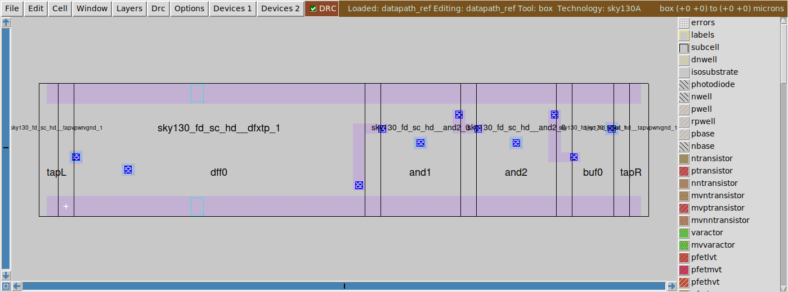
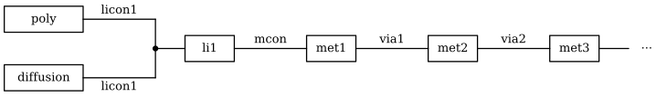

# Routing by hand

The capstone asks you to route only three nets, but three are enough to run into every basic
idea in interconnect. This page explains those ideas, and you route the nets yourself in the
[capstone](../labs/capstone-place-and-route-overview.md).



*The capstone block with its subcells collapsed, so the cells are outlines and your routing is the
only real geometry on screen. Left to right: a tap cell, the flip-flop, two AND gates, the
buffer, and another tap. The pink metal1 shapes and the boxed contacts are all of the routing
you do by hand.*

## The layer stack as a routing problem

You can't connect just any layer to any other. The layers form a single ladder, and a
connection can only step from one rung to the next through the contact or via between them:

{width=296 fig-alt="A block diagram of the layer ladder, drawn upright with the silicon at the bottom. At the bottom, a box labelled poly and a box labelled diffusion each connect upwards through a line labelled licon1, and the two lines join and run up to a box labelled li1. From li1 a chain runs upwards: a line labelled mcon to a box labelled met1, a line labelled via1 to met2, a line labelled via2 to met3, and then a line that ends in three dots."}

Each of those contacts and vias is a plug of a fixed size, and each plug has enclosure rules for
the layers on both sides of it. So a connection from a cell pin to a wire two microns away is
built in four steps:

1. an `mcon` on the pin (li1 → metal1), exactly 0.17 µm square
2. a metal1 pad around it, surrounding the cut by 0.03 µm everywhere and by 0.06 µm on both
   sides of one axis (`met1.4`, `met1.5`)
3. metal1 from that pad to the next one
4. another pad and another `mcon` at the far end

The capstone's pads are 0.29 µm wide around a 0.17 µm cut, which leaves 0.06 µm on each side.
That satisfies `met1.5` along the x axis, and it's the smallest width that does.

## Which layer to route on

**li1** is the layer the cells' own pins are drawn on, so a wire on li needs no via at either
end. The price is resistance: li1 is about **12.8 Ω per square**, against **0.125** for metal1,
which makes it about a hundred times worse. Use it only for a wire short enough that you can see
both ends. Lab 04's blocks route on li for that reason: the wire there is 2.4 µm long, so saving
the vias is worth more than the extra resistance costs.

**metal1** is where ordinary local routing goes. Of the cells in the capstone, all but one use
metal1 only for their rails, so the band between the rails is free space above every cell
**except the flip-flop**, which has internal metal1 straps of its own.

**metal2 and up** aren't used by `sky130_fd_sc_hd` at all, so if you need to cross the row, go up
to them.

## The routing band

The rails occupy y = −0.24 to 0.24 and y = 2.48 to 2.96, and two metal1 shapes have to be at
least 0.14 µm apart. So any metal1 wire that isn't part of the supply has to stay between:

```
y = 0.38   and   y = 2.34
```

That leaves 1.96 µm of vertical space, shared by every signal in the row. It's enough for the
capstone, but not for a real block, which is why routers alternate directions.

## Why routers alternate directions

The convention is that each metal layer runs in one direction only, and the layers take turns.
In SKY130 the standard-cell library's technology LEF, `sky130_fd_sc_hd__nom.tlef`, sets metal1
horizontal, metal2 vertical, metal3 horizontal, and so on up to metal5. Metal1 runs the same way
as the supply rails in your row.

That can look like bureaucracy, but it's the only thing that makes routing tractable. Two wires
on the same layer going the same way compete for the same track, while two wires on adjacent
layers at right angles can cross without interacting. Once every layer has a direction, the
question "is there room?" stops being about arbitrary geometry and becomes a question about a
grid of tracks, which a computer can answer.

All three of your nets go on metal1, which breaks the rule, but with only three nets you can
afford to. While you route them, notice that you can keep the whole picture in your head, and
that somewhere around ten nets you no longer could.

## Metal already inside a cell

Before you run metal1 across a cell, check what metal1 the cell already has. On screen, expand
the cells and press `!` with the pointer over the drawing. In the workbench image that key hides
every layer except mcon, metal1 and via1, so the metal1 inside each cell stands out; left-click a
layer's swatch in the palette to show that layer again. The other way is to read the
`<< metal1 >>` section of the cell's `.mag` file. On the workbench image, `and2_0` has 16 metal1
rectangles and `buf_1` has 12, all of them in the rails. The flip-flop, `dfxtp_1`, has 74,
including two long horizontal straps across the middle of the cell. Those straps are why the
capstone's `D` connection can't put its via at the D label: a pad there would sit 0.07 µm from a
strap, which breaks `met1.2`.

The D pin's li shape extends down to y = 0.715, clear of the straps, so the via goes down there
instead. **Finding another place on the same pin to land** is the routing move you'll use most
often, and once you've done it by hand you'll know what the tool is doing when it does the same
thing.

## Pin shapes

A cell's pin is a rectangle of li, and often it's several rectangles in different places, all on
the same net. `buf_1`, for example, publishes its output `X` at three different heights. Any of
them is a legal place to land, so pick the one your wire can reach.

To find a pin on screen, expand the cell so its shapes and labels are drawn, find the pin's label,
zoom in on it, and set the box on the pin's rectangle with the click recipe from
[Drawing in Magic](drawing-in-magic.md#exact-small-shapes); `b` then prints its corners. The
cell's `.mag` file has the same rectangle on its `flabel` lines, which is a good way to check what
you read. Here is the line for `and2_0`'s output `X`:

```
flabel locali s 397 425 431 459 0 FreeSans 340 0 0 0 X
port 7 nsew signal output
```

The units are 0.005 µm, as in every foundry cell's `.mag` file
([Drawing in Magic](drawing-in-magic.md#the-mag-file) shows how your own cells differ), so that
pin covers x = 1.985–2.155 and y = 2.125–2.295, measured from the cell's origin. Add the x
position the cell was placed at, and you can compare it with the corners `b` printed.

## The routing loop

The capstone turns this page into a step-by-step procedure: find both pins on screen, put an
`mcon` and a pad on each, join them inside the band, and then check your work. You need two
checks, because they catch different mistakes. DRC, run under both rule sets (see
[The full DRC rule set](the-rule-set-you-are-not-running.md)), catches spacing and enclosure
errors and missing tap cells, and LVS catches a wire that doesn't quite land on its pin.
