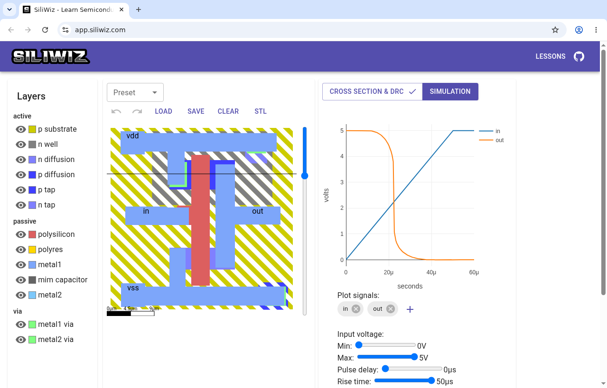

# Play with SiliWiz first

**<https://app.siliwiz.com/>** — no account, no install, works on a phone.

SiliWiz is a browser toy that lets you paint layout layers and then shows you
the **cross-section** of the silicon you just described, and simulates it. It
is not the SKY130 process and it is not a real tool. It is the fastest way to
convert "poly over diffusion makes a transistor" from a sentence you have read
into something you have seen happen.

Spend twenty minutes here before you open Magic. It is the cheapest twenty
minutes in this course.

*The layer palette down the left, the layout you are painting in the middle,
and on the right either the cross-section or — as here — a simulation of the
thing you drew. The black horizontal line across the layout is the
cross-section cut; drag the blue slider beside it and watch the picture on the
right change.*

## What to click

1. Open **<https://app.siliwiz.com/>**.
2. Top right, **LESSONS** takes you to the written walkthroughs at
   <https://tinytapeout.com/siliwiz/>. There are eight, and they are short:
   *introduction*, *resistors*, *capacitors*, *nmos*, *pmos*, *inverter*,
   *cmosinverter*, *divider*, *parasitics*.
3. Above the drawing area, the **Preset** dropdown loads a finished example.
   Load the inverter one.
4. Right-hand panel, two tabs: **CROSS SECTION & DRC** and **SIMULATION**.
5. The **vertical blue slider** to the right of the layout moves the
   cross-section cut line. This is the control that matters — everything else
   is scaffolding for it.

## The three things to actually do

**1. Find the transistor by moving the cut.**
Load the nmos lesson. Drag the cut line so it passes through the middle of the
poly stripe, and look at the cross-section: substrate, a thin oxide, poly on
top, and doped regions either side. Now drag it so it misses the poly. The
cross-section becomes two doped regions with nothing joining them. **The
transistor exists only where the poly crosses.** You will believe this
afterwards in a way you do not now.

**2. Make it fail DRC and read the message.**
Move a contact until it hangs off the edge of the diffusion it is sitting on.
The **CROSS SECTION & DRC** tab tells you immediately. SiliWiz's rules are not
SKY130's, but the *shape* of the complaint — "this thing does not surround that
thing by enough" — is exactly the shape of half the errors you will meet in
Lab 02.

**3. Watch the parasitic appear.**
Do the *parasitics* lesson. Stretch a metal wire longer and watch what happens
to the simulated waveform. That is the entire argument of Lab 05, in a
browser, in two minutes.

## Where SiliWiz is lying to you

It is a teaching model, and being clear about the gaps is more useful than
pretending there are none:

- **The process is invented.** The layer names line up with SKY130's
  (`n well`, `p diffusion`, `polysilicon`, `metal1`, `metal2`, `p tap`,
  `n tap`) but the dimensions, the rules and the device models do not. Do not
  carry a number across.
- **It has no LVS.** Nothing checks that what you drew is what you meant, and
  that turns out to be the harder half — see
  [LVS asks a different question](lvs-asks-a-different-question.md).
- **The cross-section is schematic.** Real doping profiles are gradients, not
  the flat-topped blocks in the picture.

None of that matters for what it is for. It is the only tool in this course
that lets you see *into* the wafer, and Magic never will.

## Why it is in this course at all

SiliWiz comes from the TinyTapeout project. The team has put the TinyTapeout
**shuttle** out of scope for these courses — no submissions, no tiles, no
deadlines — but that decision was about the shuttle, not about their teaching
assets. This one is good, so it stays. Nothing in AD104 depends
on it; skipping it costs you nothing but intuition.
