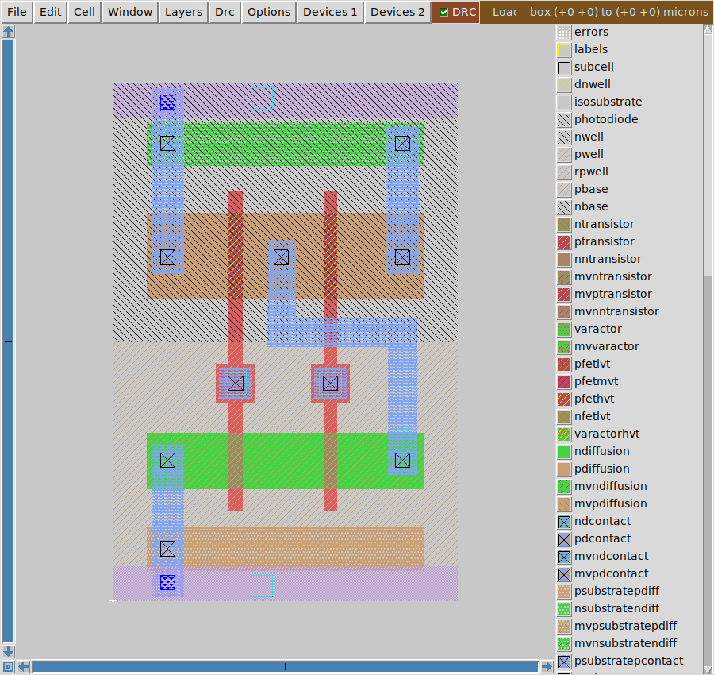

# Stick diagrams

A stick diagram is a layout with all the dimensions thrown away: coloured lines for the layers,
crosses for the contacts, and no measurements. It answers the one question that is expensive to get
wrong, **what order things go in**, and it takes ninety seconds on paper instead of an hour in
Magic. You'll sketch one at the start of
[Lab 03](../labs/lab-03-draw-an-inverter-overview.md#part-1-sketch-it-on-paper), before you draw
anything.

## The convention

Four colours and a symbol, one rule each:

| | |
|---|---|
| **Green** | n-diffusion. Runs horizontally, at the NMOS level. |
| **Yellow / brown** | p-diffusion. Also horizontal, up in the n-well. |
| **Red** | polysilicon. Runs **vertically**. Every red line crossing a diffusion is one transistor. |
| **Blue** | metal (or li). Runs wherever it likes, because it is above everything else. |
| **×** | a contact: a connection between two of the above. |

Two more conventions make every cell in a library look alike:

- **Power at the top, ground at the bottom**, in horizontal metal across the full width of the
  cell.
- **PMOS above, NMOS below.** The PMOS sits in the n-well and the n-well is tied to the positive
  rail, so this is not just a matter of taste.

## The inverter

```
   VDD  ═══════════════════════════════
                    ×
        ┌───────────╫───────────┐
   pdiff│           ║           │        (in the n-well)
        └───────────╫───────────┘
                    ║  ×────────────── Y
        ┌───────────╫───────────┐
   ndiff│           ║           │
        └───────────╫───────────┘
                    ×
   GND  ═══════════════════════════════
                    ║
                    A   (poly, vertical)
```

One red stripe crosses the p-diffusion once and the n-diffusion once, so it makes two
transistors, and because it is one stripe their gates are already connected. That shared gate is
why a CMOS inverter is compact: you get it for free by drawing one rectangle instead of two plus
a wire.

Your AD103 schematic needed an explicit wire from one gate to the other, so here the layout is
*simpler* than the schematic. That won't happen again.

## The NAND

A 2-input NAND is two NMOS **in series** and two PMOS **in parallel**.

In series, the drain of one transistor is the source of the other. On a schematic that is a wire.
On silicon it means **they are the same piece of diffusion**. Draw one strip and put two poly
stripes across it, and the region between them *is* the shared node. It needs no contact, no
wire and no extra space.

```
   VDD  ══════════════════════════════════════
              ×             ×            ×
        ┌─────╫─────────────╫────────────┐
   pdiff│     ║             ║            │      two PMOS, parallel
        └─────╫──────×──────╫────────────┘
              ║      └──────╫─────────────── Y
        ┌─────╫─────────────╫────────────┐
   ndiff│     ║             ║            │      two NMOS, series
        └─────╫─────────────╫──────×─────┘
              ║             ║      └───────────┘
              ×             ║
   GND  ══════════════════════════════════════
              A             B
```

Count the contacts on the n-diffusion: **two**, at the two ends. The middle of that strip
carries current and has no contact. A contact there would cost area, add junction capacitance to
an internal node, and gain you nothing.



*The same sketch, drawn in Magic. Two red poly stripes. The green n-diffusion runs under both of
them with contacts only at the far left and far right, and none between the gates. The orange
p-diffusion above has three contacts, because parallel devices alternate source, drain, source.*

## Choosing the order

For a 2-input gate the order of the transistors barely matters. For anything bigger it decides
whether the cell is one strip of diffusion or three, and each break in the strip costs you a
contact, a gap, and roughly a quarter of a micron of width.

The rule of thumb, and all you need at this level: **arrange the inputs so that consecutive
transistors in the series chain share a terminal.** If you write the gate as a chain of
source–drain pairs and you can walk through every transistor without lifting your pen, you can
draw it as one unbroken strip. (Formally, you are asking whether the transistor graph has an
Euler path.)

You won't need to do this in AD104. In the capstone you'll place the foundry's `and2_0`, which
is a single unbroken diffusion strip with two gates on it, and you should recognise that someone
chose that order on purpose.
