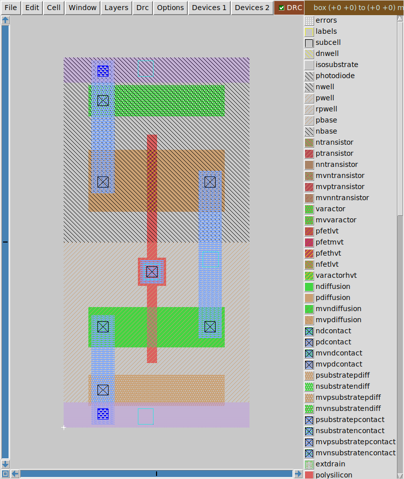

# What a layout is

A schematic tells you which terminals connect to which, while a layout is a **set of instructions
for a machine that prints patterns of light** onto a wafer. This page explains what that means
in practice: how a wafer is made, which layers you draw, and where the transistor is in a drawing
that never mentions one.

## How a chip is printed

Fabricating a wafer is a loop that repeats about seventy times. First the wafer is coated in
something, and light is shone through a mask so that the mask's pattern lands on the coating.
Then either the parts that were lit or the parts that weren't are washed away, and something is
done to whatever is now exposed: ions are implanted into it, an oxide is grown on it, it's etched
away, or metal is plated into it. Finally the coating is stripped off, and the loop starts again
with the next mask.

A **layout is the drawing on those masks**, so every rectangle you paint in Magic ends up as a
hole or a blob on a piece of quartz that the light goes through.

That has two consequences, and both are easier to say than to get used to:

- **There is no wire layer and no transistor layer.** There is a layer where the silicon was
  doped n-type and a layer where polysilicon was deposited, and wherever the two cross you get a
  transistor. So the transistor in a layout is just two overlapping rectangles that somebody
  drew.
- **Everything is a rectangle, and every rectangle has a minimum size.** The minimum comes from
  the printing itself: the light has a wavelength, the etch spreads, and the wafer isn't
  perfectly flat. The design rules are the foundry telling you what it can print with acceptable
  yield.

## The layers, bottom to top

SKY130 has about 40 mask layers, and this course uses ten of them. Physically they stack in this
order, and the order explains most of the rules:

| Magic layer | On the wafer | What it is for |
|---|---|---|
| `nwell` | a deep n-type tub in the p-substrate | somewhere to put PMOS |
| `ndiff` / `pdiff` | heavily doped silicon at the surface | the source and drain of a transistor, and the wire between them |
| `ptap` / `ntap` | doped silicon of the *same* type as the well underneath | a handle to hold the well at a known voltage |
| `poly` | polysilicon deposited on a very thin oxide | the **gate**: wherever it crosses diffusion, you get a transistor |
| `licon1` (`ndc`/`pdc`/`pc` in Magic) | a tungsten plug | the only way up from silicon or poly |
| `li1` (`li`) | a thin local-interconnect layer | short wiring inside a cell |
| `mcon` | a plug from li1 to metal1 | the only way up from li |
| `met1` … `met5` | aluminium/copper wiring | wires |
| `via1` … `via4` | plugs between metal layers | the only way between metals |

The pattern is rigid and worth memorising: **conductor, plug, conductor, plug, conductor.** You
can't connect metal1 to poly directly; you have to go poly → `licon1` → li1 → `mcon` → metal1,
and half of a beginner's DRC errors come from trying to skip one of those steps.

*Read this picture from the bottom up. The purple bands at the very bottom and very top are the
metal1 supply rails. The brown strip just above the lower rail is the p-tap, and the green block
above that is the NMOS n-diffusion. The red stripe running from below the n-diffusion to above the
p-diffusion is a single strip of polysilicon, which forms the gate of both transistors. The
pale-blue vertical runs are local interconnect, and the boxed X's are contacts. Every contact is
0.17 µm square, because that's the only size the process makes.*

## Where the transistor is

You won't find an object called "transistor" anywhere in that picture. What's there instead is:

- a strip of green n-diffusion, 0.65 µm tall,
- a red poly stripe, 0.15 µm wide, crossing it,
- and a contact on either side.

The poly sits on a few nanometres of oxide over the silicon. A voltage on the poly pulls electrons
to the surface of the silicon underneath, which joins the two diffusion regions into one
conducting channel. That means **the channel is the part of the diffusion that the poly
covers**, and it tells you where to read the transistor's size off the drawing:

- **$W$ is the height of the diffusion where the poly crosses it.** A wider channel carries more
  current.
- **$L$ is the width of the poly stripe where it crosses.** A longer channel carries less current.

In this course you never type `W=0.65`. Instead, in Lab 03 you draw a rectangle 0.65 µm tall,
and Magic reads `w=0.65` back out of it. That round trip, in which you draw a shape and a tool
tells you the device parameter, is the point where layout stops being abstract.

## Diffusion as a wire, and tying the wells

**Diffusion is also a wire.** The strip of n-diffusion between two poly gates conducts, which is
why two transistors in series can share it and need no contact between them; you'll see this in
the NAND gate in Lab 04. It's a poor wire, though, because it's resistive and carries a lot of
junction capacitance, so nobody uses it to route any further than the next transistor.

**The wells need tying to a supply.** The p-substrate under your NMOS and the n-well under your
PMOS are the *bodies* of your transistors, and the body is a real terminal that affects how the
transistor behaves. If nothing ties the wells to a supply, they float and the threshold voltages
wander. In the worst case, the parasitic bipolar structures that are present in every CMOS
process latch up and short the supply to ground until you remove power. The `ptap` and `ntap`
strips in the picture are there to prevent that. They're also the thing people most often forget
in a first layout, and the default design-rule check doesn't mention them; see [The full DRC rule set](../guide/the-rule-set-you-are-not-running.md).
