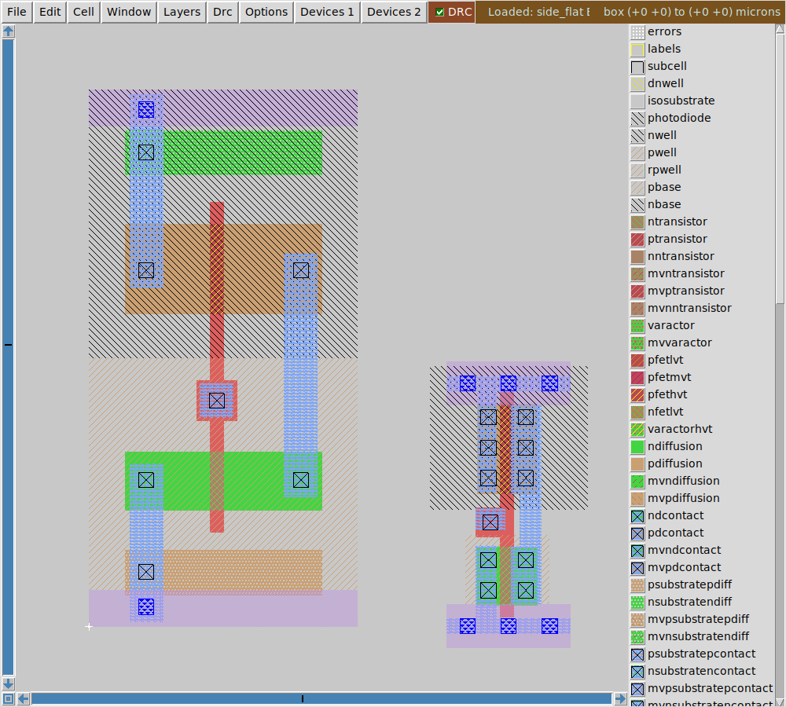

# Area, parasitics and delay

This page explains the experiment the course is built around.

Take **the same two transistors**: same width, same length, same device flavours, down to the
model name. Draw them twice, once the way the foundry did, packed to the last 0.005 µm, and once
the way you do in Lab 03, with room to move. Every difference between the two cells after that
comes from *the drawing*. You run the comparison in
[Lab 05](../labs/lab-05-what-it-costs-overview.md).



*Both cells are one NMOS at W = 0.65 µm and one high-Vt PMOS at W = 1 µm, with L = 0.15 µm for
both. Same devices, 4.8 times the area.*

## The numbers

Lab 05 runs the extraction and both simulations and prints this table:

| | yours | the foundry's | ratio |
|---|---|---|---|
| cell width | 3.00 µm | 1.38 µm | 2.17 × |
| cell height | 6.00 µm | 2.72 µm | 2.21 × |
| **cell area** | **18.00 µm²** | **3.7536 µm²** | **4.80 ×** |
| NMOS W / L | 0.65 / 0.15 | 0.65 / 0.15 | 1.00 × |
| PMOS W / L | 1 / 0.15 | 1 / 0.15 | 1.00 × |
| NMOS drain junction area | 0.715 µm² | 0.169 µm² | 4.23 × |
| PMOS drain junction area | 1.1 µm² | 0.26 µm² | 4.23 × |
| extracted capacitance, total | 2.024 fF | 1.563 fF | 1.29 × |
| **FO4 delay, average** | **67.82 ps** | **61.19 ps** | **1.11 ×** |
| **ring-oscillator stage delay** | **43.88 ps** | **34.48 ps** | **1.27 ×** |

Look at the two delay rows: the same cell is 11 % slower in one test and 27 % slower in the
other. Explaining that difference is the main job of this page.

## FO4 delay and ring-oscillator delay

A gate's delay is, roughly, how long its transistors take to charge whatever is attached to the
output. That load has two parts:

- **the load you are driving**: the gate capacitance of the cells downstream
- **the load you brought with you**: your own drain junctions and your own wiring, which have to
  be charged whether anything is connected or not

The second part is the one your layout controls, and it is close to a fixed number of
femtofarads.

**Fan-out of 4 (FO4)** means the output drives four copies of the same cell. The downstream gate
capacitance dominates, and it is identical for both cells because W and L are identical. Your
extra junction area is a small share of the total, so you come out 11 % behind.

**A ring oscillator** is a loop where each stage drives exactly one copy of itself and nothing
else. Now the self-load is a much bigger fraction of the total, and your 4.23 × junction area
shows up fully: 27 % behind.

> **Layout parasitics act roughly like a fixed extra load. They are lost in the noise when a
> gate drives something big, and they dominate when it drives something small.**

Most gates in a real chip drive something small. That is why the foundry packs its cells to the
last nanometre even though "it is only a few femtofarads".

## Where the femtofarads come from

Here is part of what `ext2spice cthresh 0` pulls out of each cell:

```
yours                         the foundry's
C0 A Y       0.02936f         C0 VGND VPB  0.01319f
C1 Y VPWR    0.06727f         C1 Y VPWR    0.12759f
C2 A VPWR    0.10808f         C2 A VPB     0.04506f
C3 Y VGND    0.20685f         C3 VGND Y    0.09986f
C4 A VGND    0.27253f         C4 A Y       0.04760f
C5 VPWR VGND 1.33952f         ... 15 in total
```

Your total is higher. But look at the row Lab 05 prints as *"of it on the output"*: **0.3035 fF
for yours against 0.3889 fF for theirs.** By that measure the foundry's cell is *worse*.

That is real, not an error. The extracted capacitors are **wire-to-wire coupling**, and the
foundry cell has more of it on the output because everything in it is packed close together. What
the extracted capacitor list does *not* contain is the **junction capacitance** of the source and
drain diffusions. That lives inside the device model, computed from the `ad`, `as`, `pd` and `ps`
parameters, and yours are 4.23 × theirs.

Adding it up:

- wire coupling: roughly even, slightly against the foundry
- junction capacitance: strongly against you, by a factor of four
- and junction capacitance is the bigger number

You can't read this off the parasitic netlist. You have to simulate, which is why Lab 05 does.

## Area

18 µm² against 3.75 µm² sounds like an academic difference until you multiply.

A modest open-source SoC has a few hundred thousand standard cells. At the foundry's density that
is about 1.5 mm² of logic; at yours it is 7 mm². Die cost goes roughly with area, and yield goes
*down* as area goes up, so each finished chip costs several times more and you get fewer good
ones per wafer. That is the whole commercial argument for a standard-cell library, and the reason a
library is drawn once, by someone very patient, and then instanced a million times.

## Summary

Your layout is deliberately roomy so that you can draw it by hand in an afternoon, and Lab 05
puts a price on that choice. The points to keep:

1. **Identical transistors do not give identical circuits.** Everything that is not in the
   schematic is in the layout.
2. **The cost of a loose layout is small per gate and very large per chip.**
3. **You can measure it.** The gap between your cell and the foundry's takes four commands and
   ninety seconds to measure; you don't have to argue about it.
