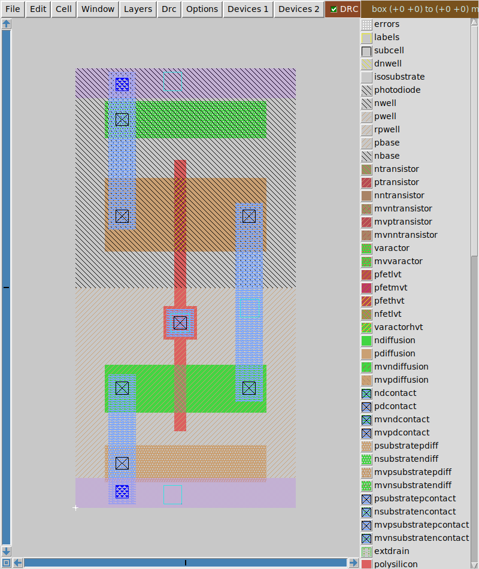

# AD104-M — Layout

In this course you draw the CMOS inverter from AD103's capstone as a layout in Magic. A layout is
the set of coloured rectangles that a foundry turns into masks. Yours has to pass a design rule
check (DRC, can it be manufactured?) and a layout-versus-schematic check (LVS, is it the circuit
you meant?). You do the work the way layout engineers do, with Magic's mouse, keys, menus and
dialogs, and run both checks in the tool yourself before `make` checks the result. You run the
checks on the foundry's own inverter in Lab 01 before you draw yours in Lab 03, and in Lab 05 you
compare the Lab 03 reference inverter with the foundry's in area and delay. In the capstone you
place four standard cells and route them by hand.

This is AD104-M, the Magic version of AD104. A KLayout version, AD104-K, is being written.

This course is part of the **UofT ASIC Team** education materials, and it's published at
**https://uoftasic.com/ad104-m/**. The labs run inside the shared **workspace** you set up in
[IC101](https://uoftasic.com/ic101/).

## At a glance

| | |
|---|---|
| **Who it's for** | Analog-track students who have finished AD103 |
| **Track** | Analog |
| **Prerequisites** | [IC101](https://uoftasic.com/ic101/) → [AD101](https://uoftasic.com/ad101/) → [AD102](https://uoftasic.com/ad102/) → [AD103](https://uoftasic.com/ad103/), in that order |
| **Main tool** | **Magic** 8.3.681, the layout editor. We assume you haven't used it before. [Getting started](guide/getting-started.md) explains how to open it, and [Drawing in Magic](guide/drawing-in-magic.md) teaches the mouse, keys and menus. |
| **Also** | netgen for LVS, KLayout 0.30.11 for looking at GDS, ngspice 47 for measuring delay |
| **Math level** | Arithmetic. Every dimension in this course is a number of microns. |
| **Time** | About 21 hours, self-paced |

## Course path

Work down this table in order. A **Read** row is one or more guide pages: concepts, figures and
worked examples, with nothing to run. A **Do** row is one lab, where you do every step
yourself. Each lab lists the pages to read before you start it.

| # | | What | Time |
|---|---|---|---|
| 1 | Read | [Getting started](guide/getting-started.md) · [What a layout is](guide/what-a-layout-actually-is.md) · [SiliWiz](guide/siliwiz.md) · [Anatomy of a standard cell](guide/anatomy-of-a-standard-cell.md) | 1.25 h |
| 2 | Do | [Lab 01: Open a cell you did not draw](labs/lab-01-open-the-cell-overview.md). Open the foundry's inverter in Magic, measure it, and get DRC, extraction and LVS to agree about it. | 1.5 h |
| 3 | Read | [Drawing in Magic](guide/drawing-in-magic.md) · [Reading DRC errors](guide/drc-is-a-conversation.md) · [The full DRC rule set](guide/the-rule-set-you-are-not-running.md) | 1.75 h |
| 4 | Do | [Lab 02: Break it on purpose](labs/lab-02-break-it-on-purpose-overview.md). Fix five inverter layouts in Magic, each with one mistake that breaks a real SKY130 rule, until DRC and LVS both pass. | 2.5 h |
| 5 | Read | [Stick diagrams](guide/stick-diagrams.md) · [Extraction](guide/extraction-is-reverse-engineering.md) · [Layout versus schematic (LVS)](guide/lvs-asks-a-different-question.md) | 1 h |
| 6 | Do | [Lab 03: Draw an inverter](labs/lab-03-draw-an-inverter-overview.md). Draw a CMOS inverter in Magic with the mouse and the palette, from an empty frame, until it is DRC clean and LVS clean. | 3.5 h |
| 7 | Read | [Instances and hierarchy](guide/cells-are-lego.md) | 30 min |
| 8 | Do | [Lab 04: A buffer and an AND gate](labs/lab-04-buffer-and-and-overview.md). Wire an inverter and a NAND into a buffer and an AND gate without drawing a new transistor, then build an inverter from Magic's device generator. | 3 h |
| 9 | Read | [Area, parasitics and delay](guide/what-your-drawing-costs.md) | 30 min |
| 10 | Do | [Lab 05: What it costs](labs/lab-05-what-it-costs-overview.md). Work out what the Lab 03 reference inverter's drawing costs in area, then measure what it costs in delay. | 1.25 h |
| 11 | Read | [Routing by hand](guide/routing-by-hand.md) · [What sets the clock frequency](guide/why-the-clock-cannot-go-faster.md) | 45 min |
| 12 | Do | [Capstone: Place and route](labs/capstone-place-and-route-overview.md). Place four standard cells, route them by hand, and measure how fast the block can be clocked. | 3.5 h |

The times are estimates, and they leave out the optional parts at the end of some labs. Lab 03
and the capstone take longest, because Lab 03 is the first cell you draw yourself and the
capstone is the first block you route.

Keep these open while you work: [Magic cheat sheet](reference/magic-cheatsheet.md) ·
[DRC error decoder](reference/drc-error-decoder.md) ·
[SKY130 layer map](reference/sky130-layer-map.md)

**If you get stuck**, ask in the [team Discord](https://discord.gg/hrJnP5UsGz); nobody expects
you to work it out alone at 2 a.m. [Getting help](guide/getting-started.md#getting-help) says
what to include in your question.

## The workbench

This course is pinned to the workbench image **`hpretl/iic-osic-tools:2026.08`**, which ships
**Magic 8.3.681**, **netgen 1.5.323** and **KLayout 0.30.11**. You start it the way IC101
showed you, and Lab 01 has you load this course's environment in it and check the Magic,
netgen and ngspice versions.

If the environment setup in Lab 01 fails, you can still run `make` in a lab folder, because every
lab pins `PDK=sky130A` itself and ships its own `.magicrc`. That means every lab's `make` runs to
completion in a bare container with no setup at all, and ends in `PASS` or `FAIL`, with a reason.

## What this course is about

A schematic says *what is connected to what*, and a layout says *what is where*. It's the
layout, rather than the schematic, that decides what a chip costs in area, speed, power and
yield.

You will draw a transistor as coloured rectangles, find out from the tools that it cannot be
manufactured, fix it, prove it is still the circuit you meant, and then measure what your
arrangement of rectangles costs compared with the foundry's.

The team lead's summary of layout is that ninety per cent of it is messing things up, and we
built the course around that, which is why Lab 02 gives you real broken layouts to fix before
you've drawn anything of your own.

*Your inverter at the end of Lab 03: nwell hatched at the top, PMOS in orange p-diffusion, NMOS
in green n-diffusion, and one red poly stripe crossing both. That stripe is the gate, and its
width is L. The contacts are the boxed X's, the local interconnect is pale blue, and the two
supply rails are purple metal1.*

## What you'll do

1. Open a cell you did not draw, the foundry's own inverter, and get four checks to agree about
   it before you draw anything.
2. Fix five broken layouts, each with one mistake that breaks a real SKY130 rule, even though
   the default rule set calls one of them clean.
3. Draw a CMOS inverter from an empty frame until it is DRC clean and LVS clean.
4. Turn that inverter into a buffer and an AND gate without drawing a single new transistor, then
   build an inverter again from transistors that Magic's device generator draws.
5. Compare the Lab 03 reference cell against the foundry's, with parasitics extracted. You'll find
   that the same transistors, drawn differently, take 4.8× the area and run 30 % slower in a ring
   oscillator.
6. Place and route four standard cells by hand, get the row clean, and measure the highest clock
   frequency your layout can run at.

## What you'll have at the end

You'll finish with a standard cell you drew yourself, a GDSII file of a small block you placed
and routed by hand, and a number for how fast that block can be clocked. You'll also have the
habit that makes layout manageable: **run DRC, read the rule name, change one thing, and run it
again.**

## Next courses

- **AD201** — Analog Signal Processing · **AD202** — Mixed Signal
- **DD103** — [RTL on FPGAs & ASICs](https://uoftasic.com/dd103/), where a tool does the
  placing and routing you did by hand, for a whole chip, in about a minute
