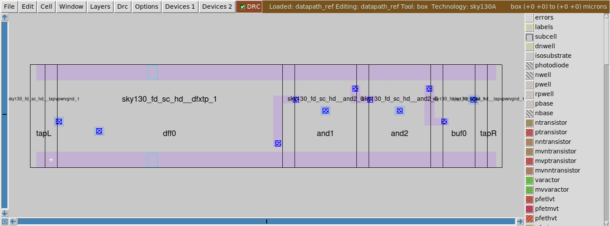

# Capstone — Place and route

**Package:** [`labs/capstone-place-and-route/`](https://github.com/uoftasic/ad104/tree/main/labs/capstone-place-and-route)

Four standard cells in a row. Three wires. Then a number for how fast you can
clock the thing you built.

This is the job a place-and-route tool does, at a scale you can hold in your
head, so that when you watch a tool do it for a hundred thousand cells you know
what you are looking at.

## Prerequisites

Labs 01–05. [Cells are Lego](guide/cells-are-lego.md) ·
[Routing by hand](guide/routing-by-hand.md) ·
[Why the clock cannot go faster](guide/why-the-clock-cannot-go-faster.md)

## The circuit

```
   Q  = DFF(CLK, D)          sky130_fd_sc_hd__dfxtp_1
   n1 = Q  AND A             sky130_fd_sc_hd__and2_0
   n2 = n1 AND B             sky130_fd_sc_hd__and2_0
   Y  = BUF(n2)              sky130_fd_sc_hd__buf_1
```

A flip-flop, two AND gates and a buffer — a register bit with some logic
hanging off it, which is the most common four-cell cluster in any synchronous
chip. It also has a clock, which is what makes the timing question at the end
a real one.

## Objectives

- Place library cells so their rails abut into a continuous supply
- Route three nets by hand on metal1, between the rails, without breaking
  `met1.2`
- Discover from the **full rule set** that your row is missing something, and
  work out what
- Prove with netgen that the geometry is the netlist you were given
- Simulate the extracted layout and compute $f_{\max}$
- Write a GDSII

## Run it

```bash
cd labs/capstone-place-and-route
make scaffold     # four cells placed, nothing wired
make edit
make layout       # DRC + LVS only, about 1.4 s
make              # ...and the timing, about a minute
```

## Stage 1 — the placement is done for you

`make scaffold` places the four cells at x = 0, 7.36, 9.66 and 11.96 — a
running total of their widths, which come from each cell's `FIXED_BBOX`
property. Because every cell in the library is 2.72 µm tall with its rails at
the same heights, the rails abut into two continuous strips and the wells
merge. **Placement, at this scale, is arithmetic.**

`tcl/place.tcl` is four `getcell` calls; if you want to do it yourself, delete
the file's output and type them.

## Stage 2 — route three nets

| net | from | to |
|---|---|---|
| `Q` | `dff0/Q` at x 6.950–7.120, y 0.425–0.595 | `and1/A` at x 7.505–7.675, y 1.785–1.955 |
| `n1` | `and1/X` at x 9.345–9.515, y 2.125–2.295 | `and2/A` at x 9.805–9.975, y 1.785–1.955 |
| `n2` | `and2/X` at x 11.645–11.815, y 2.125–2.295 | `buf0/A` at x 12.105–12.275, y 1.105–1.275 |

Those coordinates are the `flabel` lines in each cell's `.mag` file plus the
x it was placed at. Each connection is:

1. an `mcon` on the li pin, **exactly 0.17 µm square**
2. a metal1 pad around it — 0.29 µm wide gives 0.06 µm each side and satisfies
   `met1.5` on the x axis
3. metal1 joining the two pads

and it all has to stay between **y = 0.38 and y = 2.34**, because the rails
occupy y ≤ 0.24 and y ≥ 2.48 and metal1 spacing is 0.14.



*Subcells collapsed, so the cells are outlines and your routing is the only
real geometry on screen. Left to right: `tapL`, `dff0`, `and1`, `and2`,
`buf0`, `tapR`.*

Then bring the block's own pins out — `CLK`, `D`, `A`, `B`, `Y` — each an
`mcon` plus a pad plus a label, and paint metal1 rails across the whole row so
that `VGND` and `VPWR` have geometry belonging to *this* cell to sit on.

### The flip-flop is not empty above

`and2_0` and `buf_1` contain metal1 only in their rails. **`dfxtp_1` does
not.** It has internal metal1 straps at y = 1.415–1.645 and y = 1.755–1.985
running most of its width.

So the obvious place to put the via for `D` — right at the D label, y ≈ 1.19 —
puts a metal1 pad 0.07 µm from a strap and breaks `met1.2`. The D pin's li
shape runs all the way down to y = 0.715, so the via goes down there instead.

**Finding somewhere else on the same pin to land** is the routing move you
will make most often. Check what a cell already contains before you route over
it:

```bash
awk '/<< metal1 >>/,/<< labels >>/' \
  $PDK_ROOT/sky130A/libs.ref/sky130_fd_sc_hd/mag/sky130_fd_sc_hd__dfxtp_1.mag
```

## Stage 3 — the thing the default checker will not tell you

Get the routing right and `make layout` says:

```
      DRC, default rule set  0
      DRC, full rule set     32
      LVS                    Top level cell failed pin matching

      rules broken:
        All nwells must contain metal-connected N+ taps (nwell.4)
        P-diff distance to N-tap must be < 15.0um (LU.3)
        N-diff distance to P-tap must be < 15.0um (LU.2)
```

Zero and thirty-two, from the same geometry.

Every violation is about **well taps**. Nothing in your row ties the n-well to
VPWR or the substrate to VGND, because `sky130_fd_sc_hd` cells are drawn
tapless on purpose — you found that out in Lab 01 on the foundry's own
inverter.

And a second tool has noticed the same thing without using the word. Look at
the extracted netlist:

```spice
Xbuf0 buf0/A dff0/VGND VSUBS dff0/VPB dff0/VPWR Y sky130_fd_sc_hd__buf_1
```

`VSUBS` and `dff0/VPB` are invented node names for bodies that connect to
nothing.

**The fix is a cell, not a shape.** Place a
`sky130_fd_sc_hd__tapvpwrvgnd_1` — 0.46 µm wide — at each end of the row:

```tcl
box -0.46um 0um -0.46um 0um ; getcell sky130_fd_sc_hd__tapvpwrvgnd_1 ; identify tapL
box 13.34um 0um 13.34um 0um ; getcell sky130_fd_sc_hd__tapvpwrvgnd_1 ; identify tapR
```

Two taps 14.26 µm apart satisfies `LU.2` and `LU.3`, which only ask for one
within 15 µm. Re-extract and the same line becomes:

```spice
Xbuf0 buf0/A VGND VGND VPWR VPWR Y sky130_fd_sc_hd__buf_1
```

## Stage 4 — the number

```bash
make
```

```
  YOUR BLOCK

      outline                14.64 x 3.20 um   =  46.85 um2
      cells placed           2 x and2_0, 1 x buf_1, 1 x dfxtp_1
      cells in the row       and2_0, buf_1, dfxtp_1, tapvpwrvgnd_1
      ports                  CLK D A B Y VGND VPWR
      DRC, default rule set  0
      DRC, full rule set     0
      LVS                    match

  HOW FAST CAN YOU CLOCK IT

      CLK rise -> Y rise        601.05 ps    (measured on your extracted layout)
      D setup at the flop       103.32 ps    (sky130_fd_sc_hd__tt_025C_1v80.lib)
      shortest legal period     704.37 ps
      f_max                    1419.71 MHz
```

$$T_{\text{clk}} \ge t_{\text{clk}\rightarrow Q} + t_{\text{logic}} + t_{\text{setup}}$$

The first two terms are **simulated on your own geometry**, with every
parasitic capacitance Magic could find. The third is **looked up**, from the
Liberty file — setup time is a property of the flip-flop's internals and you
cannot get it out of your layout. That file,
`sky130_fd_sc_hd__tt_025C_1v80.lib`, is the same one the digital track
synthesises against in [DD103](https://uoftasic.com/dd103/); this is the point
where the two tracks are reading the same document.

601 ps is **17 inverter delays**, using the 34.48 ps you measured in Lab 05.
Four gates should not cost seventeen inverters — the flip-flop's clock-to-Q is
most of it, and the `and2_0` cells you were given are the weakest AND in the
library. `and2_2` would buy a real slice of that back, for area. That trade,
made a few million times with an objective function, is what a synthesis tool
is.

## Stage 5 — write the file

```bash
make gds
```

**25,778 bytes** for the reference block; yours will be within a few hundred of
that. GDSII is the format a foundry accepts, and everything before
it — `.mag` files, DRC, LVS, the extracted netlist — was you convincing
yourself. Look at it:

```bash
klayout -nn $PDK_ROOT/sky130A/libs.tech/klayout/tech/sky130A.lyt results/datapath.gds
```


Notice in the cell tree that the library cells are still there as separate
cells — the GDS is hierarchical, and Magic did not re-generate their geometry
at all. It copied the bytes straight out of the foundry's own GDS file, which
is what the `GDS_START` / `GDS_END` properties in their `.mag` files are for.

## Expected results

- [ ] `make layout` reports **0** under both rule sets and `match` in LVS
- [ ] `make` prints an `f_max`
- [ ] `make gds` writes a GDS
- [ ] you can say why the default rule set reported 0 while 32 rules were
      broken, without looking it up
- [ ] you can name three reasons a real chip runs at a fraction of your
      1.42 GHz

## Targets

| Command | What it does |
|---|---|
| `make` | DRC both ways, LVS, then the timing |
| `make layout` | just DRC and LVS, about 1.4 s |
| `make edit` | open your block in Magic |
| `make scaffold` | **throw your routing away**, back to four placed cells |
| `make ref` / `make refcheck` | build and check the reference block |
| `make gds` | write `results/datapath.gds` |
| `make clean` | delete `results/` |

## Where this goes next

You have now done by hand, for four cells, what
[DD103](https://uoftasic.com/dd103/) does with LibreLane for a whole design in
54 seconds: place cells in rows, insert taps, route, check DRC, check LVS,
write GDS. The tool is not doing anything you have not done. It is doing it a
hundred thousand times, with a cost function, and it never forgets the taps.
