# Capstone: Place and route

You'll place four standard cells in a row, route three wires between them by hand in Magic, and
then measure how fast you can clock what you built. This is the job a place-and-route tool does,
at a scale you can hold in your head, so that when you watch a tool do it for a hundred thousand
cells you know what you are looking at.

Package: [`labs/capstone-place-and-route/`](https://github.com/uoftasic/ad104-m/tree/main/labs/capstone-place-and-route)

## Before you start

- Finish Labs 01–05. This lab uses the click recipe and the typed size from Lab 02, the Text
  dialog from Lab 03, and typed extraction and netgen from Lab 01, without explaining them again.
- Read [Routing by hand](../guide/routing-by-hand.md) and
  [What sets the clock frequency](../guide/why-the-clock-cannot-go-faster.md).
  [Instances and hierarchy](../guide/cells-are-lego.md) covers placing cells, and why a label on a
  subcell's shape does not name your block.
- Keep the [DRC error decoder](../reference/drc-error-decoder.md) open in another tab.

**Time:** about 3.5 hours, an estimate, and about half of that goes on routing. `make layout` runs
only DRC and LVS and takes about 1.1 s, so it's the one to use while you route. The full `make`
adds the timing simulation and takes about 15 seconds (12.6 to 15.6 s on four timed clean runs).

The circuit:

```
   Q  = DFF(CLK, D)          sky130_fd_sc_hd__dfxtp_1
   n1 = Q  AND A             sky130_fd_sc_hd__and2_0
   n2 = n1 AND B             sky130_fd_sc_hd__and2_0
   Y  = BUF(n2)              sky130_fd_sc_hd__buf_1
```

That's a flip-flop, two AND gates and a buffer. Together they make a register bit with some logic
after it, which is the most common four-cell cluster in any synchronous chip. Because it has a
clock, the timing question at the end of the lab is a real one.

You'll use two terminals: one in `labs/capstone-place-and-route/mag`, where Magic, extraction and
netgen run, and one in `labs/capstone-place-and-route`, where `make` runs.

## Part 1: Look at the placement

What does a row of four standard cells look like before you wire anything?

1. Go into the lab package and lay down the placement:

   ```bash
   cd labs/capstone-place-and-route
   make scaffold     # four cells placed, nothing wired
   ```

   Be careful with `make scaffold`, because it **throws away your routing**. Use it now, and
   after that only when you want to start over.

   It places the four cells at x = 0, 7.36, 9.66 and 11.96. Those numbers are a running total of
   the cells' widths, which come from each cell's `FIXED_BBOX` property. Every cell in the library
   is 2.72 µm tall with its rails at the same heights, so the rails abut into two continuous
   strips and the wells merge. At this scale placement is just arithmetic, and `tcl/place.tcl` is
   nothing more than four `getcell` calls.

2. In your second terminal, start Magic on the block from the `mag` folder:

   ```bash
   cd labs/capstone-place-and-route/mag
   magic -d X11 datapath &
   ```

   Magic draws each cell as an outline with the cell's name and the instance's name (`dff0`,
   `and1`, `and2`, `buf0`). An unexpanded cell shows only its outline.

   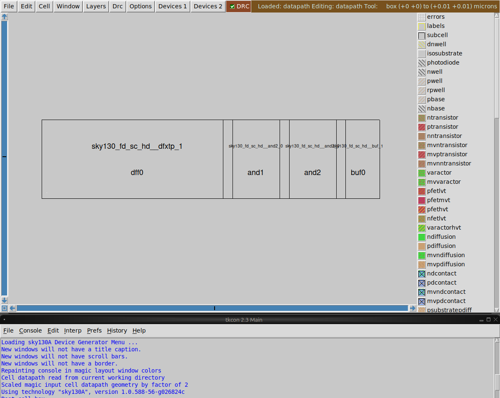

   *The placement as `make scaffold` left it. Each outline is one instance; the console under
   it shows that `datapath` was read from the current folder.*

3. Expand all four cells. Left-click below and to the left of the row, right-click above and to
   the right of it, so the box covers all four outlines, and press `x` with the pointer over the
   drawing (`Cell → Expand` does the same). The console prints a `Cell ... read from path`
   line for each library cell as Magic reads it.

4. Point at the right-hand end of the rails and read x in the title bar's readout. It should be
   the last cell's x plus its width, 11.96 + 1.38 = 13.34. You'll need that number in Parts 4
   and 5.

5. Before you run DRC on the bare placement, predict the count under each rule set and write both
   numbers down. The foundry's inverter in Lab 01 is a clue.

6. Run DRC in Magic under both rule sets:
   - `Drc → DRC update`. Magic starts in the default rule set (`DRC Fast`).
   - `Drc → DRC Complete`, then `Drc → DRC update` again. The console lists the rules broken.
   - `Options → DRC Manager` lists the same rules, each with its error areas under it.

   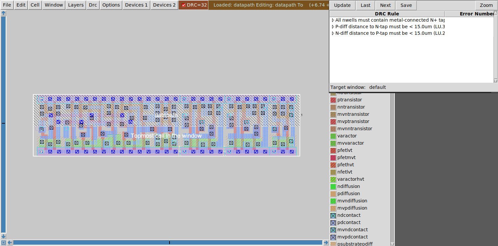

   *Under DRC Complete the button reads `DRC=32`, and the DRC Manager names the three rules. The
   manager selects the top cell, so its name and "Topmost cell in the window" are drawn across
   the row; press `,` over the drawing to clear the selection.*

   You should see `DRC=0` after the first update, and after the second:

   ```
   N-diff distance to P-tap must be < 15.0um (LU.2)
   P-diff distance to N-tap must be < 15.0um (LU.3)
   All nwells must contain metal-connected N+ taps (nwell.4)
   ```

7. Close the DRC Manager, then go back to the default rule set for routing: `Drc → DRC Fast`,
   then `Drc → DRC update`, which shows `DRC=0` again. Until Part 5, a count above zero under
   `DRC Fast` is one of your mistakes and not one of the 32 tap errors.

8. Run the checker in your other terminal:

   ```bash
   make layout
   ```

   ```
     YOUR BLOCK

         outline                13.72 x 3.20 um   =  43.90 um2
         cells placed           2 x and2_0, 1 x buf_1, 1 x dfxtp_1
         cells in the row       and2_0, buf_1, dfxtp_1
         ports                  (none)
         DRC, default rule set  0
         DRC, full rule set     32
         LVS                    Top level cell failed pin matching

         rules broken:
           All nwells must contain metal-connected N+ taps (nwell.4)
           P-diff distance to N-tap must be < 15.0um (LU.3)
           N-diff distance to P-tap must be < 15.0um (LU.2)
   ```

   The same geometry gives zero violations under one rule set and thirty-two under the other,
   before you have drawn a single wire. You'll fix the thirty-two in Part 5.

**You should see** `DRC=0` under `DRC Fast` and `DRC=32` under `DRC Complete` in Magic, and
`DRC, default rule set 0` and `DRC, full rule set 32` from `make layout`.

## Part 2: Check what is above each cell

Where can your metal1 go without hitting metal1 that is already inside a cell?

`and2_0` and `buf_1` contain metal1 only in their rails, but **`dfxtp_1` has metal1 inside the
cell as well**, and your routing has to keep clear of it.

1. Zoom in on `dff0`: left-click near its lower-left corner, right-click near its upper-right,
   and press `ctrl+z`.

2. With the pointer over the drawing, press `!`. In this image `!` shows only `mcon`, metal1 and
   `via1`, so the flip-flop's metal1 stands out: the two rails, and two long horizontal straps
   across the middle of the cell.

   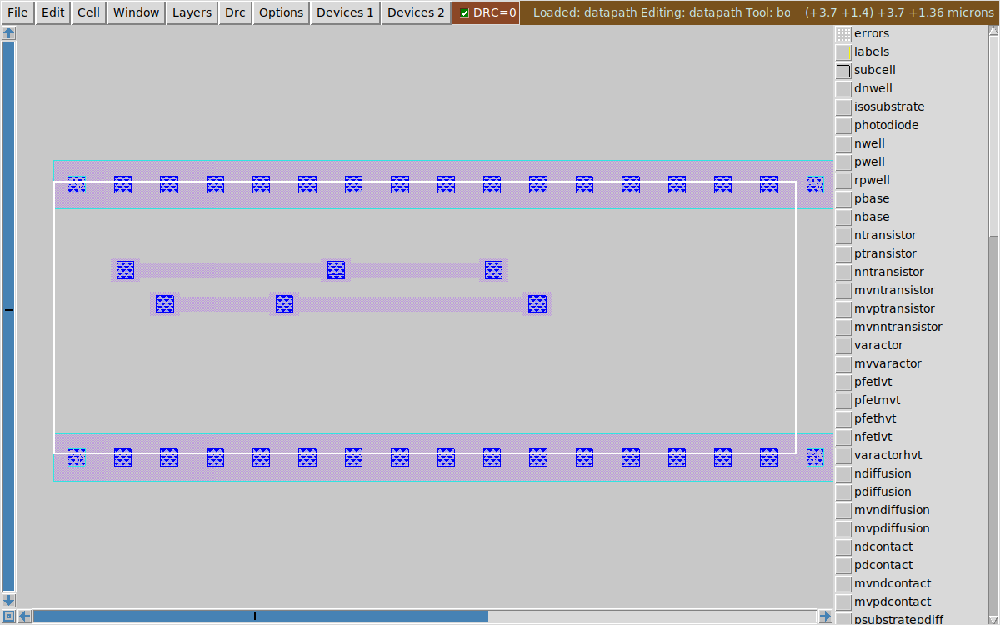

   *After `!`: the rails at the top and bottom, and the flip-flop's two internal metal1 straps
   between them. The other layers are only hidden.*

3. Read each strap's lower and upper edge: point at the edge and read y in the title bar. The
   straps run at y = 1.415–1.645 and y = 1.755–1.985. Clicks and the readout snap to 0.01 µm, so
   an edge at 1.415 reads as 1.41 or 1.42.

4. Press `9` with the pointer over the drawing to show every layer again (this image binds `9`
   to show all layers).

5. Optionally, check the straps from a terminal. List the flip-flop's metal1:

   ```bash
   awk '/<< metal1 >>/,/<< labels >>/' \
     $PDK_ROOT/sky130A/libs.ref/sky130_fd_sc_hd/mag/sky130_fd_sc_hd__dfxtp_1.mag
   ```

   If you add `| grep -c '^rect'` to the command, it counts the rectangles instead, and you get
   74 for `dfxtp_1`. Run the same count on `sky130_fd_sc_hd__and2_0.mag` and
   `sky130_fd_sc_hd__buf_1.mag` and you get 16 and 12, all of them in the rails. The file is in
   units of 0.005 µm, so the straps are the rectangles between y = 283 and 397.

6. The obvious place for the `D` input's via is at the D label, around y ≈ 1.19. Work out what
   a metal1 pad there would do next to the straps (`met1.2` is metal1 spacing, 0.14 µm), and
   where else on the D pin you could land instead.

   <details>
   <summary>Answer</summary>

   A pad at the label would sit 0.07 µm from a strap, which breaks `met1.2`. The D pin's li shape
   runs all the way down to y = 0.715, so you can take the via down there instead. Finding
   somewhere else on the same pin to land is the routing move you'll make most often.

   </details>

**You should see** the two straps with only metal1 showing, every layer back after `9`, and a
plan for where `D`'s via goes.

## Part 3: Route the three nets

How do you get from each pin to the next without touching anything else?

| net | from | to |
|---|---|---|
| `Q` | `dff0/Q` | `and1/A` |
| `n1` | `and1/X` | `and2/A` |
| `n2` | `and2/X` | `buf0/A` |

Each pin is a rectangle of the cell's li, 0.17 µm on a side, under the pin's label. You find it
on screen, put an `mcon` on it (the palette calls it `viali`), surround the `mcon` with a metal1
pad, and join the two pads with metal1. Start with net `Q`.

1. Zoom in on the area round `dff0/Q` and `and1/A`: a rough box round both labels, then
   `ctrl+z`. With the cells expanded, each pin's label is drawn as a large letter, and the
   pin's rectangle is the small outlined square under the letter.

2. Put the box on the `Q` pin with the typed size. Left-click the square's lower-left corner,
   click in tkcon and type:

   ```tcl
   box size 0.17um 0.17um
   ```

   Then click the layout window's title bar, point at the drawing and press `b`. The `microns:`
   line gives the box's corners, which are where your `mcon` will go.

   The pins' edges sit on a 0.005 µm grid, and clicks land on 0.01 µm, so your box can be up to
   0.005 µm off the outlined square. That's fine. For every pin in this lab, an `mcon` at each of
   the four nearest 0.01 µm positions was checked, and none of them broke an `mcon` or li rule.

   <details>
   <summary>Check your reading</summary>

   These are the pins' label rectangles, from the `flabel` lines in each cell's `.mag` file with
   the x the cell was placed at added on ([Routing by hand](../guide/routing-by-hand.md#pin-shapes)
   shows how). Your `b` readout should be within 0.005 µm of the first row.

   | pin | x | y |
   |---|---|---|
   | `dff0/Q` | 6.950–7.120 | 0.425–0.595 |
   | `and1/A` | 7.505–7.675 | 1.785–1.955 |
   | `and1/X` | 9.345–9.515 | 2.125–2.295 |
   | `and2/A` | 9.805–9.975 | 1.785–1.955 |
   | `and2/X` | 11.645–11.815 | 2.125–2.295 |
   | `buf0/A` | 12.105–12.275 | 1.105–1.275 |
   | `dff0/CLK` | 0.145–0.315 | 1.105–1.275 |
   | `dff0/D` | 1.445–1.615 | 1.105–1.275 |
   | `and1/B` | 8.425–8.595 | 1.445–1.615 |
   | `and2/B` | 10.725–10.895 | 1.445–1.615 |
   | `buf0/X` | 13.015–13.185 | 0.425–0.595, 1.785–1.955 or 2.125–2.295 |

   The last five are for Part 4. `buf0/X` is labelled at three heights on the same li.

   </details>

3. Paint the `mcon`: scroll the palette down to `viali` and middle-click it. The DRC button shows
   a count (4 in the shot below), because an `mcon` on its own breaks the metal1 rules until its
   pad is there.

   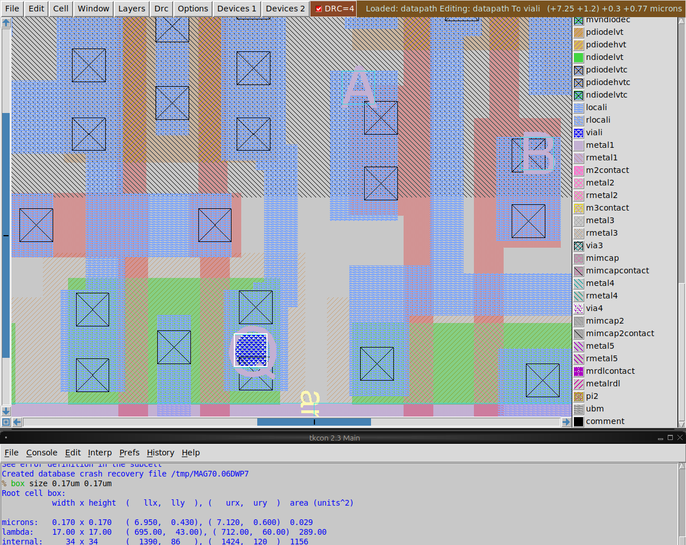

   *The first `mcon` of net `Q`, on the `Q` pin. The console shows the typed size and the box
   `b` printed; the `and1` pins `A` and `B` are at the top of the view.*

4. Put the `mcon` on `and1/A` the same way. The box keeps its size when you left-click, so you
   only left-click the pin's lower-left corner and middle-click `viali`; there's no need to type
   `box size` again.

5. Draw the metal1 with the click recipe: left-click a corner, right-click the opposite corner,
   and middle-click `metal1` in the palette. You need a pad round each `mcon` and a wire joining
   the pads, and each shape has to meet these rules:
   - `met1.4`: the pad covers the `mcon` by at least 0.03 µm on every side.
   - `met1.5`: on one axis, the pad extends 0.06 µm past the `mcon` on both sides. A pad
     0.29 µm wide leaves 0.06 µm on each side of a 0.17 µm `mcon` on the x axis.
   - `met1.2`: metal1 stays 0.14 µm from metal1 it is not connected to. The rails occupy
     y ≤ 0.24 and y ≥ 2.48, so your metal1 stays between y = 0.38 and y = 2.34, and clear of
     `dff0`'s straps.

6. Check the net: `Drc → DRC update`. If the button shows a count, press `=` with the pointer
   over the drawing to zoom to the next error, and `Drc → DRC report` to print its rule. Look the
   rule up in the decoder, fix the shape, and update again.

   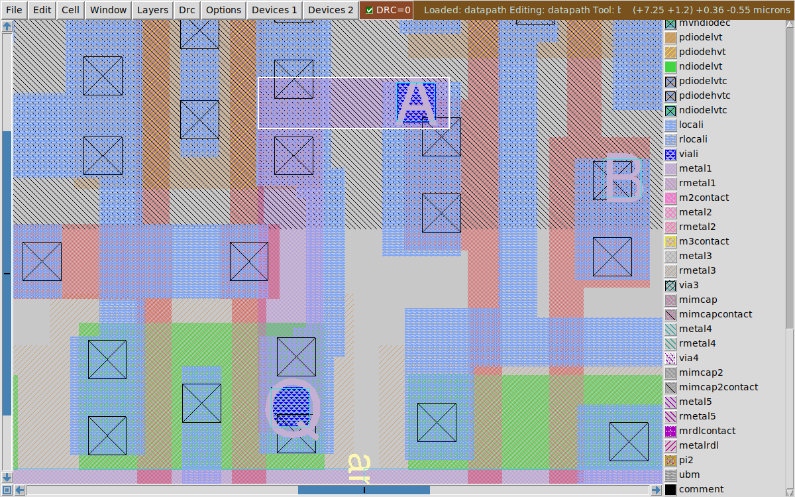

   *Net `Q`, routed: a pad up from the `Q` pin and a wire across to `and1/A`, both on metal1.
   `DRC=0` under `DRC Fast`.*

   You should see `DRC=0`. With no errors left, `=` prints `There are no errors in datapath.`

7. Route `n1` and `n2` the same way: two `mcon`s, two pads and a joining wire each, and
   `Drc → DRC update` after each net.

8. Save the block: `File → Save...`. Magic asks about each cell it counts as changed, one dialog
   at a time, and that includes the library cells. For `datapath`, click `write`. For each
   `sky130_fd_sc_hd__...` cell, click `skip`: those `.mag` files are the foundry's, in the PDK,
   and you didn't change them. (If you click `write` on one by mistake, Magic prints that the
   file `is read_only and cannot be written` and goes on to the next dialog.)

   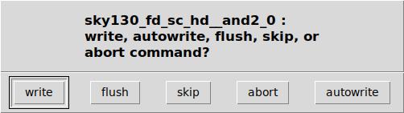

   *The first of the save dialogs asks about a library cell. Click `skip` for every
   `sky130_fd_sc_hd__` cell and `write` for `datapath`.*

9. Run `make layout`. If DRC reports a violation, use its rule name to find out what's wrong,
   fix it in Magic, save, and run it again.


*The reference block with its subcells collapsed: each cell is drawn as an outline and the
routing is the only real geometry on the screen. From left to right: `tapL`, `dff0`, `and1`,
`and2`, `buf0`, `tapR`. You add the two taps in Part 5; the reference names them `tapL` and
`tapR`, and Magic gives yours longer names, which doesn't matter.*

**You should see** `DRC=0` in Magic under `DRC Fast` after all three nets are routed, and
`DRC, default rule set 0` from `make layout`. The full rule set will still report 32, and LVS will
still fail, until you've done Parts 4 and 5.

## Part 4: Bring out the pins

How does your block get pins of its own?

1. Bring out the block's own pins, `CLK`, `D`, `A`, `B` and `Y`. Each one is an `mcon` on a
   cell's li pin with a metal1 pad over it. The circuit at the top tells you which cell each pin
   belongs to: `CLK` and `D` go to the flip-flop, `A` and `B` to the free input of `and1` and
   `and2` (their `B` pins), and `Y` comes from the buffer's output. Find each pin on screen as in
   Part 3. Use the spot you chose in Part 2 for `D`.

2. A pin's pad stands on its own, so it also has to meet `met1.6`, metal1's minimum area. Draw
   the first pad 0.29 × 0.23 µm, the smallest that meets `met1.4` and `met1.5`, and run
   `Drc → DRC update`, `=` and `Drc → DRC report`. You should see:

   ```
   Metal1 minimum area < 0.083um^2 (met1.6)
   ```

   Make the pad big enough (the decoder has the numbers), update again until the button shows
   `DRC=0`, and draw the other four pads that size from the start.

3. Name each pin with a label. Set the box on the pin's `mcon` with the click recipe, open
   `Edit → Text ...`, type the name in `Text string:`, set `Size (um):` to 0.1, and click
   `Okay`. Leave Port `enable` **unticked** this time.

   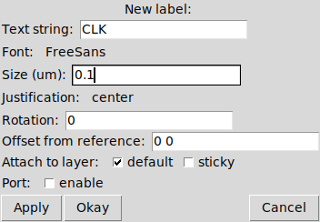

   *The Text dialog for `CLK`, with Port left unticked. You'll make the ports another way in
   step 6.*

   The console reports where each label went, for example:

   ```
   Moving label "CLK" from space to viali in cell datapath.
   ```

4. Paint the block's own metal1 rails over the cells' rails, the whole width of the row, and
   label them `VGND` (the bottom rail) and `VPWR` (the top one). The labels need geometry that
   belongs to *this* cell. If you put a label on one of the standard cells' own rails instead,
   it would stay in your block but land on empty space, because the rail under it is the
   standard cell's, and a label on space doesn't name any net.

   To draw a rail, zoom in on the left end of the bottom rail and read its lower and upper edge
   with the pointer. Left-click its lower-left corner (x = 0), click in tkcon, and type
   `box size` with the row's width from Part 1 and the rail's height, each followed by `um`.
   Click the title bar, check the box with `b`, and middle-click `metal1`. Do the same for the
   top rail, then label both rails with `Edit → Text ...`, Port unticked.

   <details>
   <summary>Answer: the size</summary>

   The rails run from y = −0.24 to 0.24 and from 2.48 to 2.96, so they are 0.48 µm tall, and the
   row is 13.34 µm wide: `box size 13.34um 0.48um`. The console reports
   `Moving label "VGND" from space to metal1 in cell datapath.` when you label the bottom one.

   </details>

5. Save (`skip` for the library cells, `write` for `datapath`) and run `make layout`. You should
   see `ports (none)`.

   A label is a name written on geometry, while a **port** is a name that the extractor puts on
   the `.subckt` line. Without ports, `make layout` reports `ports (none)` and LVS fails with
   `Top level cell failed pin matching`, and the printed advice about putting labels on the top
   cell's own geometry won't help, because yours already are.

6. Turn the labels into ports. This is a separate step, and it's the one everybody skips. Click in
   tkcon and type these two lines:

   ```tcl
   select top cell
   port makeall
   ```

   `select top cell` selects your block (the console answers `Topmost cell in the window`), and
   `port makeall` promotes every label in it to a port. This is the one place in the course where
   you type them: the Text dialog's Port box does the same one label at a time, and
   `port makeall` does all seven at once. Click the layout window's title bar and press `,` over
   the drawing to clear the selection.

7. Save again and run `make layout`:

   ```
         ports                  CLK D A B Y VGND VPWR
         DRC, default rule set  0
         DRC, full rule set     32
         LVS                    Netlists do not match

         rules broken:
           All nwells must contain metal-connected N+ taps (nwell.4)
           P-diff distance to N-tap must be < 15.0um (LU.3)
           N-diff distance to P-tap must be < 15.0um (LU.2)
   ```

   Your names may come in another order. The checker builds its timing testbench around the
   order your block has.

**You should see** `ports` listing `CLK`, `D`, `A`, `B`, `Y`, `VGND` and `VPWR`, default DRC at
0, and the full rule set still at 32. LVS has moved on from `failed pin matching` to
`Netlists do not match`: the block's pins are all there now, and the taps you add in Part 5 fix
the rest.

## Part 5: Add the tap cells

What are the 32 violations, and what fixes them?

All 32 violations are about **well taps**. Nothing in your row ties the n-well to VPWR or the
substrate to VGND, because `sky130_fd_sc_hd` cells are drawn without taps on purpose, as you saw
in Lab 01 on the foundry's own inverter.

1. The extracted netlist shows the same fault, although it never uses the word "tap". Extract the
   block: in tkcon type

   ```tcl
   extract all
   ext2spice lvs
   ext2spice
   ```

   `extract all` writes an `.ext` file for `datapath` and one for each library cell, and they all
   go in `mag/`; the PDK's folder isn't writable. Then, in the terminal in `mag/`:

   ```bash
   grep Xbuf0 datapath.spice
   ```

   ```spice
   Xbuf0 buf0/A VGND VSUBS dff0/VPB VPWR Y sky130_fd_sc_hd__buf_1
   ```

   `VSUBS` and `dff0/VPB` are invented node names, given to bodies that aren't connected to
   anything.

2. You fix this by placing a cell rather than by drawing a shape: one
   `sky130_fd_sc_hd__tapvpwrvgnd_1`, 0.46 µm wide, at each end of the row. The left one's
   lower-left corner goes 0.46 µm left of the row's lower-left corner; the right one's goes at
   the row's right-hand end, which you read in Part 1. Two taps 14.26 µm apart are enough to
   satisfy `LU.2` and `LU.3`, because those rules only ask for a tap within 15 µm.

3. Open the Library Manager first: `Options → Library Manager`, double-click the
   `.../sky130_fd_sc_hd/mag/` folder to open it, and click `sky130_fd_sc_hd__tapvpwrvgnd_1` in
   the list.

   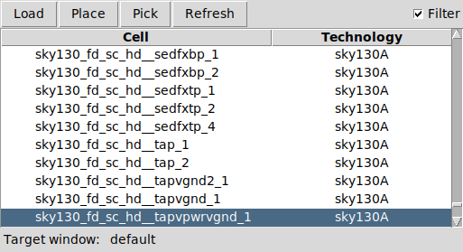

   *The Library Manager with the tap cell selected in the `sky130_fd_sc_hd` folder. `Place`
   puts it at the box.*

   Once the DRC Manager has been open in a session, as it was in Part 1, opening the Library
   Manager also moves the box onto your whole block. That's why you set the box only now.

4. Place the taps. Zoom in on the left end of the row (at the full-row view, y = 0 can't be
   clicked), left-click where the left tap's lower-left corner goes, and click `Place` in the
   Library Manager. Magic puts the cell's lower-left corner on the box's lower-left corner, names
   the instance `sky130_fd_sc_hd__tapvpwrvgnd_1_0`, and draws the box round it. Do the same at the
   row's right-hand end. If the layout window covers the Library Manager's buttons, click the
   manager's title bar to bring it forward.

5. Close the Library Manager. Switch to the full rule set, `Drc → DRC Complete`, and
   `Drc → DRC update`. You should see `DRC=0`.

   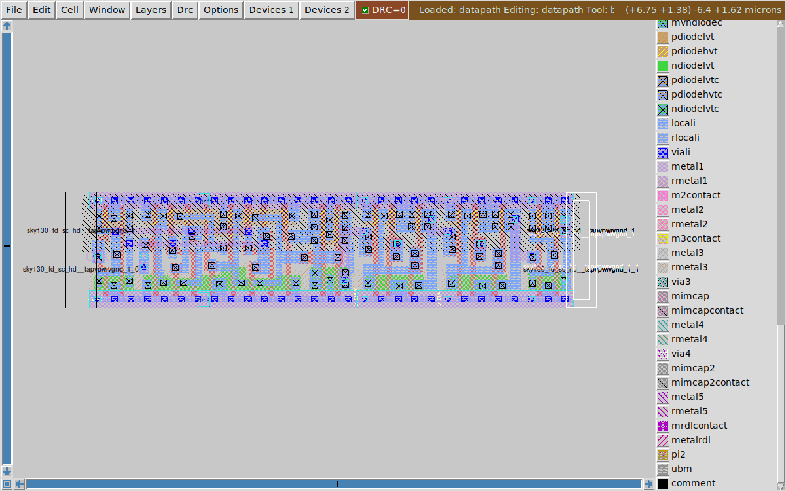

   *The row with a tap at each end. New instances are drawn as outlines; the button reads
   `DRC=0` under `DRC Complete`.*

6. Before you extract again, predict what the body terminals on the `Xbuf0` line will be now.
   Then extract (the same three lines in tkcon) and run the `grep` again. The same line now
   reads:

   ```spice
   Xbuf0 buf0/A VGND VGND VPWR VPWR Y sky130_fd_sc_hd__buf_1
   ```

7. Run LVS yourself, in the terminal in `mag/`:

   ```bash
   netgen -batch lvs "datapath.spice datapath" "../spice/datapath_sch.spice datapath" \
     $PDK_ROOT/sky130A/libs.tech/netgen/sky130A_setup.tcl
   ```

   The first argument is your extracted netlist and its top cell, the second is the schematic
   you were given and its top cell, and the third is the sky130 setup file. netgen writes its
   report to `comp.out`. Run `tail -3 comp.out` and look for:

   ```
   Final result: Circuits match uniquely.
   ```

8. Save (`skip` for the library cells, `write` for `datapath`) and run `make layout`.

**You should see** `DRC=0` under `DRC Complete` in Magic, `Circuits match uniquely.` from netgen,
and from `make layout` 0 under both rule sets and `match` in LVS.

## Part 6: Time it

How fast can you clock what you built?

1. Run the full check:

   ```bash
   make
   ```

   For the reference block it prints:

   ```
     YOUR BLOCK

         outline                14.64 x 3.20 um   =  46.85 um2
         cells placed           2 x and2_0, 1 x buf_1, 1 x dfxtp_1
         cells in the row       and2_0, buf_1, dfxtp_1, tapvpwrvgnd_1
         ports                  CLK D A B Y VGND VPWR
         DRC, default rule set  0
         DRC, full rule set     0
         LVS                    match

     HOW FAST CAN YOU CLOCK IT

         CLK rise -> Y rise        536.17 ps    (measured on your extracted layout)
         D setup at the flop       103.32 ps    (sky130_fd_sc_hd__tt_025C_1v80.lib)
         shortest legal period     639.49 ps
         f_max                    1563.75 MHz
   ```

   Your routing differs from the reference's, so your delay and `f_max` will differ in the last
   digits.

2. Match the lines to the timing rule:

   $$T_{\text{clk}} \ge t_{\text{clk}\rightarrow Q} + t_{\text{logic}} + t_{\text{setup}}$$

   The first two terms are simulated on your own geometry, with every parasitic capacitance
   Magic could find. The third is looked up in `sky130_fd_sc_hd__tt_025C_1v80.lib`, because setup
   time is a property of the flip-flop's internals and you can't get it from your layout. As
   [What sets the clock frequency](../guide/why-the-clock-cannot-go-faster.md#a-real-path)
   points out, that is the same Liberty file the digital track synthesises against in
   [DD103](https://uoftasic.com/dd103/).

3. Divide your `CLK rise -> Y rise` by the foundry cell's `one stage` delay from Lab 05 (32.8 ps
   on that page), and write down how many inverter delays it is. Why do four gates add up to
   that many?

   <details>
   <summary>Answer</summary>

   With the numbers on these pages, 536 ps is 16 inverter delays. Most of it is the flip-flop's
   clock-to-Q, and the `and2_0` cells you were given are the weakest AND in the library.
   Swapping in `and2_2` would win back some of that time, at the cost of more area.

   </details>

**You should see** an `f_max` printed. The reference block gives 1563.75 MHz.

## Part 7: Write the GDS

What do you hand to a foundry, and what is in it?

1. Write the file a foundry would accept: in Magic, `File → Write GDS`. In the `Save As` dialog,
   type `datapath.gds` in `File name:` and press Return. The dialog opens in the folder Magic
   started in, so the file lands in `mag/`.

   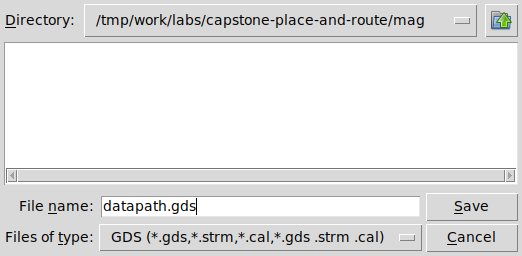

   *`File → Write GDS` asks for a file name and writes the whole hierarchy into it.*

   The console prints a `Copying output for cell ...` line for each library cell and then
   `Generating output for cell datapath`. The reference block's GDS, written the same way, is
   **25,778 bytes**; yours will be within a few hundred bytes of that. Everything before this
   step (the `.mag` files, DRC, LVS, the extracted netlist) was for convincing yourself that the
   layout is right, and GDSII is the file you would actually hand over.

2. Look at it in KLayout, from the terminal in `mag/`:

   ```bash
   klayout -nn $PDK_ROOT/sky130A/libs.tech/klayout/tech/sky130A.lyt datapath.gds &
   ```

   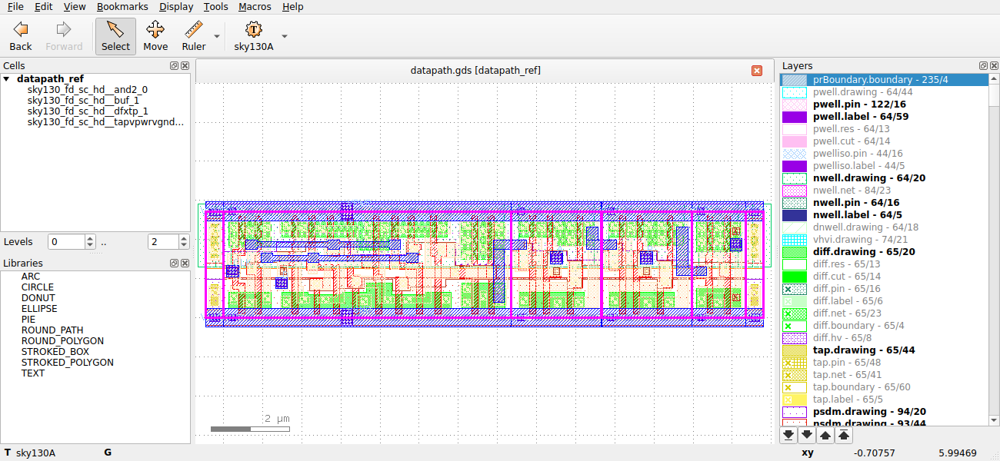

3. In the cell tree, notice that the library cells are still separate cells, because the GDS is
   hierarchical. Magic didn't regenerate their geometry, either. It copied the bytes from the
   foundry's own GDS file, which is what the `Copying output` lines say, and what the `GDS_START`
   and `GDS_END` properties in their `.mag` files are for.

**You should see** `datapath.gds` in `mag/`, and the library cells listed separately in KLayout's
cell tree.

## Finishing

You're done when `make` on your own routed block reports 0 under both rule sets, `match` in LVS
and an `f_max`, and you have written `mag/datapath.gds` with `File → Write GDS`.

Questions:

- Why did the default rule set report 0 while the full one found 32 violations?

  <details>
  <summary>Answer</summary>

  All 32 break the three well-tap rules (`nwell.4`, `LU.2`, `LU.3`), and the default rule set
  leaves those rules out; only `drc(full)` checks them
  ([The full DRC rule set](../guide/the-rule-set-you-are-not-running.md)). The cells are drawn
  without taps on purpose, so the row needed tap cells, which you added in Part 5.

  </details>

- Name three reasons a real chip runs at a fraction of your 1.56 GHz.

  <details>
  <summary>Answer</summary>

  Any three of: logic depth (a real critical path is twenty to forty levels, not four), wires
  (delay grows roughly with the square of length, and real nets are hundreds of microns to
  millimetres long), clock skew and jitter, and margin (sign-off is at the slow-slow corner,
  125 °C and low supply, where everything is 30–50 % worse).
  [What sets the clock frequency](../guide/why-the-clock-cannot-go-faster.md#why-a-real-chip-runs-at-200-mhz)
  works through each one.

  </details>

Submit: nothing for this lab.

## Going further (optional)

`make ref` and `make refcheck` build and check the reference block. `tcl/route_ref.tcl` routes it
with a comment on every coordinate; the package's
[`solutions/README.md`](https://github.com/uoftasic/ad104-m/tree/main/labs/capstone-place-and-route/solutions)
discusses five of the decisions in it. They're worth reading once your own block passes.

You have now done by hand, for four cells, what [DD103](https://uoftasic.com/dd103/) does with
LibreLane for a whole design in about a minute: place cells in rows, insert taps, route, check
DRC, check LVS, and write GDS. The tool repeats the same steps a hundred thousand times, guided
by a cost function, and it never forgets the taps.

Next on the Course path: this is the last lab in AD104. The home page lists the
[next courses](../index.md#next-courses).
