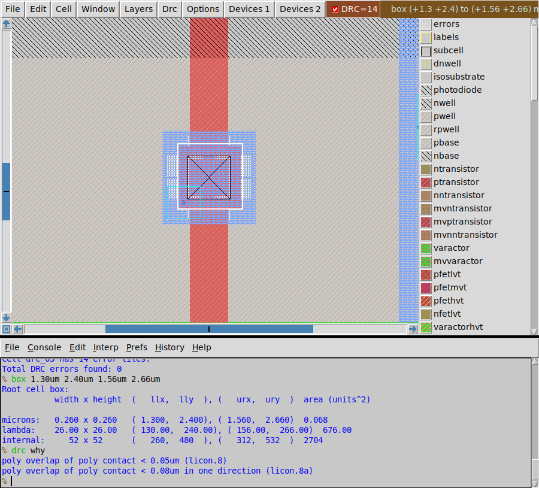

# Lab 02 — Break it on purpose

You'll fix five copies of the same inverter. Each has exactly one number changed, and each change
breaks exactly one real SKY130 design rule. You haven't drawn anything yet, and that is
deliberate: the best time to read your first DRC errors is on a layout you have no attachment to.

Package: [`labs/lab-02-break-it-on-purpose/`](https://github.com/uoftasic/ad104/tree/main/labs/lab-02-break-it-on-purpose)

## Before you start

- Finish [Lab 01](labs/lab-01-open-the-cell-overview.md), so the workbench is set up.
- Read [Drawing in Magic](guide/drawing-in-magic.md),
  [Reading DRC errors](guide/drc-is-a-conversation.md) and
  [The full DRC rule set](guide/the-rule-set-you-are-not-running.md).
- Keep the [DRC error decoder](reference/drc-error-decoder.md) open in another tab.

**Time:** about 2 hours. Each `make` takes about 4 seconds (3.97 s and 4.40 s on two timed clean
runs).

## Part 1: Run the checker on all five cells

1. Go into the lab package and run it:

   ```bash
   cd labs/lab-02-break-it-on-purpose
   make
   ```

   As shipped, it prints:

   ```
     FIVE CELLS, FIVE MISTAKES

     cell      DRC default  DRC full   LVS
     -------------------------------   ------------------------
        drc_01           3         3   match
        drc_02           2         2   match
        drc_03          14        14   match
        drc_04           2         2   match
        drc_05           0         1   Netlists do not match

     drc_01 still breaks:
         N-well overlap of P-Diffusion < 0.18um (diff/tap.8)
     drc_02 still breaks:
         Local interconnect overlap of poly contact < 0.08um in one direction (li.5)
     drc_03 still breaks:
         poly overlap of poly contact < 0.08um in one direction (licon.8a)
         poly overlap of poly contact < 0.05um (licon.8)
     drc_04 still breaks:
         Local interconnect spacing < 0.17um (li.3)
     drc_05 still breaks:
         All nwells must contain metal-connected N+ taps (nwell.4)
         P-diff distance to N-tap must be < 15.0um (LU.3)

   FAIL  Still to fix: drc_01, drc_02, drc_03, drc_04, drc_05
   ```

2. Before you touch anything, look at two rows that behave differently from the other three:

   - **`drc_03` has 14 violations from one mistake.** A single contact that is 0.01 µm short of
     its enclosure produces fourteen error tiles, because Magic reports each edge of the
     offending region separately. **The violation count is not the number of mistakes.** Fourteen
     errors can mean one number to change.
   - **`drc_05` is clean under the default rule set and wrong anyway.** It has zero violations,
     and netgen says the netlists do not match. You'll come back to it in Part 4.

**You should see** `FAIL` and all five cells listed under "Still to fix".

## Part 2: Read one violation in Magic

Work through `drc_03` once with these steps; Parts 3 and 4 repeat them for the other cells.

1. Print every violation in cell 3 with its rule name:

   ```bash
   make why C=3
   ```

   ```
   drc_03 FAST 14
   drc_03 FULL 14
   drc_03 WHY poly overlap of poly contact < 0.08um in one direction (licon.8a)
   drc_03 WHY poly overlap of poly contact < 0.05um (licon.8)
   ```

2. Open the cell in Magic:

   ```bash
   make edit C=3
   ```

   Magic opens with a green `☑ DRC` in the toolbar and **no white hatching anywhere**, on a cell
   with fourteen violations. The cell is not clean: Magic's background checker only re-checks
   tiles you have *edited*, and loading a file from disk edits nothing, so it has not looked yet.

3. Ask it to look. In the `tkcon` console:

   ```tcl
   drc check
   ```

   (`Drc → DRC update` on the menu bar does the same with the mouse.) The toolbar turns red with a
   count, and white hatching appears.

4. Put the cursor box over one of the white hatched areas (left-click one corner, right-click the
   other) and type:

   ```tcl
   drc why
   ```

   

   *Cell `drc_03`. `DRC=14` in the toolbar, white hatching around the poly contact, and `drc why`
   naming the rule twice, once plainly and once in its "in one direction" form.*

5. Look up `licon.8` in the [DRC error decoder](reference/drc-error-decoder.md) and work out what
   it protects.

**You should see** `DRC=14` in the toolbar after `drc check`, and `drc why` naming `licon.8` and
`licon.8a`.

## Part 3: Fix the first four cells

For each of `C=1` to `C=4`:

1. Run `make why C=<n>` to get the rule names.
2. Run `make edit C=<n>`, then `drc check` in the console.
3. Put the box over a hatched area and run `drc why`.
4. Look the rule up in the [DRC error decoder](reference/drc-error-decoder.md), work out what it
   protects, and change the geometry to satisfy it with a comfortable margin. Fix by rule; don't
   nudge shapes until the hatching disappears.
5. Type `save` in the console, then run `make` in the terminal again.

Two of the five use the phrase "in one direction". It means: pick an axis, x or y, and on that
axis the outer layer must extend past the inner one by at least the rule's amount **on both
sides**. That is why the fix is often free: you only need one axis to be generous.
[Reading DRC errors](guide/drc-is-a-conversation.md#in-one-direction) explains it with examples.

If you get stuck, read only the row for the cell you are stuck on. Don't read this table before
you have tried.

| Cell | Rule | Category | The idea |
|---|---|---|---|
| `drc_01` | `diff/tap.8` | enclosure | An implant mask has to extend past what it is implanting, because two masks never align perfectly. |
| `drc_02` | `li.5` | enclosure | A wire has to overhang the contact under it. Paint the wire first, bigger, and put the contact inside it. |
| `drc_03` | `licon.8` / `licon.8a` | enclosure | A 0.15 µm poly stripe cannot hold a 0.17 µm contact. Gates get a landing pad. |
| `drc_04` | `li.3` | spacing | Two wires on different nets, too close. |
| `drc_05` | `nwell.4`, `LU.3` | context | **Invisible to the default rule set.** |

[`solutions/README.md`](https://github.com/uoftasic/ad104/tree/main/labs/lab-02-break-it-on-purpose/solutions)
in the package explains how to get unstuck without reading the answer.

**You should see** `drc_01` to `drc_04` at `0` in both DRC columns, still `match` in LVS.

## Part 4: Fix drc_05

`drc_05` has been reported clean by the default checker since your first run, and it is wrong.
Look at how the tools report it before you fix it.

1. Two independent tools notice the problem, and neither uses the word "tap". The full rule set
   says:

   ```
   All nwells must contain metal-connected N+ taps (nwell.4)
   P-diff distance to N-tap must be < 15.0um (LU.3)
   ```

2. Netgen reports a mismatch. Open `results/drc_05.lvs.spice` and find the PMOS line:

   ```spice
   X1 Y A VPWR w_0_600# sky130_fd_pr__pfet_01v8_hvt w=1 l=0.15
   ```

   `w_0_600#` is the PMOS body. It is on an invented node instead of on VPWR, because the n-well
   tap has no contact on it and nothing ties the well to VPWR.

3. Fix it with the same loop as Part 3 (`make why C=5`, `make edit C=5`, `drc check`,
   `drc why`), then `save` and run `make`. In Magic, type `drc style drc(full)` before
   `drc check`: under the default rule set this cell has no violations, so there is nothing for
   `drc why` to name.

Answer for yourself: if you had only run the default rule set, what would have told you about
this cell? The habit to keep is one line: **before you believe a DRC count of zero, run
`drc style drc(full)`.** Every lab in this course runs both rule sets and shows you both counts.
Tools outside this course will not.

**You should see** `drc_05` at `0` under both rule sets and `match` in LVS, and `make` ending in
`PASS`.

## Part 5: Erase instead of fix

You can take every one of these cells to zero violations by deleting the shape that broke the
rule. Try it once, on `drc_04`.

1. Run `make edit C=4`, erase the `A` pad, `save`, and run `make`. The li spacing error is gone,
   and `make` says:

   ```
     Note: drc_04 is clean and no longer an inverter.
     Erasing the shape that broke the rule is not a fix. Move it, resize it,
     or add the thing it needed - the circuit has to survive.
   ```

2. Put the pad back the way you had fixed it (`u` in the layout window undoes the erase, or
   repaint it), `save`, and run `make` again.

This is why the lab runs LVS on all five cells as well as DRC. A layout has two jobs, and
satisfying one at the expense of the other is not progress.

**You should see** the note in step 1, and `drc_04` back to `match` after step 2.

## Finishing

You are done when:

- [ ] all five cells are at 0 violations under **both** rule sets
- [ ] all five still `match` in LVS
- [ ] `make` ends in `PASS`
- [ ] you can say, without looking, what "in one direction" means

To start again or check your answers:

```bash
make reset        # throw your fixes away and rebuild the five broken cells
make solutions    # write the answer key into solutions/
```

`tcl/make_broken.tcl` generates the broken cells and has one `BREAK` comment for each change, so
it is the answer key too. Read it after you finish, not before.
