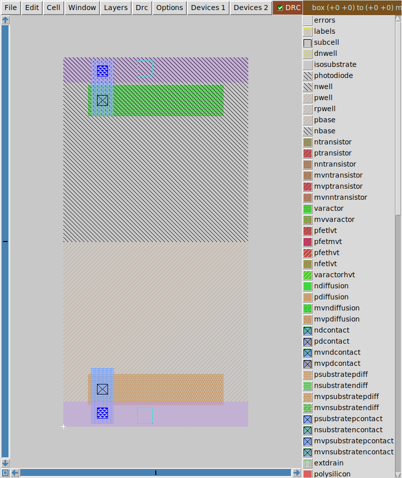
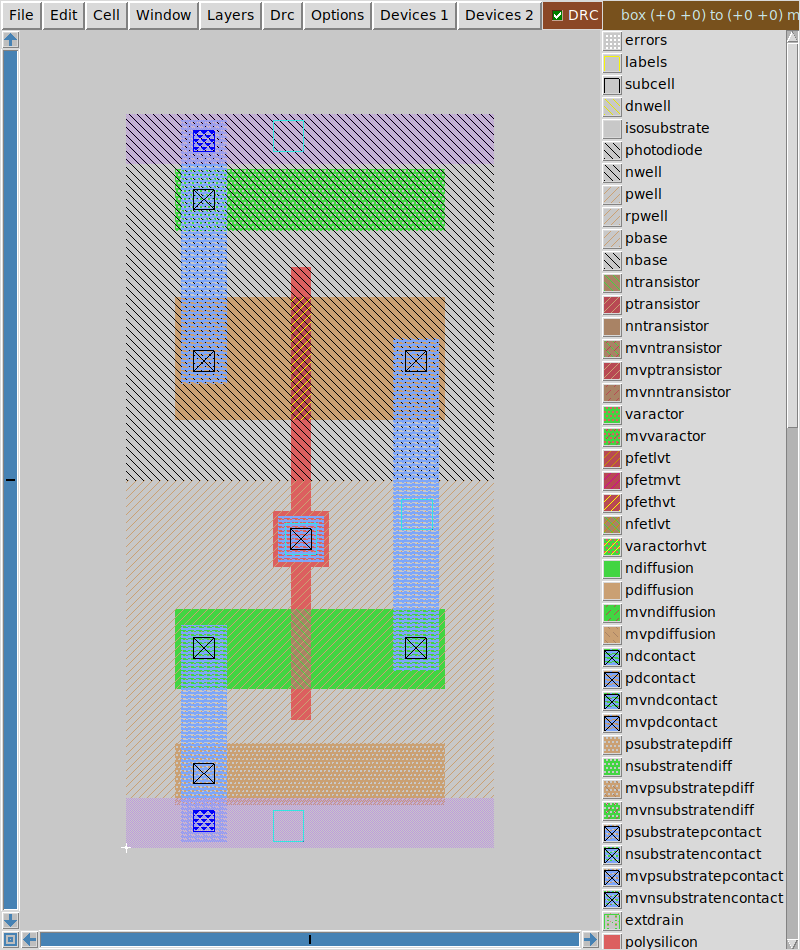

# Lab 03: Draw an inverter

AD103's capstone was a CMOS inverter you could simulate. In this lab you draw the same circuit
as geometry: two transistors and one shared gate, DRC clean under both rule sets, and proved by
netgen to be the circuit you meant.

Package: [`labs/lab-03-draw-an-inverter/`](https://github.com/uoftasic/ad104/tree/main/labs/lab-03-draw-an-inverter)

## Before you start

- Finish [Lab 02](../labs/lab-02-break-it-on-purpose-overview.md).
- Read [Stick diagrams](../guide/stick-diagrams.md), [Extraction](../guide/extraction-is-reverse-engineering.md)
  and [Layout versus schematic (LVS)](../guide/lvs-asks-a-different-question.md). You'll use
  [Drawing in Magic](../guide/drawing-in-magic.md) constantly.
- Have paper and a pen for Part 1.

**Time:** about 3 hours. Each `make` takes about 1.1 s.

**The sizes:** Wn = 0.65 µm, Wp = 1.00 µm, L = 0.15 µm. These are exactly
`sky130_fd_sc_hd__inv_1`'s numbers, which you read in Lab 01. In
[Lab 05](../labs/lab-05-what-it-costs-overview.md) you put your cell next to the foundry's and
measure the difference, and keeping the transistors identical means **the only thing left to
compare is the drawing**. L = 0.15 µm is the SKY130 minimum (`poly.1a`). Your cell will still be
nearly five times the foundry's area, because area depends on packing, not on $L$.

## Part 1: Sketch it on paper

What goes where, before any dimensions?

1. Draw the inverter stick diagram from [Stick diagrams](../guide/stick-diagrams.md) **from memory**,
   not copied: PMOS above, NMOS below, one vertical poly stripe crossing both.
2. Mark **where the two well taps go** and which rail each one connects to. They are not in the
   guide page's sketch. Leaving them out is the most common bug in a first layout, and drawing
   them by hand once is cheap insurance.
3. Decide which side of the cell the input is on and which side the output is on, and why.
   Part 6 shows where this lab's reference cell puts them.

This takes about ninety seconds.

**You should see** a sketch with both taps marked, the output on one side and the input on the
gate.

## Part 2: Start from the frame

What does the frame already give you, and what is missing?

1. Go into the lab package and lay down the frame:

   ```bash
   cd labs/lab-03-draw-an-inverter
   make scaffold
   ```

   `make scaffold` **throws away whatever is in `mag/my_inv.mag`** and starts again from the
   frame. Use it now, and later only when you want to start over.

2. Open the cell in Magic:

   ```bash
   make edit
   ```

   

   *Everything except the transistors. The n-well is the grey hatch across the top half and the
   p-substrate the orange hatch below it. The green strip is the n-well tap and the brown one the
   substrate tap, each with a contact and a short li run up to a purple metal1 rail. The middle is
   yours.*

   The frame already contains:

   - the n-well (y = 3.00 to 6.00) and the p-well below it
   - the two metal1 supply rails, with `VGND` and `VPWR` already labelled
   - both **well taps**, contacted, with li up to the rails through `mcon`

   Compare that with your sketch: the taps you marked are already drawn, so the tap problem from
   Lab 02 is handled. What is missing is the middle of the cell.

3. Run the checker:

   ```bash
   make
   ```

   ```
     WHAT MAGIC FOUND IN my_inv.mag

         transistors            0   (0 n, 0 p)

         ports                  VGND VPWR

         DRC, default rule set  0
         DRC, full rule set     0

         LVS                    Top level cell failed pin matching.

   FAIL  No transistors at all. A transistor is the place where a poly stripe
         crosses a diffusion. If Magic sees no crossing, either the poly does
         not overlap the diffusion, or one of them is not the layer you think
         it is - check the layer name in the title bar as you paint.
         ...
   ```

   Every failure in this lab is reported like that, in words, naming the layer or the rule. Fix
   one thing and run `make` again.

**You should see** `FAIL` with "No transistors at all".

## Part 3: Draw the two diffusions

How big is each diffusion, and is a diffusion on its own a transistor?

1. In the `tkcon` console (or by painting with the mouse):

   ```tcl
   box 0.40um 1.30um 2.60um 1.95um
   paint ndiff                        ;# 0.65 um tall. The height IS W.

   box 0.40um 3.50um 2.60um 4.50um
   paint pdiff                        ;# 1.00 um tall, inside the nwell
   ```

   The n-well starts at y = 3.00, so the PMOS diffusion clears its edge by 0.50 µm, comfortably
   more than the 0.18 µm that `diff/tap.8` needs.

2. Save:

   ```tcl
   save my_inv
   ```

   `make` reads `mag/my_inv.mag` from disk. Painting in Magic changes what is on your screen, not
   what is in that file, so until you `save`, every `make` reports on the last version you saved,
   and nothing tells you why the output did not change. **Save before every `make`** from here
   on.

3. Before you run `make`, predict how many transistors it will find.

   <details>
   <summary>Answer</summary>

   None. A diffusion on its own is not a transistor: a transistor is where a poly stripe crosses
   a diffusion, and there is no poly yet.

   </details>

4. Run `make` in the terminal.

**You should see** still `transistors 0`.

## Part 4: Draw the gate

Where does the stripe go, and what sets W and L?

1. Paint the poly stripe:

   ```tcl
   box 1.35um 1.05um 1.50um 4.75um
   paint poly
   ```

   It is **0.15 µm wide, and that width is L.** It runs from below the NMOS diffusion to above the
   PMOS one, overhanging each by 0.25 µm, because a gate that stops inside the diffusion leaves a
   leakage path round its end (`poly.8`).

2. `save my_inv`, then run `make`.

**You should see** two transistors with the right W and L, and DRC still at zero under both rule
sets:

```
      transistors            2   (1 n, 1 p)
        X0   sky130_fd_pr__nfet_01v8          W=0.65  L=0.15
        X1   sky130_fd_pr__pfet_01v8          W=1  L=0.15
```

The checker also complains that `X1` is `pfet_01v8`, not `pfet_01v8_hvt`. Leave that for now;
Part 8 fixes it.

## Part 5: Add the contacts

What do the contacts need around them?

1. Paint four contacts, each **exactly 0.17 × 0.17 µm**:

   ```tcl
   box 0.55um 1.55um 0.72um 1.72um ; paint ndc     ;# NMOS source
   box 2.28um 1.55um 2.45um 1.72um ; paint ndc     ;# NMOS drain
   box 0.55um 3.90um 0.72um 4.07um ; paint pdc     ;# PMOS source
   box 2.28um 3.90um 2.45um 4.07um ; paint pdc     ;# PMOS drain
   ```

2. The gate needs a contact too, and it cannot go on the 0.15 µm stripe: `licon.8` wants 0.05 µm
   of poly around a 0.17 µm cut, which needs 0.27 µm of stripe. Draw a landing pad in the gap
   between the diffusions and put the contact on it:

   ```tcl
   box 1.20um 2.30um 1.65um 2.75um ; paint poly
   box 1.34um 2.44um 1.51um 2.61um ; paint pc
   ```

3. `save my_inv`. Before you run `make`, predict whether the DRC count goes up or stays at zero.

4. Run `make`.

**You should see** DRC jump to 35 under both rule sets, from three rules:

```
      rules broken:
        Local interconnect overlap of poly contact < 0.08um in one direction (li.5)
        Local interconnect overlap of diffusion contact < 0.08um in one direction (li.5)
        Local interconnect minimum area < 0.0561um^2 (li.6)
```

Why did five correctly sized contacts break two li rules?

<details>
<summary>Answer</summary>

Each contact brought its own li, exactly the size of the cut, and li has to overhang a contact
(`li.5`). A 0.17 µm square of li is also smaller than li's minimum area of 0.0561 µm² (`li.6`).

</details>

Part 6 fixes all 35 at once.

## Part 6: Wire it in li

Which contacts join which, and how wide does the li have to be?

1. Paint four li runs. Each has to overhang its contacts by 0.08 µm **on both sides of one axis**
   (`li.5`), which is what the 0.37 µm width is for:

   ```tcl
   box 0.45um 0.05um 0.82um 1.82um ; paint li    ;# VGND: tap -> NMOS source
   box 2.18um 1.45um 2.55um 4.17um ; paint li    ;# Y: NMOS drain -> PMOS drain
   box 0.45um 3.80um 0.82um 5.95um ; paint li    ;# VPWR: PMOS source -> tap
   box 1.24um 2.34um 1.61um 2.71um ; paint li    ;# A: the gate
   ```

2. `save my_inv`, then run `make`.

**You should see** DRC back to 0 under both rule sets, and LVS reporting
`Top level cell failed pin matching`: the circuit is there, but `A` and `Y` have no names yet.

## Part 7: Name the pins

How does netgen know which shape is `A` and which is `Y`?

1. Label the input and output, turn the labels into ports, and save:

   ```tcl
   box 1.30um 2.40um 1.55um 2.65um ; label A c li
   box 2.25um 2.60um 2.50um 2.85um ; label Y c li
   select top cell
   port makeall
   save my_inv
   ```

2. Run `make`.

**You should see** four ports, `VGND VPWR A Y`, and two transistors. LVS still says
`Netlists do not match`, for the reason in Part 8.

## Part 8: Fix the PMOS flavour

Why does LVS still fail when DRC is clean and every pin has a name?

1. Read the device lines in the `make` output again:

   ```
           X1   sky130_fd_pr__pfet_01v8          W=1  L=0.15
   ```

   `pfet_01v8`, not `pfet_01v8_hvt`: **you have built the wrong transistor.** The foundry's PMOS
   is the high-threshold flavour, and which one you get is decided by an implant mask that
   nothing in your drawing so far mentions. Why did DRC never complain?

   <details>
   <summary>Answer</summary>

   Both are legal devices, so DRC has no opinion. Only LVS, which compares your devices with the
   schematic's, catches it, which is the case for always running LVS.

   </details>

2. Paint the implant over the PMOS gate region and save:

   ```tcl
   box 1.35um 3.50um 1.50um 4.50um
   paint pfethvt
   save my_inv
   ```

3. Run `make`.

**You should see** `PASS`:

```
  WHAT MAGIC FOUND IN my_inv.mag

      transistors            2   (1 n, 1 p)
        X0   sky130_fd_pr__nfet_01v8          W=0.65  L=0.15
        X1   sky130_fd_pr__pfet_01v8_hvt      W=1  L=0.15

      ports                  VGND VPWR A Y

      DRC, default rule set  0
      DRC, full rule set     0

      LVS                    Circuits match uniquely.

PASS  Two transistors, the right flavours, the right W and L, four ports,
      zero DRC violations under both rule sets, and netgen agrees your
      geometry is the schematic.
```



## Part 9: Read what you drew

Where in your geometry do `w=0.65` and `w=1` come from?

1. Print the netlist Magic extracted from your geometry:

   ```bash
   make netlist
   ```

   ```spice
   .subckt my_inv VGND VPWR A Y
   X0 Y A VGND VGND sky130_fd_pr__nfet_01v8 ad=0.715 pd=3.5 as=0.6175 ps=3.2 w=0.65 l=0.15
   X1 Y A VPWR VPWR sky130_fd_pr__pfet_01v8_hvt ad=1.1 pd=4.2 as=0.95 ps=3.9 w=1 l=0.15
   .ends
   ```

   [Extraction](../guide/extraction-is-reverse-engineering.md#reading-the-netlist) explains every
   field. Your port order depends on the order you created the labels, so it may differ from the
   reference's.

2. Open `mag/my_inv.mag` in a text editor and find the `<< ndiff >>` section. The file has no
   `magscale` line, so one unit is 0.01 µm, and the section's `rect` lines together span `40 130`
   to `260 195`: your 0.40 → 2.60 by 1.30 → 1.95 µm n-diffusion, split into tiles.
   [Drawing in Magic](../guide/drawing-in-magic.md#the-mag-file) explains the units.

**You should see** `w=0.65` and `w=1`, both at `l=0.15`, and you should be able to point at the
rectangle whose height is `w=0.65`.

## Finishing

You're done when `make` ends in `PASS` on your own `mag/my_inv.mag`, and `make netlist` shows
two devices, `w=0.65` and `w=1`, both at `l=0.15`.

Questions:

- Which rectangle's height is `w=0.65`? Part 9, step 2 answers it.
- Why did your cell need LVS, as well as DRC, to show that it was the wrong circuit? Part 8
  answers it.

Submit: nothing for this lab.

## Going further (optional)

After yours passes, compare it with the reference:

- `make refcheck` runs every check on the reference cell instead of yours.
- `tcl/inverter.tcl` draws the reference cell command by command, with a comment on every line
  saying which rule set the number. It did not come out right first time either; the package's
  [`solutions/README.md`](https://github.com/uoftasic/ad104/tree/main/labs/lab-03-draw-an-inverter/solutions)
  shows the 62 violations its first version had.

Next on the Course path: read [Instances and hierarchy](../guide/cells-are-lego.md), then do
[Lab 04: A buffer and an AND gate](../labs/lab-04-buffer-and-and-overview.md).
