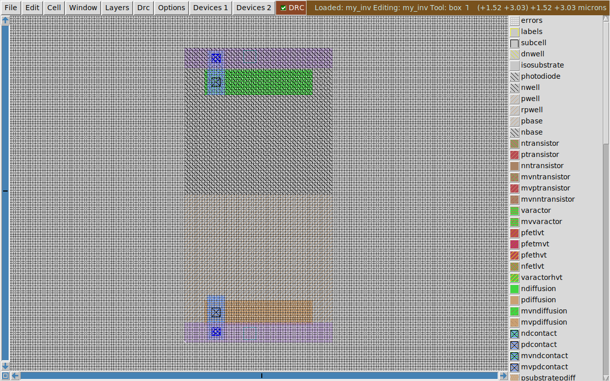
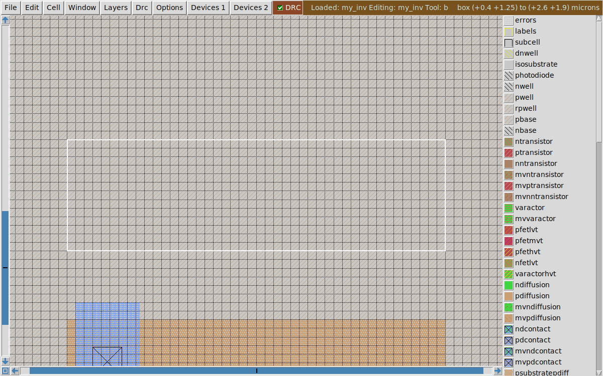
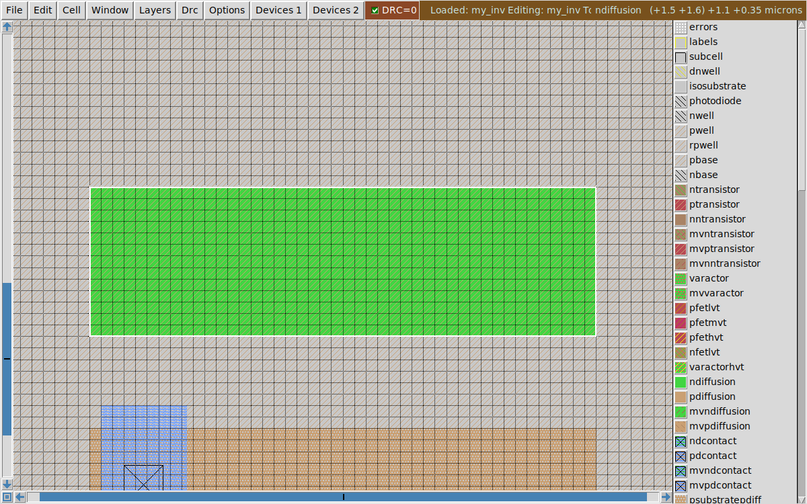
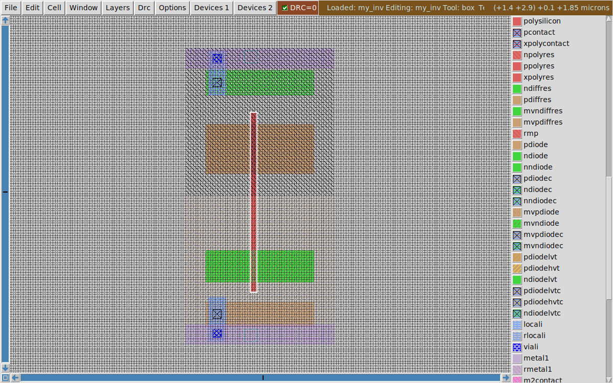
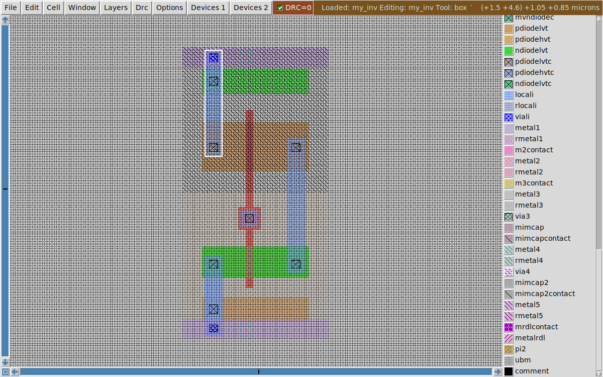

# Lab 03: Draw an inverter

AD103's capstone was a CMOS inverter that you could simulate. In this lab you draw the same
circuit as geometry in Magic, with the mouse and the layer palette: two transistors sharing one
gate, clean under both DRC rule sets, and checked by netgen to be the circuit you meant.

Package: [`labs/lab-03-draw-an-inverter/`](https://github.com/uoftasic/ad104/tree/main/labs/lab-03-draw-an-inverter)

## Before you start

- Finish [Lab 02](../labs/lab-02-break-it-on-purpose-overview.md). This lab uses its two ways
  of drawing an exact shape, the **click recipe** and the **typed size**, and doesn't explain
  them again.
- Read [Stick diagrams](../guide/stick-diagrams.md), [Extraction](../guide/extraction-is-reverse-engineering.md)
  and [Layout versus schematic (LVS)](../guide/lvs-asks-a-different-question.md). You'll use
  [Drawing in Magic](../guide/drawing-in-magic.md) constantly.
- Have paper and a pen for Part 1.

**Time:** about 3.5 hours, an estimate. Each `make` takes about a second.

**The sizes:** Wn = 0.65 µm, Wp = 1.00 µm, L = 0.15 µm. These are exactly the
numbers in `sky130_fd_sc_hd__inv_1`, which you read in Lab 01. In
[Lab 05](../labs/lab-05-what-it-costs-overview.md) you put the inverter next to the foundry's and
measure the difference, and because the transistors are identical, the only thing left to
compare is the way each cell is drawn. L = 0.15 µm is the SKY130 minimum (`poly.1a`), but your
cell will still be nearly five times the foundry's area, because area depends on how tightly the
shapes are packed rather than on $L$.

**Coordinates:** you choose them. Each drawing part has a table of what its shapes must
achieve: a size, the rules they must meet, and where they sit relative to shapes already on the
screen. Because you choose the corners, your cell won't match anyone else's exactly, so the
checks on this page show verdicts, device lines and rule names rather than error counts.

## Part 1: Sketch it on paper

What goes where, before any dimensions?

1. Draw the inverter stick diagram from [Stick diagrams](../guide/stick-diagrams.md) **from memory**,
   not copied: PMOS above, NMOS below, one vertical poly stripe crossing both.
2. Mark **where the two well taps go** and which rail each one connects to. The guide page's
   sketch leaves them out, and leaving them out is also the most common bug in a first layout,
   so drawing them by hand once is cheap insurance.
3. Decide which side of the cell the input is on and which side the output is on, and why.
   Part 6 shows where this lab's cell puts them.

The whole sketch takes about ninety seconds.

**You should see** a sketch with both taps marked, the output on one side and the input on the
gate.

## Part 2: Start from the frame

What does the frame already give you, and what is missing?

1. Go into the lab package and lay down the frame:

   ```bash
   cd labs/lab-03-draw-an-inverter
   make scaffold
   ```

   `make scaffold` **throws away whatever is in `mag/my_inv.mag`** and starts again from the
   frame, so use it now, and after this only when you want to start over.

2. Open the cell in Magic from the folder that holds it, then come back to the lab folder:

   ```bash
   cd mag
   magic -d X11 my_inv &
   cd ..
   ```

   Magic keeps `mag/` as its own folder, so the files it writes later in this lab (the
   extraction) land next to `my_inv.mag`. Your terminal is back in the lab folder, which is where
   `make` runs.

   

   *The frame has everything except the transistors. The n-well is the grey hatch across the top
   half, and the p-substrate is the orange hatch below it. The green strip is the n-well tap and
   the brown one is the substrate tap, each with a contact and a short li run up to a purple
   metal1 rail. The middle of the cell is left for you to draw.*

   The frame already contains:

   - the n-well (y = 3.00 to 6.00) and the p-well below it
   - the two metal1 supply rails, with `VGND` and `VPWR` already labelled
   - both **well taps**, contacted, with li up to the rails through `mcon`

   Compare that with your sketch. The taps you marked are already drawn, so the frame takes care
   of the tap problem from Lab 02, and what's missing is the middle of the cell.

3. Put a grid on the drawing: `Window → Set grid 0.05um`. The dots are 0.05 µm apart. Leave
   `Snap-to-grid` alone: clicks still land on 0.01 µm steps, which is what you want.

   {fig-alt="Magic's layout window showing the frame under a dense dot grid: the n-well hatch across the top half, the substrate below, a tap with its contact and li stub near the top and the bottom, and the layer palette down the right side."}

4. Read the frame's numbers off the screen; they are the anchors for the next parts. Move the
   pointer onto the n-well's bottom edge, where the well's hatch meets the substrate's. The
   readout at the right of the title bar starts with the pointer's x and y in microns, and on
   that edge the y reads `+3`. Then zoom in on the p-tap, set the box on its corners with the
   click recipe, and press `b` with the pointer over the drawing. tkcon prints:

   ```
   microns:   2.200 x 0.500   ( 0.400,  0.350), ( 2.600,  0.850)  1.100
   ```

   That's the tap's width and height, then its lower-left and upper-right corners. Measure the
   n-tap at the top of the cell the same way: Part 3 needs its bottom edge.

5. Run the checker in the terminal:

   ```bash
   make
   ```

   ```
     WHAT MAGIC FOUND IN my_inv.mag

         transistors            0   (0 n, 0 p)

         ports                  VGND VPWR

         DRC, default rule set  0
         DRC, full rule set     0

         LVS                    Top level cell failed pin matching.

   FAIL  No transistors at all. A transistor is the place where a poly stripe
         crosses a diffusion. If Magic sees no crossing, either the poly does
         not overlap the diffusion, or one of them is not the layer you think
         it is - check the layer name in the title bar as you paint.
         ...
   ```

   The checker reports every failure in this lab like that, in words, naming the layer or the
   rule involved. Fix one thing at a time, and run `make` again after each fix.

**You should see** `FAIL` with "No transistors at all".

## Part 3: Draw the two diffusions

How big is each diffusion, and is a diffusion on its own a transistor?

The two diffusions have to meet these targets. The rule values come from the
[DRC error decoder](../reference/drc-error-decoder.md); each one was checked by drawing a shape
that breaks it and reading the rule Magic names.

| Shape (palette name) | Must be | Rules it must meet |
|---|---|---|
| n-diffusion (`ndiffusion`) | 0.65 µm tall, because the height is W. Wide enough for a contact, the gate and a second contact: about 2.2 µm | at least 0.27 µm from the p-tap (`diff/tap.3`); at least 0.34 µm below the n-well (`diff/tap.9`) |
| p-diffusion (`pdiffusion`) | 1.00 µm tall, the same width, inside the n-well | the n-well past it by at least 0.18 µm (`diff/tap.8`); at least 0.27 µm from the n-tap (`diff/tap.3`) |

Line both diffusions up with the taps' left and right edges, and put every corner on a grid dot.
You'll click on these corners again in Parts 8 and 9, and a corner on a dot is easy to hit.

1. Zoom on the lower half of the cell: set a rough box around it and press `ctrl+z`.
2. Left-click the n-diffusion's lower-left corner and right-click its upper-right corner. The
   title bar shows the box as you set it; press `b` and check that the `microns:` line in tkcon
   gives a height of `0.650`.

   {fig-alt="Magic zoomed in on the lower half of the frame, with a white rectangle outlining where the n-diffusion will go above the p-tap, and the title bar reading box, then the lower-left and upper-right corners in microns."}

3. Hover over `ndiffusion` in the palette until the title bar names it, then middle-click it.

   {fig-alt="The same view with the white box now filled in solid green, the n-diffusion, and the title bar showing DRC=0 and the word ndiffusion."}

4. Draw the p-diffusion the same way: zoom on the upper half, set the box on its corners, check
   it with `b`, and middle-click `pdiffusion`.
5. Save: `File → Save...`, then `write` in the dialog that opens. `make` reads
   `mag/my_inv.mag` from disk. Painting in Magic changes only what's on your screen, and the file
   stays as it was until you save. Until then, every `make` reports on the last version you
   saved, and neither Magic nor `make` warns you that this is why the output hasn't changed. From
   here on, **save before every `make`**.
6. Before you run `make`, predict how many transistors it will find.

   <details>
   <summary>Answer</summary>

   None. A transistor is the place where a poly stripe crosses a diffusion, and there's no poly
   yet, so a diffusion on its own isn't a transistor.

   </details>

7. Run `make` in the terminal.

**You should see** still `transistors 0`, and the same `FAIL` as in Part 2:

```
      transistors            0   (0 n, 0 p)
```

## Part 4: Draw the gate

Where does the stripe go, and what sets W and L?

| Shape (palette name) | Must be | Rules it must meet |
|---|---|---|
| gate stripe (`polysilicon`) | 0.15 µm wide, because the width is L. One vertical stripe crossing both diffusions, with room on each side of it for a contact | past the edge of each diffusion by at least 0.13 µm (`poly.8`; the reference cell uses 0.25) |

A gate that stops inside the diffusion leaves a leakage path round its end, which is what
`poly.8` guards against.

1. `polysilicon` is below the visible part of the palette. Scroll the palette with the mouse
   wheel until you see it.
2. Zoom in far enough to click a 0.15 µm width, set the box on the stripe's corners, check it
   with `b`, and middle-click `polysilicon`.

   {fig-alt="The whole cell: a thin red vertical stripe runs from below the green n-diffusion near the bottom to above the tan p-diffusion in the n-well, with the box still outlining the stripe in white."}

3. Check it in Magic: `Drc → DRC update`. The DRC button reads `DRC=0`.
4. Save (`File → Save...`, then `write`), and run `make`.

**You should see** two transistors with the right W and L, and DRC still at zero under both rule
sets:

```
      transistors            2   (1 n, 1 p)
        X0   sky130_fd_pr__nfet_01v8          W=0.65  L=0.15
        X1   sky130_fd_pr__pfet_01v8          W=1  L=0.15

      ports                  VGND VPWR

      DRC, default rule set  0
      DRC, full rule set     0

      LVS                    Netlists do not match.
```

The checker also complains that `X1` is a `pfet_01v8` where it expected a `pfet_01v8_hvt`. Leave
that for now; you'll fix it in Part 8.

## Part 5: Add the contacts

What do the contacts need around them?

The frame's li stubs come down on the left, so put the two **source** contacts on the left of
the gate, under the stubs, and the two **drain** contacts on the right.

| Shape (palette name) | Must be | Rules it must meet |
|---|---|---|
| four diffusion contacts (`ndcontact` in the n-diffusion, `pdcontact` in the p-diffusion) | 0.17 × 0.17 µm each (`licon.1`), one on each side of the gate | the diffusion past the contact by at least 0.06 µm on both sides along one axis (`licon.5c`), and by at least 0.04 µm all round (`licon.5a`); at least 0.055 µm from the gate (`licon.11`), which on the 0.01 µm clicks means 0.06 |
| a poly landing pad (`polysilicon`) | joined to the stripe, in the gap between the two diffusions | poly round the gate contact by at least 0.05 µm on every side (`licon.8`) and 0.08 µm on both sides along one axis (`licon.8a`), so at least 0.27 × 0.33 µm |
| the gate contact (`pcontact`) | 0.17 × 0.17 µm, inside the pad | at least 0.19 µm from both diffusions (`licon.14`) |

The gate needs a contact too, but it can't sit on the 0.15 µm stripe. `licon.8` asks for
0.05 µm of poly all round a 0.17 µm cut, and that takes a stripe 0.27 µm wide. That is why the
table has a landing pad of poly in the gap between the diffusions, with the contact on the pad.

1. Use the typed size for the first contact. Zoom in on the NMOS, left-click the contact's
   lower-left corner, click in tkcon and type:

   ```tcl
   box size 0.17um 0.17um
   ```

   Then click the layout window's title bar, press `b` with the pointer over the drawing, and
   check for `0.170 x 0.170`. Middle-click `ndcontact`.

   {fig-alt="Magic zoomed on the NMOS with a small white square on the green n-diffusion left of the red stripe, and tkcon below showing the typed box size command and the microns line 0.170 x 0.170."}

2. The other three diffusion contacts are quicker: a left click moves the box to a new
   lower-left corner and keeps its size, so left-click each corner, check with `b`, and
   middle-click `ndcontact` or `pdcontact`.
3. Draw the pad with the click recipe and middle-click `polysilicon`. Then the gate contact:
   left-click its lower-left corner inside the pad. The box is the pad's size now, so type
   `box size 0.17um 0.17um` again, click the title bar, check with `b` and middle-click
   `pcontact`.
4. Predict whether DRC goes up or stays at zero.
5. Check it in Magic: `Drc → DRC update`, then press `=` to jump to the first error, then
   `Drc → DRC report` to name the rules broken there.

   {fig-alt="Magic zoomed on the p-diffusion with white dotted error hatching round one contact, the DRC button reading a count, and tkcon below listing li.6 and li.5 messages."}

6. Save (`File → Save...`, then `write`), and run `make`.

**You should see** DRC above zero under both rule sets, with these entries under `rules broken`:

```
      rules broken:
        Local interconnect overlap of poly contact < 0.08um in one direction (li.5)
        Local interconnect overlap of diffusion contact < 0.08um in one direction (li.5)
        Local interconnect minimum area < 0.0561um^2 (li.6)
```

Your count depends on your shapes, so it may differ from anyone else's. Why did five correctly sized
contacts break two li rules?

<details>
<summary>Answer</summary>

Each contact came with its own patch of li exactly the size of the cut, but li has to overhang a
contact (`li.5`). That 0.17 µm square of li is also smaller than li's minimum area of
0.0561 µm² (`li.6`).

</details>

In Part 6 you fix them all at once.

## Part 6: Wire it in li

Which contacts join which, and how wide does the li have to be?

| Run (palette `locali`) | Joins |
|---|---|
| VGND | the p-tap's li stub to the NMOS source contact |
| Y | the NMOS drain contact to the PMOS drain contact, on the right of the gate |
| VPWR | the PMOS source contact to the n-tap's li stub |
| A | a patch over the gate contact |

Every run has to cover its contacts with at least 0.08 µm to spare on both sides along one axis
(`li.5`), be at least 0.17 µm wide (`li.1`) and stay at least 0.17 µm from the other runs
(`li.3`). The frame's li stubs are 0.37 µm wide, which leaves 0.10 µm on each side of a contact;
making your runs that wide and lining the outer ones up with the stubs is the simplest way to
meet `li.5`. The A patch has to reach li's minimum area too (`li.6`).

1. For each run, set the box with the click recipe and middle-click `locali`.

   {fig-alt="The whole cell with light-blue li: a run from the bottom tap up to the NMOS's left contact, a run from the PMOS's left contact up to the top tap, a run on the right joining the two right-hand contacts, and a small square patch on the gate contact between the diffusions. The DRC button reads DRC=0."}

2. `Drc → DRC update`. If the button shows a count, find and name each error with `=` and
   `Drc → DRC report`, and fix it. When the default rule set is clean, check the full one:
   `Drc → DRC Complete`, then `Drc → DRC update`. Then switch back with `Drc → DRC Fast`.
3. Save (`File → Save...`, then `write`), and run `make`.

**You should see** DRC back to 0 under both rule sets, and LVS reporting
`Top level cell failed pin matching.`, because the circuit is there but `A` and `Y` don't have
names yet.

## Part 7: Name the pins

How does netgen know which shape is `A` and which is `Y`?

1. Set the box over the A patch, then open `Edit → Text ...`. In the `texthelper` window that
   opens:
   - `Text string:` `A`
   - `Size (um):` `0.1`. The default of 1 µm draws a letter that covers a third of the cell.
   - `Attach to layer:` untick `default`, and type `locali` in the field that appears.
   - `Port:` tick `enable`. The number next to it is the port's number.

   Click `Okay`.

   {fig-alt="Magic zoomed on the gate's poly pad with the li patch and a white box on it, and beside it the texthelper window headed New label, with Text string A, Size 0.1, Attach to layer with default unticked and locali typed in a field, and Port enable ticked with the number 3."}

   Typing the layer keeps the label on the li. With `default` ticked, Magic attaches the label
   to a layer that covers the whole box. On the A patch the gate contact takes the li's place
   in the middle, so a box that touches the contact isn't all li, and the layer left that
   covers it is the p-well, which is the VGND net. The console then prints
   `Moving label "A" from space to pwell` and the VGND net takes the name A, so `make` lists no
   VGND port and reports `mismatched pins: A <-> VGND`.

2. Do the same for `Y`, with the box on the Y run. The window remembers the size, `locali`
   and the ticked `enable`, and moves the port number on to 4, so this time you only change
   `Text string:`.
3. Don't use the `l` key for labels: it puts `label ` on the console line but leaves the keyboard
   in the layout window, where the letters you type next run Magic's one-key commands.
4. Save (`File → Save...`, then `write`), and run `make`.

**You should see** four ports, `VGND VPWR A Y`, and two transistors. LVS still says
`Netlists do not match`; Part 8 finds out why.

## Part 8: Run LVS yourself and fix the PMOS flavour

Why does LVS still fail when DRC is clean and every pin has a name?

1. Extract the cell. Magic has no menu for this, so type the three commands in tkcon:

   ```tcl
   extract all
   ext2spice lvs
   ext2spice
   ```

   `extract all` writes `my_inv.ext` next to your cell, and `ext2spice lvs` followed by
   `ext2spice` turns it into the SPICE netlist `my_inv.spice`, with the `.subckt` line netgen
   needs.

   {fig-alt="The tkcon console showing extract all, then Extracting my_inv into my_inv.ext and Processing my_inv, then ext2spice lvs, then ext2spice and exttospice finished."}

2. In the terminal, go into `mag/` and run netgen's `lvs` on your netlist against the schematic:

   ```bash
   cd mag
   netgen -batch lvs "my_inv.spice my_inv" "../spice/my_inv_sch.spice my_inv" $PDK_ROOT/sky130A/libs.tech/netgen/sky130A_setup.tcl
   ```

   The first argument is your extracted netlist and the subcircuit in it to compare, the second
   is the schematic and its subcircuit, and the third is the SKY130 setup file that tells netgen
   which devices and parameters to compare. netgen writes its full report to `comp.out`, and
   what it prints in the terminal ends with:

   ```
   Final result:
   Netlists do not match.
   ```

3. Read the summary table in the report:

   ```bash
   grep -A 8 "Subcircuit summary" comp.out
   ```

   {fig-alt="A terminal showing the grep command and the Subcircuit summary table: Circuit 1 my_inv on the left, Circuit 2 my_inv on the right; sky130_fd_pr__nfet_01v8 (1) on both sides; sky130_fd_pr__pfet_01v8 (1) on the left against no matching element; no matching element on the left against sky130_fd_pr__pfet_01v8_hvt (1); 2 devices and 4 nets on each side."}

   Your layout (Circuit 1) has a `sky130_fd_pr__pfet_01v8` with no matching element, and the
   schematic (Circuit 2) has a `sky130_fd_pr__pfet_01v8_hvt` with none. The flavour of PMOS you
   get is decided by an implant mask that nothing you've drawn so far mentions, and the
   foundry's PMOS is the high-threshold flavour. Why did DRC never complain?

   <details>
   <summary>Answer</summary>

   Both are legal devices, so DRC has nothing to object to. Only LVS catches the mistake, because
   it compares your devices with the schematic's, and that is the case for always running LVS.

   </details>

4. Paint the implant over the PMOS channel. The channel is where the stripe crosses the
   p-diffusion, and the box has to sit **exactly** on it: the stripe's left and right edges, and
   the p-diffusion's bottom and top edges. Zoom in, set it with the click recipe, and check with
   `b` for `0.150 x 1.000`. Then middle-click `pfethvt` in the palette, between `pfetmvt` and
   `nfetlvt`.

   `pfethvt` is a transistor layer, so a box that misses the channel changes the transistor.
   A box 0.05 µm bigger than the channel all round turns poly and diffusion outside the channel
   into transistor too: DRC reports `poly overhang of transistor < 0.13um (poly.8)`, and the
   PMOS comes out with L = 0.25. A box 0.01 µm narrower than the stripe leaves a sliver of
   ordinary PMOS beside it, and DRC reports
   `Min. spacing between pFET and HVTP < 0.36um (hvtp.4)`. If DRC complains after this step,
   press `u` to undo and set the box again.

5. `Drc → DRC update`: the button should read `DRC=0`. Then run the three extraction commands
   again in tkcon, and netgen again in the terminal (the up arrow brings the command back). This
   time it ends with:

   ```
   Final result:
   Circuits match uniquely.
   ```

6. Save (`File → Save...`, then `write`), go back to the lab folder in the terminal with
   `cd ..`, and run `make`.

**You should see** `PASS`. The two device lines can come out in either order:

```
  WHAT MAGIC FOUND IN my_inv.mag

      transistors            2   (1 n, 1 p)
        X0   sky130_fd_pr__pfet_01v8_hvt      W=1  L=0.15
        X1   sky130_fd_pr__nfet_01v8          W=0.65  L=0.15

      ports                  VGND VPWR A Y

      DRC, default rule set  0
      DRC, full rule set     0

      LVS                    Circuits match uniquely.

PASS  Two transistors, the right flavours, the right W and L, four ports,
      zero DRC violations under both rule sets, and netgen agrees your
      geometry is the schematic.
```

If the PMOS line says anything other than `W=1  L=0.15`, the implant box in step 4 missed the
channel.


## Part 9: Read what you drew

Where in your geometry do `w=0.65` and `w=1` come from?

1. Print the netlist you extracted in Part 8. In the terminal, from the lab folder:

   ```bash
   cat mag/my_inv.spice
   ```

   Find `w=0.65` on the NMOS line and `w=1` on the PMOS line, both at `l=0.15`.
   [Extraction](../guide/extraction-is-reverse-engineering.md#reading-the-netlist) explains every
   field. Your `ad=` and `pd=` (the drain's area and perimeter) depend on where you put the
   contacts and the gate, so they won't match anyone else's. The reference cell,
   `solutions/inv_ref.mag`, extracts as:

   ```spice
   .subckt inv_ref A Y VPWR VGND
   X0 Y A VGND VGND sky130_fd_pr__nfet_01v8 ad=0.715 pd=3.5 as=0.6175 ps=3.2 w=0.65 l=0.15
   X1 Y A VPWR VPWR sky130_fd_pr__pfet_01v8_hvt ad=1.1 pd=4.2 as=0.95 ps=3.9 w=1 l=0.15
   .ends
   ```

   So the reference cell's NMOS drain area is 0.715 µm² and its PMOS drain area is 1.1 µm².
   [Lab 05](../labs/lab-05-what-it-costs-overview.md) compares those two numbers with the
   foundry cell's.

2. Find the 0.65 µm in the layout. Zoom in on the NMOS, set the box on its channel (where the
   stripe crosses the n-diffusion) with the click recipe, and press `b`. The `microns:` line
   starts `0.150 x 0.650`: the stripe's width is L, and the diffusion's height under it is W.
3. Open `mag/my_inv.mag` in a text editor and find the `<< ndiff >>` section. The file has no
   `magscale` line, so one unit is 0.01 µm, and the section's `rect` lines together span your
   n-diffusion's corners: 0.40 µm is written `40`. Magic has split the shape into tiles around
   the contacts, and the part under the gate is not there at all, because it is in the `<< nmos >>`
   section. [Drawing in Magic](../guide/drawing-in-magic.md#the-mag-file) explains the units.

**You should see** `w=0.65` and `w=1`, both at `l=0.15`, and you should be able to point at the
rectangle whose height is `w=0.65`.

## Finishing

You're done when `make` ends in `PASS` on your own `mag/my_inv.mag`, and the `my_inv.spice` you
extracted shows two devices, `w=0.65` and `w=1`, both at `l=0.15`.

Questions:

- Which rectangle's height is `w=0.65`? Part 9, step 2 answers it.
- Why did your cell need LVS, as well as DRC, to show that it was the wrong circuit? Part 8
  answers it.

Submit: nothing for this lab.

## Going further (optional)

After yours passes, compare it with the reference:

- `make refcheck` runs every check on the reference cell instead of yours.
- `tcl/inverter.tcl` draws the reference cell command by command, with a comment on every line
  saying which rule the number comes from. It didn't come out right the first time either: the
  package's [`solutions/README.md`](https://github.com/uoftasic/ad104/tree/main/labs/lab-03-draw-an-inverter/solutions)
  shows the 62 violations its first version had.

Next on the Course path: read [Instances and hierarchy](../guide/cells-are-lego.md), then do
[Lab 04: A buffer and an AND gate](../labs/lab-04-buffer-and-and-overview.md).
