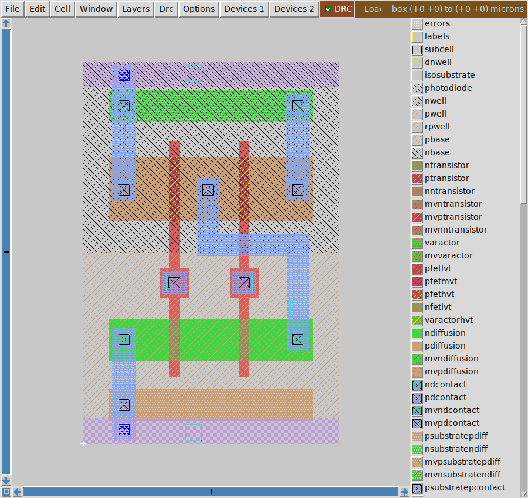

# Lab 04 — A buffer and an AND gate

**Package:** [`labs/lab-04-buffer-and-and/`](https://github.com/uoftasic/ad104/tree/main/labs/lab-04-buffer-and-and)

Two more cells, and **not one new transistor**. A buffer is two of your
inverters. An AND gate is a NAND gate and one of your inverters. This lab is
about placing, abutting, wiring and naming — which is what the rest of a chip
is made of.

## Prerequisites

Lab 03 passing. [Cells are Lego](guide/cells-are-lego.md) ·
[Stick diagrams](guide/stick-diagrams.md) ·
[LVS asks a different question](guide/lvs-asks-a-different-question.md)

## Objectives

- Place instances of a cell and abut them so the rails connect for free
- Route one wire between two cells and get it to land
- Discover that a label on a subcell's geometry is not your label
- Read a NAND layout and find the shared diffusion
- Meet netgen's most confusing message on purpose

## The NAND is given to you

`mag/my_nand2.mag` ships finished, and `tcl/nand2.tcl` is how it was drawn,
commented line by line. Open it and find the one idea that is not in the
inverter:



*Two red poly stripes crossing one strip of green n-diffusion. Contacts at the
far left and the far right only — nothing between the gates. The two NMOS are
in **series**, which on silicon means the drain of one and the source of the
other are literally the same piece of doped silicon.*

Extract it and you can see the same fact from the other side:

```spice
.subckt my_nand2 A B Y VPWR VGND
X0 a_300_260# A VGND VGND sky130_fd_pr__nfet_01v8 w=0.65 l=0.15
X3 Y B a_300_260# VGND     sky130_fd_pr__nfet_01v8 w=0.65 l=0.15
X1 VPWR B Y VPWR sky130_fd_pr__pfet_01v8_hvt w=1 l=0.15
X2 Y A VPWR VPWR sky130_fd_pr__pfet_01v8_hvt w=1 l=0.15
.ends
```

`a_300_260#` is the shared node. You never named it, so Magic named it after
its coordinates. A contact there would cost area and add capacitance to an
internal node and buy nothing, which is why there is not one.

The PMOS above are in **parallel** — three contacts, alternating source,
drain, source, with the middle one going to `Y`.

## Run it

```bash
cd labs/lab-04-buffer-and-and
make cells        # (re)build mag/my_inv.mag and mag/my_nand2.mag
make scaffold     # two blocks, each with its two cells already placed
make edit CELL=my_buf
make              # about a minute, most of it ngspice loading the models
```

## Procedure

### L1 — The buffer

`make scaffold` gives you `my_buf` containing two `my_inv` instances, at
x = 0 and x = 3.0, and the block's own metal1 rails painted over the row.

Because both cells are 6.00 µm tall with rails at the same heights, the rails
already abut into two continuous strips and the wells have merged. **You have
not drawn anything and power is connected.**

What is missing is the signal. `inv1`'s output `Y` is an li shape at
x = 2.18–2.55; `inv2`'s input `A` is at x = 3 + 1.24 = 4.24–4.61, both around
y = 2.4. So:

```tcl
box 2.18um 2.40um 4.61um 2.65um
paint li
```

One rectangle. That is the buffer.

### L2 — Name it

```tcl
box 1.30um 2.40um 1.55um 2.65um ; paint li ; label A c li
box 5.20um 2.42um 5.45um 2.67um ; paint li ; label X c li
box 2.60um 0.05um 2.85um 0.30um ; label VGND c m1
box 2.60um 5.70um 2.85um 5.95um ; label VPWR c m1
select top cell
port makeall
save my_buf
```

Two of those lines paint a small patch of `li` before labelling it, and it is
worth knowing why. **A label lands on geometry belonging to the current cell.**
The input pin you want to name is `inv1`'s, and a label placed on it would
belong to `inv1`. Painting your own 0.25 µm patch on top — same net,
electrically nothing — gives the top cell something of its own to name.

The rails are the same story, which is why the scaffold painted metal1 over
the whole row. Delete those two rectangles and re-run `make` if you want to
watch the block come out with no supply ports at all; it is a good failure to
have met.

### L3 — The AND gate

Same shape. `my_and2` has `my_nand2` at x = 0 and `my_inv` at x = 4.0.
`nd0`'s output is at x = 3.20–3.53; `in0`'s input is at 4 + 1.24 = 5.24–5.61.

```tcl
box 3.20um 2.40um 5.61um 2.65um
paint li
```

Then `A` and `B` patches over the NAND's two inputs, `X` over the inverter's
output, and the two rail labels.

### L4 — Watch it work

`make` extracts both blocks, LVSes them against `spice/cells_sch.spice`, and
then simulates the AND gate's truth table on the **extracted layout with
parasitics**:

```
  TWO BLOCKS, BUILT OUT OF CELLS

  block      DRC default  DRC full   LVS                       contains
  --------------------------------   ------------------------  ----------------
  ok my_buf            0         0   match                     my_inv, my_inv
  ok my_and2           0         0   match                     my_inv, my_nand2

  THE AND GATE, SIMULATED

      ok  A=0  B=0   X = 0.000000 V   (expected 0.0)
      ok  A=0  B=1   X = 0.000000 V   (expected 0.0)
      ok  A=1  B=0   X = 0.000001 V   (expected 0.0)
      ok  A=1  B=1   X = 1.800000 V   (expected 1.8)

PASS  A buffer and an AND gate, both clean under both rule sets, both
      matching their schematics, and the AND gate really does AND.
```

Six transistors in that AND gate, and you drew none of them in this lab.

### L5 — The message worth meeting on purpose

```bash
make swapped
```

This LVSes your NAND against a netlist with `A` and `B` exchanged:

```
Netlists match uniquely.

Subcircuit pins:
Circuit 1: my_nand2         |Circuit 2: my_nand2
----------------------------|----------------------------
VPWR                        |VPWR
Y                           |Y
VGND                        |VGND
B                           |A **Mismatch**
A                           |B **Mismatch**

Final result: Top level cell failed pin matching.
```

Two statements, and they are not contradictory:

- **the topology is right** — four devices wired exactly as the schematic says
- **two names are on the wrong shapes** — netgen had to swap `A` and `B`

A NAND is symmetric in its inputs, so nothing else in the flow will ever
notice. Simulation passes. DRC passes. And the timing model is wrong, because
in a series stack the input nearer the output really is faster than the one
nearer ground.

**The fix is to swap the labels in the layout, not in the schematic.**

## Expected results

- [ ] both blocks at 0 violations under both rule sets
- [ ] both `match` in LVS
- [ ] all four rows of the truth table correct
- [ ] you can explain why the shared node in the NAND has no contact
- [ ] you have run `make swapped` and can read its output

## Targets

| Command | What it does |
|---|---|
| `make` | DRC + LVS both blocks, then simulate the AND |
| `make layout` | just the DRC and LVS part, about 2 s |
| `make edit CELL=my_and2` | open a block in Magic |
| `make cells` | rebuild the two leaf cells |
| `make scaffold` | **throw your work away**, back to two placed cells |
| `make ref` / `make refcheck` | build and check the reference blocks |
| `make swapped` | the pin-matching failure, on purpose |
| `make clean` | delete `results/` |

## A note on the testbench

`src/mktb.py` builds the simulation deck **around your netlist's own port
order**, rather than assuming it. Magic numbers a cell's ports in the order
the labels were created, so if you named `X` before `A` your `.subckt` line
differs from the reference's — and a testbench with the terminals in the wrong
order is a silent wrong answer, not an error.
