# Lab 04: A buffer and an AND gate

In this lab you'll build two more cells without drawing a single new transistor, because both are
made from cells that are already drawn: a buffer is two copies of the Lab 03 inverter, and an AND
gate is a NAND gate followed by the same inverter. The work is wiring the placed cells together
and naming their pins in Magic, which is also what the rest of a chip is made of. Then you build
the inverter a third time, with Magic's device generator drawing the transistors for you.

Package: [`labs/lab-04-buffer-and-and/`](https://github.com/uoftasic/ad104/tree/main/labs/lab-04-buffer-and-and)

## Before you start

- Get [Lab 03](../labs/lab-03-draw-an-inverter-overview.md) to `PASS`.
- Read [Instances and hierarchy](../guide/cells-are-lego.md). This lab also uses
  [Stick diagrams](../guide/stick-diagrams.md) and
  [Layout versus schematic (LVS)](../guide/lvs-asks-a-different-question.md).
- Open two terminals. You run `make` in one, in `labs/lab-04-buffer-and-and`. You start Magic,
  run netgen and read files in the other, in its `mag/` folder.

**Time:** about 3 hours, an estimate, not counting the optional Part 10. The full `make` takes 10
to 15 seconds (10.3 and 13.4 s on two timed clean runs), and nearly all of that is ngspice reading
the SKY130 model library for the truth-table simulation. `make layout` runs only the DRC and LVS
part, which takes about 1.5 s, so use it while you are wiring.

## Part 1: Look at the NAND

How is the NAND you were given wired, in silicon?

1. Go into the lab package and build the starting cells:

   ```bash
   cd labs/lab-04-buffer-and-and
   make cells        # (re)build mag/my_inv.mag and mag/my_nand2.mag
   make scaffold     # two blocks, each with its two cells already placed
   ```

   `mag/my_inv.mag` is the Lab 03 reference inverter rather than the one you drew, so this lab
   works on its own. Be careful with `make scaffold`: it **throws away your work in `my_buf` and
   `my_and2`**, so run it again only if you want to start over.

2. The NAND comes already drawn, and `tcl/nand2.tcl` is the script that drew it, commented line
   by line. In your other terminal, open the cell in Magic from the `mag/` folder:

   ```bash
   cd labs/lab-04-buffer-and-and/mag
   magic -d X11 my_nand2 &
   ```

   

   *Two red poly stripes cross one strip of green n-diffusion, with contacts only at the far left
   and far right and nothing between the gates. The two NMOS are in **series**, and on silicon
   that means the drain of one and the source of the other are the same piece of doped silicon.*

   The PMOS above them are in **parallel**, with three contacts that alternate source, drain,
   source, and the middle one goes to `Y`.

3. Select the node between the two NMOS. Hide the wells first (right-click the `nwell` and
   `pwell` swatches in the palette, as in Lab 02), because otherwise `s` picks a well. Then point
   at the n-diffusion between the two gates and press `s` three times. The first press selects
   the piece under the pointer, the second everything connected to it on that layer, and the
   third the whole net. If nothing is selected after the presses, press `,` and try again.

   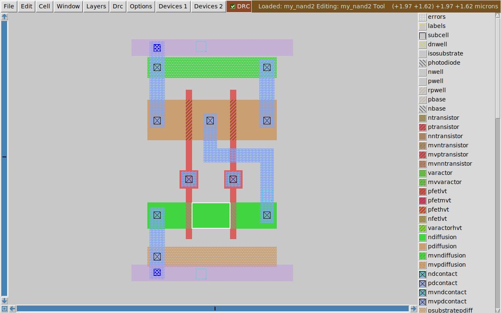{fig-alt="Magic's layout window on my_nand2 with the wells hidden. The selection outline covers only the n-diffusion between the two poly gates, with no contact or li in it."}

   *After three presses of `s` the selection is only the diffusion between the two gates. The
   whole net is that one piece of silicon, with no contact and no wire.*

   Press `,` to clear the selection, and left-click the two swatches to show the wells again.

4. Extract the NAND yourself. In the console (tkcon), type:

   ```tcl
   extract all
   ext2spice lvs
   ext2spice
   ```

   These are the commands from Lab 01, Part 6: `extract all` writes `my_nand2.ext`, and
   `ext2spice` turns it into `my_nand2.spice`, next to the cell. In your `mag/` terminal, print
   it:

   ```bash
   cat my_nand2.spice
   ```

   Find the two NMOS lines. They share a node you never named:

   ```spice
   X0 a_300_260# A VGND VGND sky130_fd_pr__nfet_01v8 ad=0.30875 pd=1.6 as=0.6175 ps=3.2 w=0.65 l=0.15
   X3 Y B a_300_260# VGND sky130_fd_pr__nfet_01v8 ad=0.65 pd=3.3 as=0.30875 ps=1.6 w=0.65 l=0.15
   ```

   `a_300_260#` is the shared diffusion between the two gates. You never gave it a name, so Magic
   made one up from its coordinates.

Why is there no contact on the shared node between the two NMOS?

<details>
<summary>Answer</summary>

In series, the drain of one transistor is the source of the other, so on silicon they are the
same piece of diffusion, and the region between the two gates is itself the shared node. A
contact there would cost area and add junction capacitance to an internal node without gaining
you anything ([Stick diagrams](../guide/stick-diagrams.md#the-nand)).

</details>

**You should see** the selection cover only the n-diffusion strip between the gates, and
`a_300_260#` on two NMOS lines in `my_nand2.spice`.

## Part 2: Wire the buffer

What do the two inverters already share, and what is missing?

1. Open the buffer from Magic's menu: `File → Open...`, type `my_buf.mag` in `File name:` and
   press Return.

   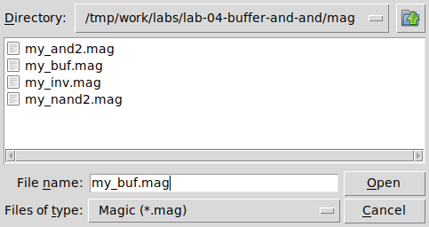{fig-alt="Magic's Open dialog listing the .mag files in mag/, with my_buf.mag typed in the File name field."}

   *`File → Open...` lists the `.mag` files in the folder you started Magic in. Type the name and
   press Return.*

   `make scaffold` gave you `my_buf` containing two `my_inv` instances side by side, `inv1` on the
   left and `inv2` on the right, with the block's own metal1 rails painted over the row and
   already labelled `VGND` and `VPWR`. Both cells are 6.00 µm tall with their rails at the same
   heights, so the rails already abut into two continuous strips and the wells have merged. That
   means power is already connected, even though you haven't drawn anything yet.

2. The instances open as outlines with their names in them. Set the box over the whole block
   (left-click below and left of it, right-click above and right of it) and press `x` with the
   pointer over the drawing: Magic expands both instances and draws what is inside them.

3. What's missing is the signal from the first inverter to the second. Find `inv1`'s output `Y`,
   the vertical li strip on the right of the cell that joins the two drains, and `inv2`'s input
   `A`, the li square over its gate contact. Point at each one and read its x and y in the title
   bar. Write down where each starts and ends.

4. Zoom on the gap between them (set a rough box and press `ctrl+z`). Draw one li rectangle that
   overlaps both pins: left-click its lower-left corner, right-click its upper-right corner, check
   the size in the title bar, then middle-click `locali` in the palette. Keep it at least 0.17 µm
   from every other li shape (`li.3`).

5. Run `Drc → DRC update` to check it.

   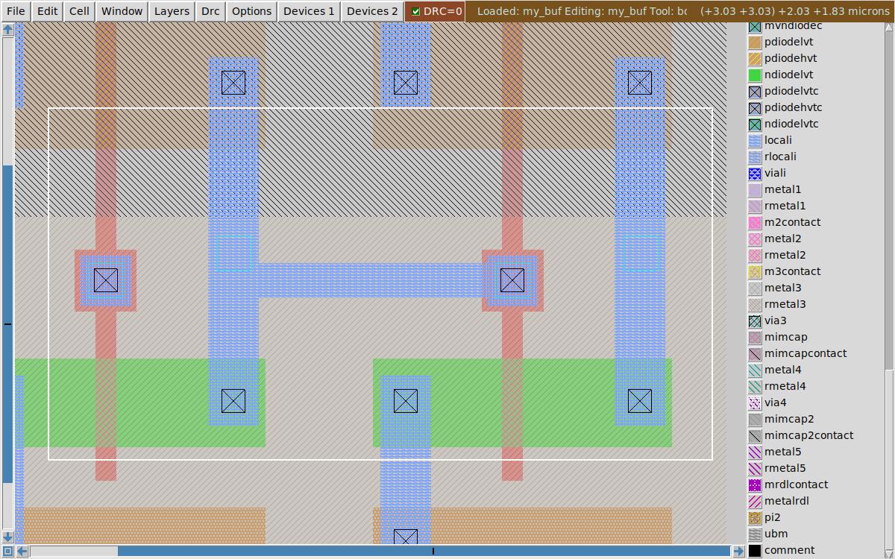{fig-alt="my_buf expanded in Magic: inv1 on the left and inv2 on the right, with one horizontal li rectangle running from inv1's output strip across the cell boundary to inv2's input square. The DRC button reads DRC=0."}

   *One li rectangle from `inv1`'s `Y` strip to `inv2`'s `A` square, and `DRC=0` on the button.*

**You should see** a single li rectangle running from `inv1`'s output to `inv2`'s input, which is
all the wiring the buffer needs, and `DRC=0`.

## Part 3: Name the buffer's pins

How do you give the block, rather than the cells inside it, its own pins?

1. Try the obvious way first. Set the box inside `inv1`'s `A` square, then open
   `Edit → Text ...` and label it as you did in Lab 03, Part 7: `Text string:` A, `Size (um):` 0.1,
   tick `Port:` `enable`, and click `Okay`. The label appears on the pin, and the console prints
   nothing.

2. Extract the buffer (`extract all`, `ext2spice lvs`, `ext2spice` in the console) and look at the
   block's port list in your `mag/` terminal:

   ```bash
   grep subckt my_buf.spice
   ```

   ```
   .subckt my_inv A Y VPWR VGND
   .subckt my_buf VGND VPWR
   ```

   `my_buf` has no `A`. Why not?

   <details>
   <summary>Answer</summary>

   **A label names a net only if it sits on a shape in the cell you're editing.** The pin you
   labelled is a shape inside `inv1`, so the label went into `my_buf` with nothing of `my_buf`'s
   under it. Magic put it on empty space, where it isn't attached to any net, and `my_buf` comes
   out of extraction with no `A` port. The scaffold's metal1 rails are there for the same reason:
   they give the `VGND` and `VPWR` labels top-cell geometry to sit on.

   </details>

3. Give the label a shape of the block's own. Leave the box where it is and middle-click `locali`
   in the palette. That paints a small patch of li in `my_buf`, on top of `inv1`'s pin: it's the
   same net, so electrically it adds nothing. Magic moves the label onto it, and the console says
   so:

   ```
   Moving label "A" from space to locali in cell my_buf.
   ```

   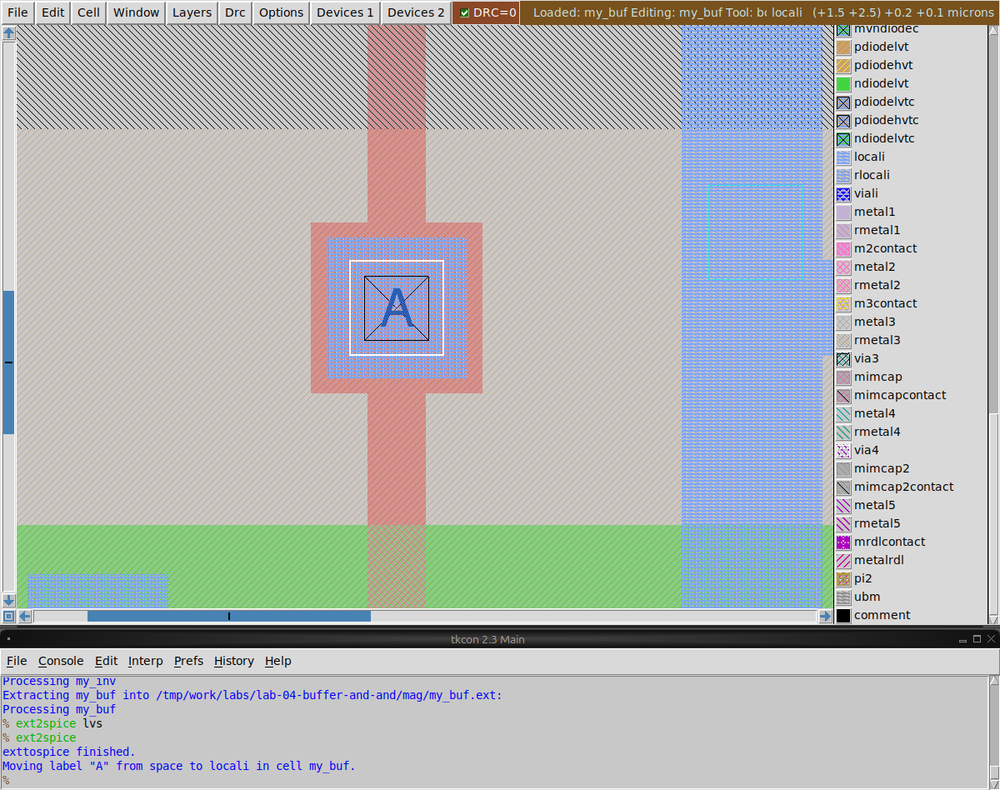{fig-alt="Magic zoomed on inv1's input with a small li patch painted over the pin and the label A on it. The console below ends with: Moving label \"A\" from space to locali in cell my_buf."}

   *The patch under the label, and the console line that confirms the label is now on li.*

4. Do the same for the output: set the box inside `inv2`'s `Y` strip, middle-click `locali`, then
   `Edit → Text ...` with `Text string:` X, `Size (um):` 0.1 and `Port:` `enable` ticked. With the
   patch already there, the console prints `Moving label "X" from space to locali in cell my_buf.`
   when you click `Okay`.

5. `Drc → DRC update`, then save: `File → Save...`, and click `autowrite` in the dialog. The
   dialog names `my_inv` first, not `my_buf`: Magic marks the cells inside a block as changed when
   it runs DRC on them, and asks about every changed cell in turn. `autowrite` saves them all
   without asking. Nothing in `my_inv`'s drawing changes. `make` reads the saved files, so save
   before every check.

6. Run the layout checks in your other terminal, in `labs/lab-04-buffer-and-and`:

   ```bash
   make layout
   ```

   ```
     block      DRC default  DRC full   LVS                       contains
     --------------------------------   ------------------------  ----------------------------
     ok my_buf            0         0   match                     my_inv, my_inv
        my_and2           0         0   Top level cell failed pin matching  my_inv, my_nand2

   FAIL  my_and2 has no port called A, B, X. Its ports are: VGND VPWR.
   ```

**You should see** the `my_buf` row read `ok`, `0`, `0`, `match`. The `my_and2` row will keep
failing until you wire it in Part 4.

## Part 4: Build the AND gate

Can you find the AND gate's pins yourself?

1. `File → Open...` → `my_and2.mag`. Set the box over the whole block and press `x` to expand it.
   It contains `my_nand2` (instance `nd0`) on the left and `my_inv` (instance `in0`) on its right,
   with the block's rails painted and labelled the same way as in `my_buf`.

2. Find `nd0`'s output and `in0`'s input on screen, as in Part 2: the NAND's `Y` is the li strip
   that comes down its right-hand side to the NMOS drain. Join them with one li rectangle and run
   `Drc → DRC update`.

3. Patches and labels, with the recipe from Part 3: `A` and `B` on the NAND's two input squares,
   and `X` on the inverter's output strip. If you would rather read the NAND's inputs than point
   at them, they are the `A` and `B` li lines in `tcl/nand2.tcl`.

   The Text dialog keeps counting port numbers from the last label you made, even in another
   cell, and two ports with the same number in one cell clash. So when you start labelling in a
   different cell, untick `enable` and tick it again: the number beside it becomes the next free
   port number of the cell you're editing.

4. `Drc → DRC update`, `File → Save...` → `autowrite`, then `make layout`.

**You should see** both rows read `ok`, with `0`, `0` and `match`, and
`PASS  Both blocks are clean under both rule sets and netgen agrees they`.

## Part 5: Check and simulate the AND gate

Does the AND gate match its schematic, and does it really AND?

1. With `my_and2` open, extract it in the console: `extract all`, `ext2spice lvs`, `ext2spice`.
   Magic extracts `my_nand2` and `my_inv` on the way, and `my_and2.spice` holds all three
   subcircuits.

2. In your `mag/` terminal, run netgen's `lvs` on your netlist against the schematic:

   ```bash
   netgen -batch lvs "my_and2.spice my_and2" "../spice/cells_sch.spice my_and2" $PDK_ROOT/sky130A/libs.tech/netgen/sky130A_setup.tcl
   ```

   As in Lab 01, Part 7, the first argument is your extracted netlist and the cell in it, the
   second is the schematic file and the subcircuit to compare it with, and the third is the
   SKY130 setup file. The terminal ends with:

   ```
   Final result:
   Circuits match uniquely.
   ```

   netgen compares the hierarchy from the bottom up. Its full report, `comp.out`, has a
   subcircuit summary for `my_inv`, then `my_nand2`, then `my_and2` built from them, and each one
   ends in `Netlists match uniquely.`

3. Before you simulate, write down the output `X` you expect for each of the four input rows.

4. Run the full check, in `labs/lab-04-buffer-and-and`:

   ```bash
   make
   ```

   This extracts both blocks, runs LVS on them against `spice/cells_sch.spice`, and then
   simulates the AND gate's truth table on the **extracted layout, with parasitics**:

   ```
     TWO BLOCKS, BUILT OUT OF CELLS

     block      DRC default  DRC full   LVS                       contains
     --------------------------------   ------------------------  ----------------------------
     ok my_buf            0         0   match                     my_inv, my_inv
     ok my_and2           0         0   match                     my_inv, my_nand2

     THE AND GATE, SIMULATED

         ok  A=0  B=0   X = 0.000000 V   (expected 0.0)
         ok  A=0  B=1   X = 0.000000 V   (expected 0.0)
         ok  A=1  B=0   X = 0.000001 V   (expected 0.0)
         ok  A=1  B=1   X = 1.800000 V   (expected 1.8)

   PASS  A buffer and an AND gate, both clean under both rule sets, both
         matching their schematics, and the AND gate really does AND.
   ```

The AND gate you just simulated has six transistors, and you didn't draw any of them in this lab.

`src/mktb.py` generates the testbench **around your netlist's own port order**, instead of
assuming one. It does this because Magic numbers a cell's ports in the order you created the
labels, so if you labelled `X` before `A`, your `.subckt` line lists the ports in a different
order from the reference's. A testbench that connected the terminals in the wrong order would
give a wrong answer without raising any error.

**You should see** `Circuits match uniquely.` from your own netgen run, then all four
truth-table rows marked `ok`, and `PASS`.

## Part 6: Meet the pin-swap message

What does netgen say when the circuit is right but two names are on the wrong shapes?

1. In your `mag/` terminal, compare the NAND inside your netlist with a schematic that has `A`
   and `B` exchanged, `spice/swapped_sch.spice`:

   ```bash
   netgen -batch lvs "my_and2.spice my_nand2" "../spice/swapped_sch.spice my_nand2" $PDK_ROOT/sky130A/libs.tech/netgen/sky130A_setup.tcl
   ```

   The terminal ends with `Final result:` and `Top level cell failed pin matching.`

2. netgen writes the whole comparison to `comp.out`. Print it and read the end:

   ```bash
   cat comp.out
   ```

   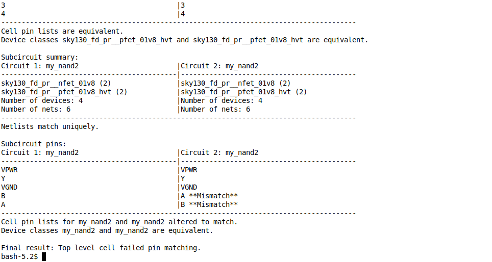{fig-alt="A terminal showing the end of comp.out: the subcircuit summary for my_nand2 with 4 devices and 6 nets on both sides, the line Netlists match uniquely, a pin table in which B and A are marked Mismatch, and Final result: Top level cell failed pin matching."}

   ```
   Netlists match uniquely.

   Subcircuit pins:
   Circuit 1: my_nand2                        |Circuit 2: my_nand2
   -------------------------------------------|-------------------------------------------
   VPWR                                       |VPWR
   Y                                          |Y
   VGND                                       |VGND
   B                                          |A **Mismatch**
   A                                          |B **Mismatch**
   ---------------------------------------------------------------------------------------
   Cell pin lists for my_nand2 and my_nand2 altered to match.
   Device classes my_nand2 and my_nand2 are equivalent.

   Final result: Top level cell failed pin matching.
   ```

3. Read the report as two separate statements, which don't contradict each other:

   - **the topology is right**: all four devices are wired exactly as the schematic says
   - **two names are on the wrong shapes**: netgen had to swap `A` and `B` to make the match work

Why will nothing else in the flow notice this?

<details>
<summary>Answer</summary>

A NAND is logically symmetric in its inputs, so with `A` and `B` swapped both simulation and DRC
still pass. What the swap does get wrong is the timing model, because in a series stack the
input nearer the output is faster than the one nearer ground.

</details>

To fix it, swap the two labels in the layout rather than the pin names in the schematic.

**You should see** `Netlists match uniquely` and `failed pin matching` in the same report.

## Part 7: Let the generator draw the transistors

What does Magic's device generator draw for you?

So far every transistor in this course was drawn shape by shape. Magic's `Devices 1` menu draws a
whole transistor from a few numbers, and in this part and the next two you build the same
inverter again from it, in a new cell, `my_inv_gen`: Wn 0.65 µm, Wp 1.00 µm (high-Vt), L 0.15 µm.

1. Close Magic (`File → Quit`), and start it again on the new cell from your `mag/` terminal:

   ```bash
   magic -d X11 my_inv_gen &
   ```

   The cell is new and empty, and Magic opens it zoomed in on a view 0.025 µm wide. With the
   pointer over the drawing, press `Z` about eight times, until the view is several microns
   across.

2. Left-click where the NMOS should go. Magic puts the device's lower-left corner at the click,
   and its guard ring reaches a little further down and left. Then open
   `Devices 1 → nmos (MOSFET)`.

   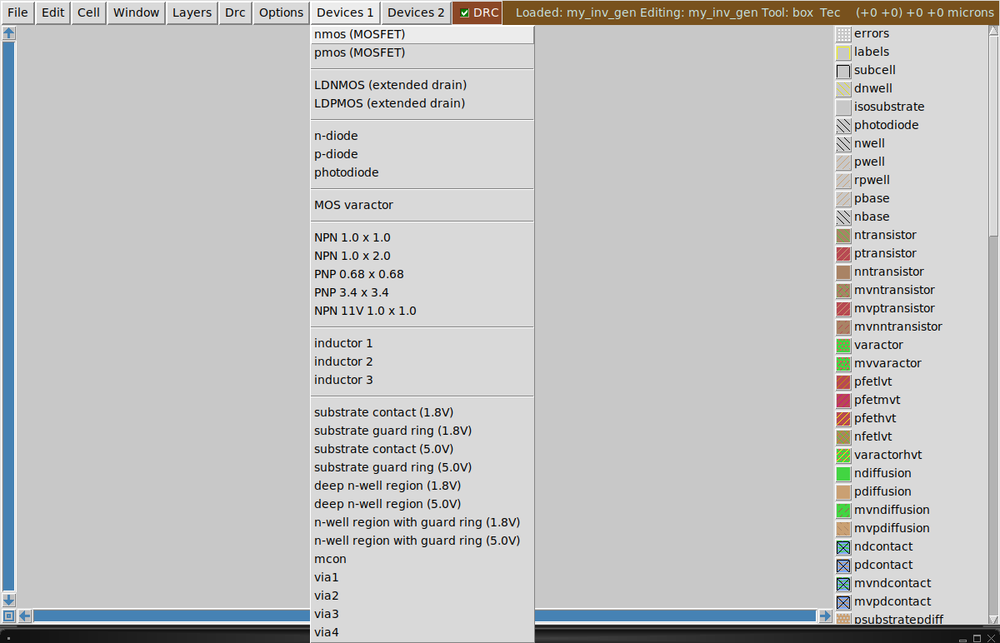{fig-alt="Magic's Devices 1 menu open over an empty layout, listing nmos (MOSFET) and pmos (MOSFET) at the top, then the other device generators."}

   *`Devices 1` lists Magic's device generators. This lab uses the first two.*

3. A window titled `params` opens. The device window is taller than the desktop, so its
   `Create and Close` button starts below the bottom of the screen. Double-click the window's
   title bar: the window fills the screen and the buttons appear along its bottom edge.

   Fill in `Width (um)` 0.65, `Length (um)` 0.15 and `Fingers` 1. Leave the check boxes as they
   are, and click `Create and Close`.

   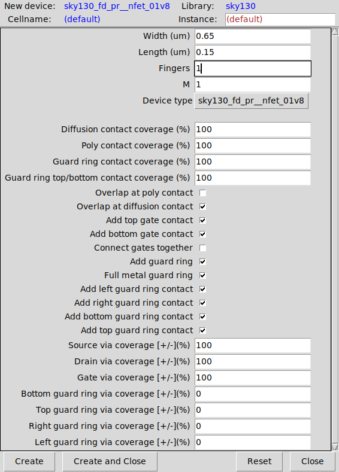{fig-alt="The params window headed New device: sky130_fd_pr__nfet_01v8, with Width (um) 0.65, Length (um) 0.15 and Fingers 1 filled in. Below are the coverage fields and the check boxes, with Add top gate contact, Add bottom gate contact and Add guard ring ticked, and the Create, Create and Close, Reset and Close buttons at the bottom."}

   *The NMOS: W, L and one finger. The ticked boxes include both gate contacts and the guard
   ring.*

   The console prints a `Diagnostic: Device bounding box …` line, and the transistor appears
   inside a ring of substrate contacts, its guard ring.

4. Left-click above the NMOS. Leave room for it: with its guard ring the NMOS is about 2.1 µm wide
   and 2.75 µm tall. Open `Devices 1 → pmos (MOSFET)` and bring its buttons up the same way. Fill in
   `Width (um)` 1, `Length (um)` 0.15 and `Fingers` 1. `Device type` is a button showing
   `sky130_fd_pr__pfet_01v8`: click it and choose `sky130_fd_pr__pfet_01v8_hvt`, the high-Vt
   device that Lab 03's schematic asks for. Click `Create and Close`.

   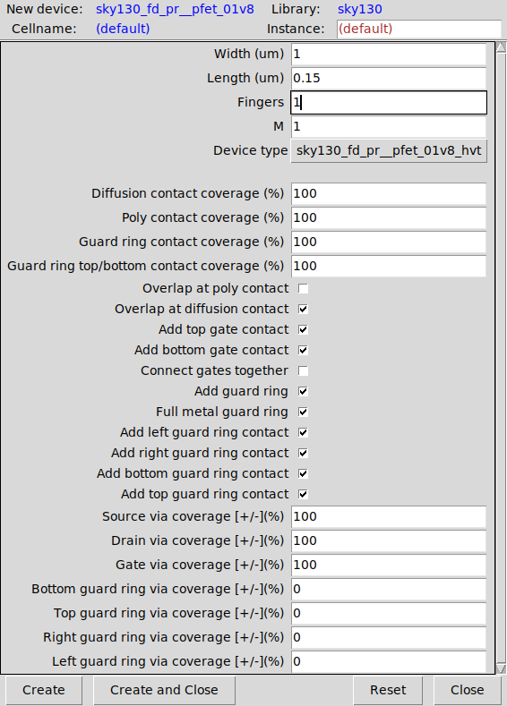{fig-alt="The params window for the pmos with Width (um) 1, Length (um) 0.15 and Fingers 1, and the Device type button now reading sky130_fd_pr__pfet_01v8_hvt."}

   *The PMOS, with `Device type` switched to the high-Vt device.*

5. Press `v` to see both devices.

**You should see** two transistors, the PMOS above the NMOS, each inside its own guard ring, and a
`Diagnostic: Device bounding box` line in the console for each.

## Part 8: Change the devices' gate contacts

What does DRC say about the two devices, and how do you change a device after placing it?

1. `Drc → DRC update`. With your two devices placed apart, the button reads `DRC=12`. Press `=`
   (pointer over the drawing) to jump to the first error, then `Drc → DRC report`:

   ```
   Metal1 minimum area < 0.083um^2 (met1.6)
   ```

   Each device has a gate contact at the top of its gate and another at the bottom, and each
   contact has a small metal1 pad, 0.29 × 0.23 µm. On its own that pad is below metal1's
   minimum area, 0.083 µm² (`met1.6`). The pads you wire to something will grow, and the others
   have to go.

2. Decide which pads you will use. The gates are joined by a metal1 wire from one device to the
   other, so the NMOS's top pad and the PMOS's bottom pad face each other and are the ones to
   keep. The NMOS's bottom pad and the PMOS's top pad would only ever be loose metal.

3. Change the NMOS: point at it, press `i` to select it, then `q`. The same window opens, headed
   `Edit device:`, with `Apply`, `Okay`, `Reset` and `Close` along the bottom (double-click its
   title bar again to reach them). Untick `Add bottom gate contact` and click `Okay`.

   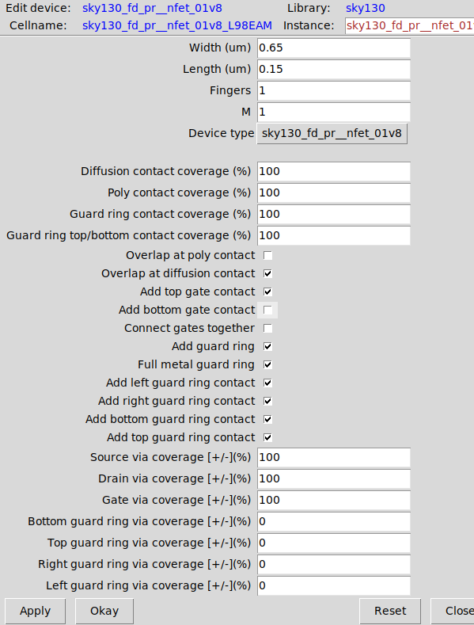{fig-alt="The params window headed Edit device: with the NMOS's values, Add bottom gate contact unticked, and Apply, Okay, Reset and Close at the bottom."}

   *`i` then `q` reopens a placed device's window. Untick the gate contact you won't use.*

4. Do the same on the PMOS, and untick `Add top gate contact` there.

5. `Drc → DRC update` again. The button reads `DRC=6`, and the report names the same rule: the
   two pads you kept are still loose until you wire them in Part 9.

An option change replaces the device with a new one, under a new cell name, and Magic keeps its
lower-left corner where it was. So when the NMOS lost its bottom contact, its transistor moved
down by the height of that contact. Make these changes before you wire, and if you change a
device later, check every wire that touched it.

**You should see** `DRC=12` before the changes, `DRC=6` after them, and only `met1.6` in the
report.

## Part 9: Wire and check the generated inverter

Can you finish the inverter around the generator's two devices?

Each device has two metal1 strips, one on each side of its gate, over its source and drain
contacts, and an li guard ring around it. Wire them like this:

| Net | What to draw | Rules to respect |
|---|---|---|
| `A` | metal1 from the NMOS's top gate pad to the PMOS's bottom gate pad | metal1 at least 0.14 µm wide (`met1.1`) and 0.14 µm from other metal1 (`met1.2`) |
| `Y` | metal1 joining the left-hand strip of the NMOS to the left-hand strip of the PMOS, round the outside of the devices | the same |
| sources | li from each device's right-hand strip to its own guard ring | li at least 0.17 µm wide (`li.1`) and 0.17 µm from other li (`li.3`) |
| `VGND` | a metal1 rail along the bottom, over the NMOS guard ring's bottom li strip, with an `mcon` (`viali` in the palette) between the two | an `mcon` is exactly 0.17 × 0.17 µm; the rail covers it by at least 0.03 µm on every side (`met1.4`) and 0.06 µm on both sides of one axis (`met1.5`) |
| `VPWR` | the same along the top, over the PMOS guard ring's top li strip | the same |

1. Draw the metal1 and li shapes: box by mouse, then middle-click `metal1` or `locali` in the
   palette.

2. Draw each `mcon` with the typed-size recipe: zoom in, left-click its lower-left corner on the
   guard ring's li strip, type `box size 0.17um 0.17um` in the console, click the layout
   window's title bar, press `b` to check the size, and middle-click `viali`.

3. Label `A`, `Y`, `VGND` and `VPWR` with `Edit → Text ...` (`Size (um):` 0.1, `Port:` `enable`
   ticked), each with the box on metal1 that you drew in `my_inv_gen` itself. A label over a
   device's own metal1 has the same problem as Part 3's label over `inv1`'s pin.

4. `Drc → DRC update` until the button shows no errors. Then `Drc → DRC Complete` and
   `Drc → DRC update` to check under the full rule set, and `Drc → DRC Fast` to go back.

   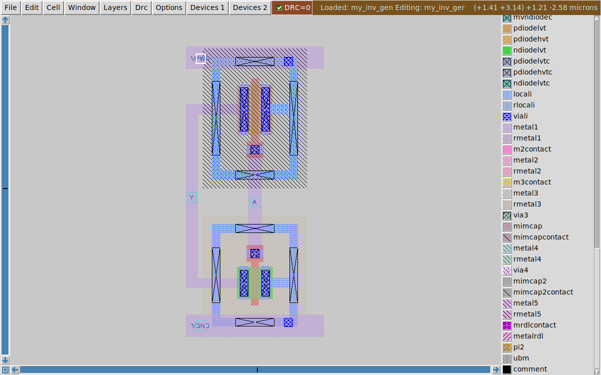{fig-alt="my_inv_gen in Magic: the PMOS above the NMOS, each in its guard ring, a vertical metal1 wire joining the two gate pads, a metal1 wire round the left joining the two left-hand strips, short li wires from the right-hand strips to the rings, and metal1 rails at the bottom and top over an mcon on each ring. The DRC button reads DRC=0."}

   *One way to wire it: `A` straight up the middle, `Y` round the left, the sources to their
   rings, and a rail over an `mcon` on each ring.*

5. Extract it (`extract all`, `ext2spice lvs`, `ext2spice` in the console), and run netgen in your
   `mag/` terminal:

   ```bash
   netgen -batch lvs "my_inv_gen.spice my_inv_gen" "../spice/my_inv_gen_sch.spice my_inv_gen" $PDK_ROOT/sky130A/libs.tech/netgen/sky130A_setup.tcl
   ```

   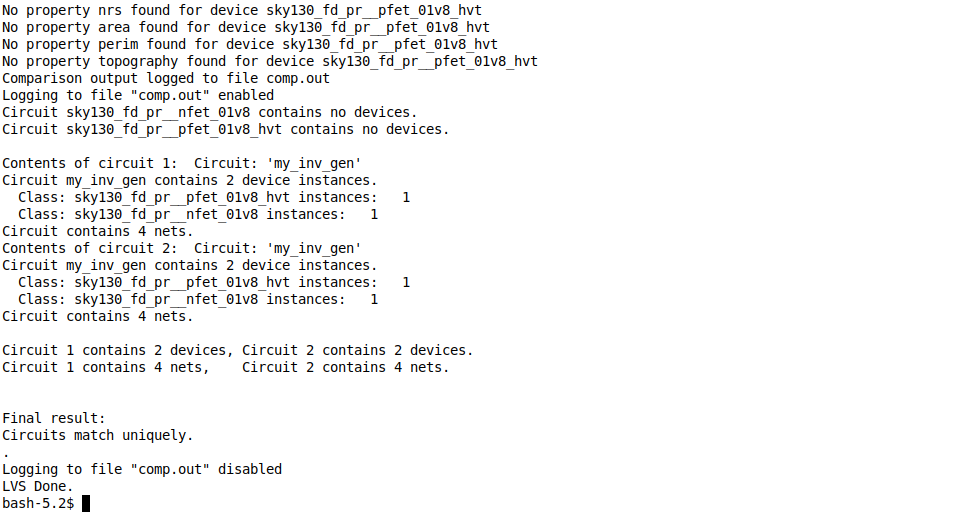{fig-alt="A terminal with the end of netgen's output for my_inv_gen: on both sides the circuit contains one sky130_fd_pr__pfet_01v8_hvt, one sky130_fd_pr__nfet_01v8 and 4 nets, then Final result: Circuits match uniquely."}

   *Two transistors and four nets on each side, and `Circuits match uniquely.`*

   `cat my_inv_gen.spice` shows how the generator's cells come out: each generated device is a
   cell of its own, extracted as its own subcircuit with pins `B D S G` holding one transistor.
   The schematic has no such subcircuits, so netgen flattens them into `my_inv_gen` and compares
   transistors.

6. Save: `File → Save...` and click `autowrite`, not `write`. `autowrite` saves every cell that
   changed, and that includes the two device cells, which have to be in `mag/` beside
   `my_inv_gen.mag` for `make gen` to find them. The dialog names one of the device cells first. The console then prints a `Writing` line for
   each of the three cells: the two device cells, whose names start with
   `sky130_fd_pr__nfet_01v8_` and `sky130_fd_pr__pfet_01v8_hvt_` and end in a code Magic makes up
   from the device's options, and `my_inv_gen`.

7. Check it, in `labs/lab-04-buffer-and-and`:

   ```bash
   make gen
   ```

   ```
     THE GENERATED INVERTER, my_inv_gen

         transistors            2   (1 n, 1 p)
           sky130_fd_pr__nfet_01v8          W=0.65  L=0.15
           sky130_fd_pr__pfet_01v8_hvt      W=1  L=0.15

         ports                  A Y VGND VPWR

         DRC, default rule set  0
         DRC, full rule set     0

         LVS                    Circuits match uniquely.

   PASS  Two generated transistors, the right flavours, W and L, four ports,
         zero DRC violations under both rule sets, and netgen agrees it is
         the inverter.
   ```

   Your `ports` line lists the four in the order you made the labels.

How does the generator's drain area compare with your Lab 03 cell's? Find `ad=` on the two
transistor lines in `my_inv_gen.spice` and on the ones in Lab 03's netlist, and write both pairs
down. [Lab 05](../labs/lab-05-what-it-costs-overview.md), Part 9, uses them.

<details>
<summary>Answer</summary>

The generator's NMOS has `ad=0.1885` and its PMOS `ad=0.29`, against 0.715 and 1.1 in the
Lab 03 reference cell; your own Lab 03 cell's depend on how long you drew its diffusions. `ad`
is the drain's length times W. The generator runs each drain only as far past the gate as its
contact needs, 0.29 µm, where the Lab 03 reference runs it 1.10 µm.

</details>

**You should see** `Circuits match uniquely.` from netgen, and `make gen` ending in `PASS`.

## Part 10: Take away the block's rails (optional)

What happens to the block's supply ports if it has no rails of its own?

1. `File → Open...` → `my_buf.mag`. Set the box over the bottom rail and shift + middle-click
   `metal1` in the palette, which erases only metal1 from the box (as in Lab 02). Do the same for
   the top rail. The `VGND` and `VPWR` labels go too, because they sat on those rectangles, while
   the inverters' own rails are left untouched.

2. `File → Save...` → `autowrite`, then `make layout`. The `my_buf` row fails:

   ```
        my_buf            0         0   Top level cell failed pin matching  my_inv, my_inv

   FAIL  my_buf has no port called VGND, VPWR. Its ports are: A X.
   ```

   The two inverters' rails still abut into continuous strips. Why does the block lose its supply
   ports anyway?

   <details>
   <summary>Answer</summary>

   The labels went with the rectangles, and the only rail metal left is inside `inv1` and
   `inv2`. A label over that metal would stay in `my_buf` but land on empty space, as in Part 3,
   so the block has no shape of its own to carry `VGND` and `VPWR`, and it comes out of
   extraction with no supply ports at all.

   </details>

3. Put the rails back: box over each rail's old place (the full width of the block, 0.40 µm tall,
   on top of the inverters' rails), middle-click `metal1`. Label them `VGND` and `VPWR` with
   `Edit → Text ...` (`Size (um):` 0.1, `Port:` `enable`). You come back to `my_buf` from
   another cell, so untick and tick `enable` before the first label, as in Part 4. Save with
   `autowrite`, and run `make layout` again.

**You should see** `my_buf has no port called VGND, VPWR` after step 2, and the `my_buf` row back
to `ok`, `0`, `0`, `match` after step 3.

## Finishing

You're done when `make` ends in `PASS` on the two blocks you wired and named (both clean under
both rule sets, both `match` in LVS, and all four truth-table rows `ok`), and `make gen` ends in
`PASS` on the inverter you built from the generator.

Questions:

- Why is there no contact on the shared node between the two NMOS in the NAND? Part 1 answers it.
- Why did a label put straight on `inv1`'s pin give `my_buf` no `A` port? Part 3 answers it.
- netgen reported `Netlists match uniquely` and `failed pin matching` together in Part 6. What is
  right, and what is wrong? Part 6 answers it.

Submit: nothing for this lab.

## Going further (optional)

`make ref` and `make refcheck` build and check the reference blocks and the reference generated
inverter. The package's
[`solutions/README.md`](https://github.com/uoftasic/ad104/tree/main/labs/lab-04-buffer-and-and/solutions)
discusses three decisions in the blocks, and `tcl/inv_gen.tcl` builds the reference generated
inverter by calling Magic's generator from Tcl with the values you typed into the dialogs.

Next on the Course path: read [Area, parasitics and delay](../guide/what-your-drawing-costs.md),
then do [Lab 05: What it costs](../labs/lab-05-what-it-costs-overview.md).
