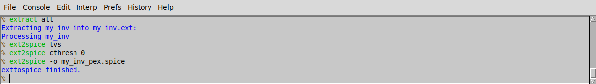
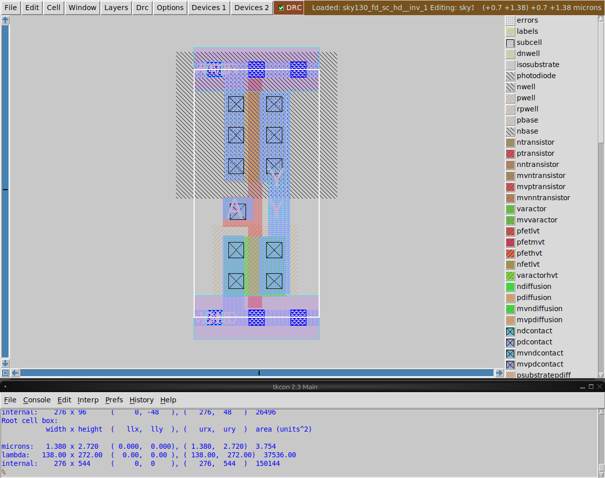

# Lab 05: What it costs

In this lab you compare two layouts of the same two transistors, the Lab 03 reference inverter and
the foundry's `inv_1`, to see what the drawing costs in area and in delay. You start by working
out the area price from numbers you already have. Then you measure both cells and extract them in
Magic with every parasitic capacitance kept, and `make` simulates them, so you can check your
arithmetic against the measurement.

Package: [`labs/lab-05-what-it-costs/`](https://github.com/uoftasic/ad104-m/tree/main/labs/lab-05-what-it-costs)

## Before you start

- Get [Lab 03](../labs/lab-03-draw-an-inverter-overview.md) to `PASS`.
- Read [Area, parasitics and delay](../guide/what-your-drawing-costs.md). This lab also uses
  [Extraction](../guide/extraction-is-reverse-engineering.md).
- Have paper or a text file ready for the numbers you work out in Parts 1 and 7.
- Open two terminals. You run `make` in one, in `labs/lab-05-what-it-costs`. You start Magic and
  read files in the other, in its `mag/` folder.

**Time:** about 1.25 hours, an estimate, not counting the optional Parts 8 and 9. Each full `make`
takes about half a minute (27 to 39 s on seven timed clean runs, depending on what else the
machine is doing). Nearly all of that time goes on the two ngspice runs, about 13 s for the
fan-out deck and 15 s for the two ring oscillators, which between them have 62 extracted
subcircuits to simulate for 20 ns of transient. Each run starts by reading the whole SKY130 model
library.

## Part 1: Predict the price

How much does the drawing cost in area, judging only from numbers you have already seen?

1. The Lab 03 cell is 3.00 × 6.00 µm, and Lab 01 measured `inv_1` at 1.38 × 2.72 µm. Work out
   how many times bigger the Lab 03 cell is, and write it down.

2. The extracted netlists give each transistor's drain junction area as `ad=`: 0.715 µm² for the
   NMOS of the Lab 03 reference cell and 1.1 µm² for its PMOS (the reference cell's numbers in
   Lab 03, Part 9), against 0.169 µm² and 0.26 µm² for `inv_1` (Lab 01, Part 6). Work out both
   ratios and write them down.

3. Guess how much slower the Lab 03 cell will be. Is it closer to the area ratio, the junction
   ratio, or much less than either? Write down a number, because Part 5 compares it with the
   measurement.

**You should see** three ratios and a guess in your notes. Part 4 checks the ratios against the
table.

## Part 2: Measure and extract the Lab 03 cell

Do your own measurements give the numbers Part 1 used?

1. In your `mag/` terminal, open the cell the table calls `yours`, which is the Lab 03 reference
   inverter:

   ```bash
   cd labs/lab-05-what-it-costs/mag
   magic -d X11 my_inv &
   ```

2. Measure the cell. Its metal1 rails run along its bottom and top edges, so their outer corners
   are the cell's corners: left-click the bottom rail's lower-left corner, right-click the top
   rail's upper-right corner, and press `b` with the pointer over the drawing. The `microns:` line
   in the console gives the width and height:

   ```
   microns:   3.000 x 6.000   ( 0.000,  0.000), ( 3.000,  6.000)  18.000
   ```

3. Extract it with every capacitance kept. In the console, type:

   ```tcl
   extract all
   ext2spice lvs
   ext2spice cthresh 0
   ext2spice -o my_inv_pex.spice
   ```

   `ext2spice cthresh 0` sets the smallest capacitance `ext2spice` writes out to zero, so it
   keeps them all; without it Magic leaves out the small coupling capacitances. `-o` names the
   output file, so this netlist doesn't overwrite a plain `my_inv.spice`.

   {fig-alt="Magic's console after the four commands extract all, ext2spice lvs, ext2spice cthresh 0 and ext2spice -o my_inv_pex.spice, with Extracting my_inv into my_inv.ext and exttospice finished."}

   *The four commands in tkcon, and Magic's answers.*

4. Print the netlist in your `mag/` terminal:

   ```bash
   cat my_inv_pex.spice
   ```

   ```spice
   * NGSPICE file created from my_inv.ext - technology: sky130A

   .subckt my_inv A Y VPWR VGND
   X0 Y A VGND VGND sky130_fd_pr__nfet_01v8 ad=0.715 pd=3.5 as=0.6175 ps=3.2 w=0.65 l=0.15
   X1 Y A VPWR VPWR sky130_fd_pr__pfet_01v8_hvt ad=1.1 pd=4.2 as=0.95 ps=3.9 w=1 l=0.15
   C0 VPWR Y 0.06413f
   C1 VPWR A 0.10808f
   C2 Y A 0.02272f
   C3 Y VGND 0.33997f
   C4 VPWR VGND 1.32518f
   .ends
   ```

   The `C` lines can come out in another order in your file; the values are the same.

**You should see** `3.000 x 6.000` on the `microns:` line, `ad=0.715` and `ad=1.1` on the two
transistor lines, and five `C` lines.

## Part 3: Measure and extract the foundry's cell

What does Magic extract from the foundry's `inv_1`?

1. Open `inv_1` in the same Magic: `File → Open...`, type the full path of the cell's file in
   `File name:` and press Return:

   ```
   /foss/pdks/sky130A/libs.ref/sky130_fd_sc_hd/mag/sky130_fd_sc_hd__inv_1.mag
   ```

   As in Lab 01, the cell's file is in the PDK and read-only, so Magic shows the cell without
   letting you edit it. The full caption includes `[NOT BEING EDITED]`, but with a name this long
   the window cuts that part off, even at the full width of the 1280-pixel desktop. You can still
   measure and extract the cell.

2. Measure it. As you found in Lab 01, `inv_1`'s rails straddle its bottom and top edges: point at
   the middle of each rail and read the y in the title bar. Then set the box from the left end of
   the bottom rail's centre line to the right end of the top rail's centre line, and press `b`.

   {fig-alt="Magic showing sky130_fd_sc_hd__inv_1 with the box running from the left end of the bottom rail's centre line to the right end of the top rail's centre line. The console below shows the b output, whose microns line reads 1.380 x 2.720."}

   *The box from rail centre to rail centre, and the `microns:` line: 1.380 × 2.720.*

3. Extract it the same way, with `inv_1_pex.spice` as the output name. Magic can't write into the
   PDK's read-only folder, so, as in Lab 01, Part 6, `extract all` writes
   `sky130_fd_sc_hd__inv_1.ext` into the folder you started Magic in, here `mag/`:

   ```tcl
   extract all
   ext2spice lvs
   ext2spice cthresh 0
   ext2spice -o inv_1_pex.spice
   ```

4. Print it with `cat inv_1_pex.spice`, count its `C` lines, and find `ad=` on the two transistor
   lines.

   ```spice
   .subckt sky130_fd_sc_hd__inv_1 A VGND VNB VPB VPWR Y
   X0 Y A VGND VNB sky130_fd_pr__nfet_01v8 ad=0.169 pd=1.82 as=0.169 ps=1.82 w=0.65 l=0.15
   X1 Y A VPWR VPB sky130_fd_pr__pfet_01v8_hvt ad=0.26 pd=2.52 as=0.26 ps=2.52 w=1 l=0.15
   C0 VPWR Y 0.07413f
   ...
   C13 VPB VNB 0.33898f
   .ends
   ```

**You should see** `1.380 x 2.720`, then `ad=0.169` and `ad=0.26` on the transistor lines and 14
`C` lines, against the Lab 03 cell's five.

## Part 4: Run the comparison

Does the measurement agree with your arithmetic?

1. In your other terminal, go into the lab package and run it:

   ```bash
   cd labs/lab-05-what-it-costs
   make
   ```

   `make` runs the same extraction you just typed, on both cells, then simulates them. By default
   it compares the **reference** Lab 03 inverter, in `mag/my_inv.mag`, with the foundry's, so the
   `yours` column is the reference cell's: the one you measured in Part 2. Part 8 (optional) swaps
   in your own file instead. The run prints:

   ```
     THE SAME TWO TRANSISTORS, DRAWN TWICE

                                          yours       foundry           ratio
     ------------------------------------------------------------------------
     cell width                               3          1.38 um       2.17 x
     cell height                              6          2.72 um       2.21 x
     cell area                               18         3.754 um2      4.80 x

     NMOS: sky130_fd_pr__nfet_01v8
        W                                  0.65          0.65 um       1.00 x
        L                                  0.15          0.15 um       1.00 x
        drain junction area               0.715         0.169 um2      4.23 x
        drain junction perim                3.5          1.82 um       1.92 x
     PMOS: sky130_fd_pr__pfet_01v8_hvt
        W                                     1             1 um       1.00 x
        L                                  0.15          0.15 um       1.00 x
        drain junction area                 1.1          0.26 um2      4.23 x
        drain junction perim                4.2          2.52 um       1.67 x

     extracted capacitance, total          1.86         1.424 fF       1.31 x
          ... of it on the output        0.4268        0.3519 fF       1.21 x

     DELAY, fan-out of 4
     t_pHL                                37.32         33.95 ps       1.10 x
     t_pLH                                88.43         81.51 ps       1.08 x
     average                              62.88         57.73 ps       1.09 x

     RING OSCILLATOR, 31 stages, nothing but the cell driving itself
     period                                2640          2034 ps       1.30 x
     frequency                            378.8         491.7 MHz      0.77 x
     one stage                            42.58          32.8 ps       1.30 x
     ...

   PASS  Both cells extracted with parasitics, both simulated, and the
         comparison is above. There is no wrong answer here - it is a
         measurement, and yours is yours.
   ```

2. Find the four `1.00 x` rows for W and L. They're the control in this experiment: the
   transistors in the two cells are identical, down to the model name, so every other difference
   in the table comes from the way they were drawn.

3. Compare the `cell area` row and the two `drain junction area` rows with the ratios you worked
   out in Part 1.

**You should see** `1.00 x` on every W and L row, `4.80 x` for the cell area and `4.23 x` on both
drain junction area rows, matching your Part 1 ratios to rounding, and `make` ending in `PASS`.

## Part 5: Compare the two delay rows

Why does the same drawing cost more delay in one test than in the other?

1. Find the two delay ratios in your table: the fan-out 4 `average` row and the ring
   `one stage` row. On this page they are 1.09 x at fan-out 4 and 1.30 x in the ring, so the
   cell is 9 % slower in one test and 30 % slower in the other. Compare yours with the guess you
   wrote down in Part 1.

2. Work out why the two ratios differ before you read the `WHAT TO TAKE FROM THIS` block at the
   end of your `make` output, because that block gives the answer. Hint: a gate's delay is how
   long it takes to charge whatever hangs off its output, and that load has two parts: what you
   are driving, and what you brought with you.

   <details>
   <summary>Answer</summary>

   At fan-out 4 most of the load is the four downstream gates, and their input capacitance is the
   same whichever cell is driving them. In the ring each stage drives one gate and nothing else,
   so your 4.23 × junction area makes up a large share of the total load.
   [Area, parasitics and delay](../guide/what-your-drawing-costs.md#fo4-delay-and-ring-oscillator-delay)
   has the full explanation.

   </details>

**You should see** that the self-loaded test (the ring) shows the bigger penalty.

## Part 6: Look at the capacitors

Where does the extra capacitance live?

1. Find the two capacitance rows in your table:

   ```
     extracted capacitance, total          1.86         1.424 fF       1.31 x
          ... of it on the output        0.4268        0.3519 fF       1.21 x
   ```

2. Add up the values of the five `C` lines in `my_inv_pex.spice` from Part 2: they come to the
   1.86 fF in the `total` row. The three that have `Y` as one end add up to the 0.4268 fF on the
   output. The 14 lines of `inv_1_pex.spice` make the foundry's column the same way.

3. Compare the two rows with the drain junction areas from Part 1. Your cell has more extracted
   capacitance than the foundry's, but only 1.2 to 1.3 times as much, even though its drain
   junctions are 4.23 times the size. As
   [Area, parasitics and delay](../guide/what-your-drawing-costs.md#where-the-femtofarads-come-from)
   explains, the extracted `C` elements are the capacitance of the wiring and the well, and the
   drain junctions aren't among them.

4. Where does the junction capacitance of the source and drain diffusions live, and why isn't it
   in the `C` lines?

   <details>
   <summary>Answer</summary>

   It's inside the device model, which computes it from the `ad`, `as`, `pd` and `ps` parameters
   on each device line, and your drain areas are 4.23 × theirs. Because it lives in the model, you
   can't read it off the parasitic netlist; the only way to see its effect is to simulate, which
   is why this lab does.

   </details>

**You should see** the `C` lines for both cells add up to the table's capacitance rows, with no
junction capacitance among them.

## Part 7: Read the ring oscillator

How long does one gate take when it drives nothing but a copy of itself?

A loop of an odd number of inverters can't settle, because whatever value a node holds comes back
inverted one lap later. So the loop oscillates, with period $2 N t_p$ for $N$ stages of delay
$t_p$ each. That makes it the cleanest way to measure a single gate delay, because there is no
source and no external load, only the cell driving one copy of itself.

1. Open `src/mkring.py`, which writes both 31-stage rings. It is about fifty lines long, and
   `N = 31` near the top sets the number of stages. Near the end it starts each ring's nodes
   alternately low and high, so that a single edge runs round each ring.

2. From the `period` row of your table, work out the delay of one stage for each cell,
   $t_p = T / (2 \times 31)$, and write both down. Then compare them with the `one stage` row.

   <details>
   <summary>Answer</summary>

   For the table on this page: 2640.2 ps / 62 = 42.58 ps for your cell, and
   2033.6 ps / 62 = 32.80 ps for the foundry's, which the table prints as `32.8`. The table
   rounds the periods to 2640 and 2034, which is why dividing the rounded numbers gives 42.58 and
   32.81.

   </details>

The foundry's 33 picoseconds is the floor for this process at 1.8 V: it's the delay of one gate
driving nothing but a copy of itself. The capstone's timing numbers are multiples of it, and
[What sets the clock frequency](../guide/why-the-clock-cannot-go-faster.md) builds on it.

**You should see** your two stage delays agree with the `one stage` row, to rounding.

## Part 8: Measure your own cell (optional)

How does the cell you drew in Lab 03 compare?

1. Copy your Lab 03 cell in and run the comparison again:

   ```bash
   make mine MAG=../lab-03-draw-an-inverter/mag/my_inv.mag
   make
   ```

   A cell drawn by following Lab 03 lists its ports as `VGND VPWR A Y`, because the frame you
   started from already had `VGND` and `VPWR` labelled, while the reference lists them as
   `A Y VPWR VGND`. So `make` reads the order out of your extracted netlist, wires both decks
   around it, and prints it on its `wrote results/fo4.spice` line. If your cell is missing a
   port, `make` stops there instead and names the ports it found.

2. Check the W and L rows. If they don't read `1.00 x`, your transistors aren't the ones Lab 03
   asked for, so the comparison no longer isolates the effect of the drawing.

To go back to the reference cell afterwards, run `git checkout mag/my_inv.mag` and then `make`.

**You should see** `1.00 x` on the W and L rows. The junction and capacitance rows are your
cell's own, because you chose your own coordinates in Lab 03, so they differ from the reference's.
The area rows don't, because a cell drawn in Lab 03's frame is 3.00 × 6.00 µm, like the reference.

## Part 9: The generator's inverter (optional)

How much drain area does Magic's device generator draw?

This part needs the `my_inv_gen` you built in Lab 04, Parts 7 to 9.

1. In your `mag/` terminal, go to Lab 04's `mag/` folder and open it:

   ```bash
   cd ../../lab-04-buffer-and-and/mag
   magic -d X11 my_inv_gen &
   ```

2. Extract it the way you extracted `my_inv` in Part 2, and name the output `my_inv_gen_pex.spice`.

3. `cat my_inv_gen_pex.spice`. Each generated device is its own subcircuit, and its one
   transistor line is inside it. Find `ad=` and `pd=` on the two transistor lines, and compare
   them with the table's two columns.

   ```spice
   .subckt sky130_fd_pr__nfet_01v8_HFW449 B D S G
   X0 S G D B sky130_fd_pr__nfet_01v8 ad=0.1885 pd=1.88 as=0.1885 ps=1.88 w=0.65 l=0.15
   ...
   .subckt sky130_fd_pr__pfet_01v8_hvt_55X2WM B D S G VSUBS
   X0 S G D B sky130_fd_pr__pfet_01v8_hvt ad=0.29 pd=2.58 as=0.29 ps=2.58 w=1 l=0.15
   ```

   The code at the end of each device cell's name may differ in yours.

Why is the generator's drain area so much closer to the foundry's than to the Lab 03 reference
cell's?

<details>
<summary>Answer</summary>

`ad` is the drain's length, from the edge of the gate to the end of the diffusion, times W. The
generator draws each drain only as long as its contact needs, 0.29 µm, so its NMOS has
0.29 × 0.65 = 0.1885 µm². The foundry's drains are 0.26 µm long (0.169 µm² for the NMOS), and the
Lab 03 reference cell's are 1.10 µm long (0.715 µm²).

</details>

This lab doesn't simulate the generator's inverter: `make` compares only the cell in
`mag/my_inv.mag` with the foundry's.

**You should see** `ad=0.1885 pd=1.88` on the NMOS line and `ad=0.29 pd=2.58` on the PMOS line,
wherever you placed the devices, because the generator draws the same devices for the same width,
length and options.

## Finishing

You're done when the area and drain-area ratios you worked out in Part 1 match the table's
`cell area` and `drain junction area` rows, and the stage delays you worked out in Part 7 match
its `one stage` row.

Questions:

- Why does the ring show a bigger penalty than fan-out 4? Part 5 answers it.
- Where does junction capacitance live, and why is it not in the `C` lines? Part 6, step 4
  answers it.

Submit: nothing for this lab.

## Going further (optional)

`make table` prints the comparison again from the results already on disk, so it returns
instantly.

Next on the Course path: read [Routing by hand](../guide/routing-by-hand.md) and
[What sets the clock frequency](../guide/why-the-clock-cannot-go-faster.md), then do the
[Capstone: Place and route](../labs/capstone-place-and-route-overview.md).
