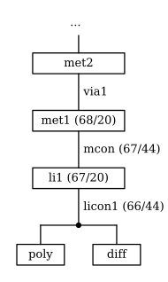
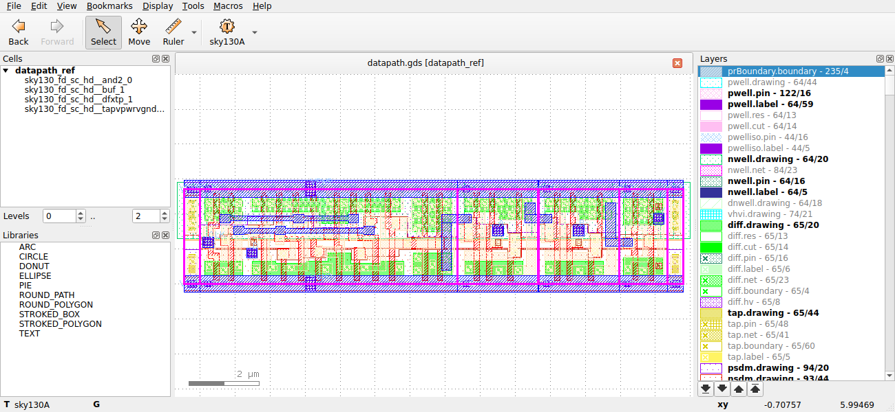

# SKY130 layer map

This page lists the layers this course uses, from the bottom of the stack to the top. For each
one it gives the name you type in Magic, the number the GDS file uses, and what the layer
physically is.

The GDS numbers are written as `layer/datatype`. They come from the `calma` lines in
`$PDK_ROOT/sky130A/libs.tech/magic/sky130A.tech`, and they're the numbers you see in KLayout's
layer panel. The sheet resistances are the `resist` lines in the same file, converted from milliohms to
ohms per square.

| Magic | GDS | Physically | Sheet R |
|---|---|---|---|
| `nwell` | 64/20 | an n-type tub in the p-substrate | 950 Ω/□ |
| `pwell` | 64/44 (marker) | the p-substrate itself. SKY130 has no p-well mask, so Magic draws a p-well only as a marker that lets it reason about the body, and the marker doesn't become a real layer. | 4400 Ω/□ |
| `ndiff` | 65/20 + 93/44 | n+ silicon at the surface | 120 Ω/□ |
| `pdiff` | 65/20 + 94/20 | p+ silicon at the surface | 197 Ω/□ |
| `ntap` | 65/44 + 93/44 | n+ silicon **inside the n-well**: a handle on the well | 120 Ω/□ |
| `ptap` | 65/44 + 94/20 | p+ silicon in the substrate: a handle on the substrate | 197 Ω/□ |
| `poly` | 66/20 | polysilicon on the thin gate oxide | 48.2 Ω/□ |
| `pfethvt` | 78/44 | the HVTP implant, which makes a PMOS high-threshold | — |
| `pc` (poly contact) | 66/44 + 95/20 | a tungsten plug from poly to li, plus the NPC blocking mask | — |
| `ndc` / `pdc` / `ntapc` / `ptapc` | 66/44 | the same plug, from silicon to li | — |
| `li` | 67/20 | local interconnect | **12.8 Ω/□** |
| `mcon` | 67/44 | plug from li to metal1 | — |
| `m1` | 68/20 | metal1 | **0.125 Ω/□** |
| `via1` | 68/44 | plug from metal1 to metal2 | — |
| `m2` | 69/20 | metal2 | 0.125 Ω/□ |
| `via2` / `m3` | 69/44 / 70/20 | and upward, to metal5 | |

## Reading the table

**Diffusion and tap are the same GDS layer.** `diff` is 65/20 and `tap` is 65/44, so they
share one mask and differ only in datatype. Whether a piece of either one is n-type or p-type
depends on which implant mask (`nsdm` 93/44 or `psdm` 94/20) covers it. Physically, a `ptap` and
a `pdiff` are identical, and they differ only in where they sit: the tap in the substrate, the
diffusion in an n-well. That's why the tap rules and the diffusion rules look so similar.

**li is a hundred times more resistive than metal1.** Its sheet resistance is 12.8 Ω/□, against
0.125 Ω/□ for metal1. A 10 µm li wire 0.17 µm wide is 59 squares long, so it has about
**750 Ω** of resistance, while the same wire in metal1 has 7 Ω. That's why li is called *local*
interconnect: it gets you from a transistor to the wire, and it isn't meant to be used as the
wire itself.

**Poly is a poor conductor.** Its sheet resistance is 48.2 Ω/□. Poly is the gate, and you can use
it as a short wire inside a cell, but it is never used for routing.

## The contact ladder

There is exactly one legal route from the silicon up to the metal. The ladder below uses the
PDK's layer names (`licon1`, `li1`, `met1`) rather than Magic's, with the GDS numbers in
parentheses:

{width=720 fig-alt="A block diagram of the contact ladder. On the left, a box labelled poly and a box labelled diff join into one line labelled licon1 (66/44), which runs to a box labelled li1 (67/20). From there a line labelled mcon (67/44) runs to a box labelled met1 (68/20), a line labelled via1 runs to a box labelled met2, and a last line ends in three dots."}

That means you can't connect poly straight to metal1, or diffusion straight to metal2; you go up
one step at a time. Every step is a plug of a fixed size, with enclosure rules at both ends.

## Implant masks

`nsdm` (93/44) and `psdm` (94/20) decide whether a piece of active silicon is n+ or p+. In Magic
you never paint them directly. You paint `ndiff` or `ptap`, and Magic generates the right
implant when it writes the GDS. You'll still see them named in DRC messages, though:

```
NSDM width < 0.40um (diff/tap.5)
```

They also appear in the `MASKHINTS_NSDM` properties of the foundry's cells, which is where the
library records hand-tuned implant shapes that Magic's automatic generation would not have
produced.

The one implant you *do* paint is `hvtp` (78/44), as `pfethvt`, because nothing else in the
layout says which threshold flavour you want for a PMOS.

## Viewing layers in KLayout

```bash
klayout -nn $PDK_ROOT/sky130A/libs.tech/klayout/tech/sky130A.lyt yourfile.gds
```

The layer panel on the right lists every layer in the file with its numbers, and clicking a
layer's eye icon hides it. The fastest way to see the standard-cell rows underneath a routed
block is to hide everything above `met1`.



*The capstone's GDS in KLayout. The cell tree on the left has `datapath_ref` at the top, with
`and2_0`, `buf_1`, `dfxtp_1` and the tap cell under it, and the layer list on the right shows the
numbers from the table above.*
